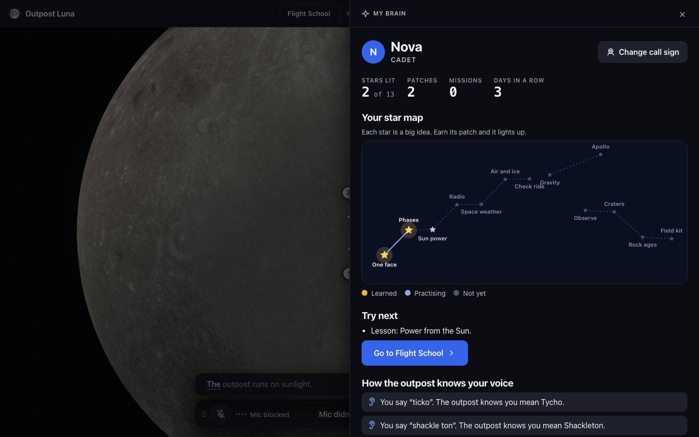
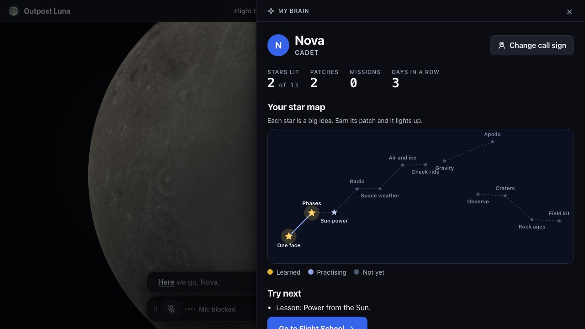
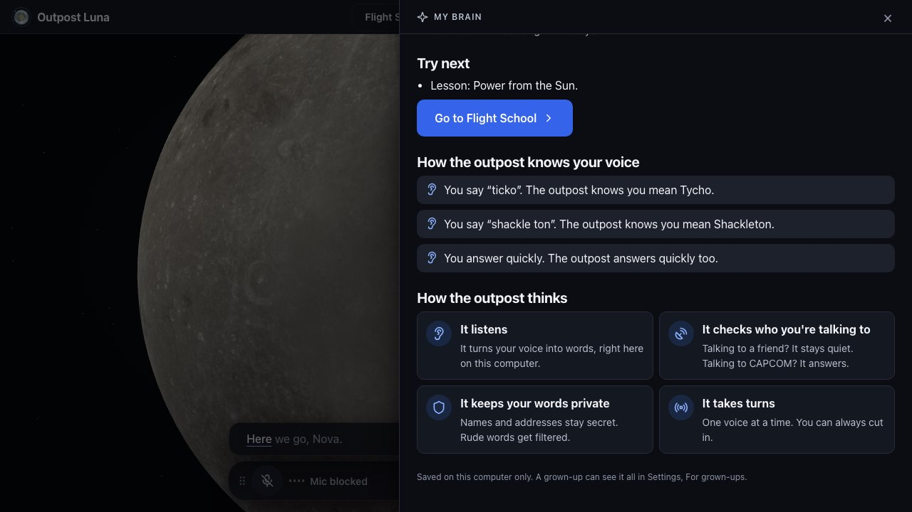
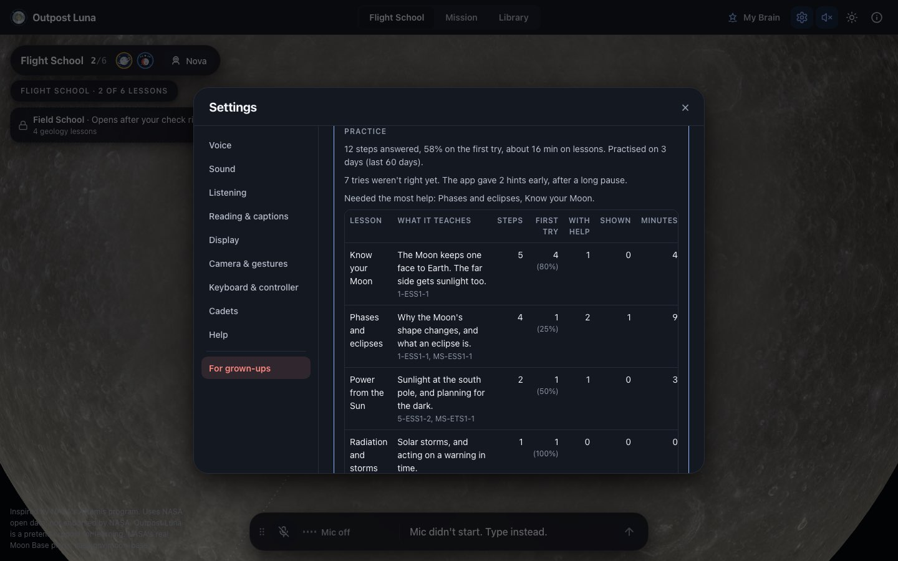
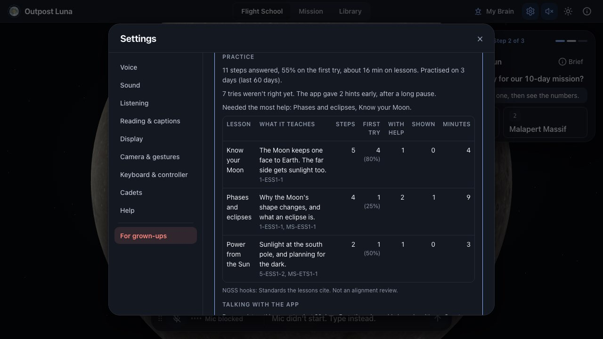
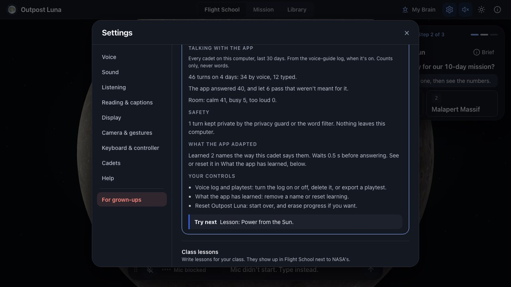

# My Brain

My Brain is the cadet's own page about two things: what they've learned, and how the outpost works with them. It has
a grown-up side in Settings → For grown-ups → Progress.

It grew out of the old cadet area, the call-sign chip on the Flight School map. That chip now opens My Brain, and My
Brain has "Change call sign".

- **Cadet side:** `frontend/src/brain.js`, styled in `brain.css`. It opens from:
  - the top bar's **My Brain** button;
  - the call-sign chip on the map;
  - **B** on the keyboard, or focus plus A on a controller;
  - voice: "my brain", "what have I learned", "how does the outpost think" (the `brain` intent in
    `backend/app/turn_router.py` NAV).
- **Grown-up side:** `frontend/src/progress.js`, which renders `brain.js` `practiceHtml` and `computerHtml`.
- **The one new store:** `frontend/src/brain_store.js` (§5).
- **Grown-up counts:** `backend/app/brain.py`, `GET /api/brain/summary` (§4).
- **Tests:** `frontend/tests/brain.test.js` and `backend/tests/test_brain.py`.

## 0. Why the name "My Brain"

- **It's the owner's word, and a cadet gets it without reading.** "My Brain" is what I've learned and what I know.
- **"My" makes it the cadet's.** Nobody is watching them; it's their own page. Under "How the outpost thinks", the
  app explains its own side in the same plain words.
- **Rejected names:**
  - "Flight Log" fits the console look, but reads as a list of flights. It also hides the voice and how-it-thinks parts.
  - "Progress" is the grown-ups' word and stays theirs.
- **The space look carries through.** The star map is a night-sky constellation of big ideas, and the top-bar icon is
  a star.

## 1. What the system already knows and decides, per turn

Everything below runs on the device. The left column is the part of the system; the right column is what it does and
what it keeps.

| Part | What it does (and keeps) |
|---|---|
| **The ear: Arc Transcriber Space, libarc ABI 2** (`model_server/app/arc_ear.py`, `docs/ARC_ABI2.md`, `docs/LOCAL_EAR.md`) | Gives words and partials, name links with p (`link_view`), almost-matches (`almost_view`), disfluency, quantities, word confidence, leak and barge-in. `device_directed` drives the router gates. Speaker is always None, and the ear's act/intent are None (`docs/SPEECH_SIGNALS_AUDIT.md` §2). The v2 room read-outs are shadow only (`arc_room.py`). Per turn and in memory (`backend/app/session.py` `EAR_ABI2`). Never stores words. |
| **Entity layer** (`docs/ENTITY_LAYER.md` §3) | `EntityMemory` is per session and in memory only. |
| **Arc Tagger** (`model_server/app/arctag.py`, `backend/app/readout.py`, `backend/app/safety.py`) | Uses domain `kids` for safety and `assistant` for the Director read-out. Finds act, intent, mentions, numbers, PII and `hard_pii` (address, phone, email, card, ID, date of birth, handle). `safety.classify` gives `mask` (the turn is ignored), `care` (CAPCOM's "Let's take a break. Talk to a grown-up you trust."; a care flag kept by kind and day until a grown-up marks it seen, §9.2) and `pii` (kept out of the log). |
| **Privacy guard** (`backend/app/director.py` `_hard_pii`, `NAME_GIVEN`) | Says "Let's keep names and addresses private." Highest floor priority (`docs/SESSION_CONTRACT.md` §3). A guarded turn is logged as `"text":"<private>"` with `guard: true` and never a clip (`backend/app/turnlog.py` `finish`). |
| **Screen masking** (`frontend/src/profanity.js` `maskProfanity`) | Masks rude words in on-screen kid text. Stores nothing. |
| **Session Director** (`docs/SESSION_CONTRACT.md`) | Streams in, typed decisions out, under the floor rules: one voice at a time, the kid always wins, never talk over the kid, silence is fine. The learned model (`backend/app/director_model/runtime.py`) runs in `guarded` mode: r12 xl on "quiet", r10 on hot and echo (`director_model/RESULTS.md` round 12). The privacy guard always wins. |
| **On-device learning** (`docs/ON_DEVICE_LEARNING.md`, `backend/app/learn/`) | Learns per cadet: name aliases (2 confirmations, or 1 at p ≥ 0.85; cap 24; 45-day half-life), the end-of-turn wait (0.5 to 0.8 s), pace and yes/no words. Learns per computer: the echo path. Kept in `profile-<id>.json` and `device.json`, mode 0600. Shown in Settings → What the app has learned (`frontend/src/learning_ui.js`). |
| **Turn log v2** (`backend/app/turnlog.py`) | On by default since 0.4.3 (`prefs.improve`, Settings → Listening → "Help improve the voice guide"; an explicit off stays off, and prefs saved before 0.4.3 keep what they had), and always during a grown-up's Playtest session. On the device only. Redacted text (`<callsign>`, `<name>`, `<address>`, `<number>`), with numbers and enums only for the ear, room, router and Director. Signals: repeat, negate, retap, hint, pass, undo, confirm. Capped at 5 MB total. `DELETE /api/turnlog` empties it. |
| **Room state** (`frontend/src/room.js`) | Calm, busy or loud, plus a listen mode (open, hold, offer, type). Only the label is sent. The turn log copies the label. |
| **0.6 voice signals** (`docs/GAMEPLAY.md` §14) | Radio readback (`backend/app/mission/readback.py`): in-session praise or a nudge, never counted. Hesitation (`backend/app/hesitation.py`): fillers, a pause of 2.5 s or more, or low confidence move the hint ladder one rung early, once per step. The pause itself is never stored or shown. |
| **Learning data** | The course (`backend/data/academy/course.json`, 13 lessons). Sourced facts (`backend/data/learning/concepts.json`, 31 concepts, no lesson mapping). `atm-academy` holds patches, qualified, and the half-done step. `outpost-missions-flown:<call sign>`. Debriefs are computed live (stars, grade, objectives, good calls, physics "numbers" lines) and not kept. The paused mission is `saves/mission.json`. Class lessons. |

**What was missing for learning analysis:** how a step went. Tries, first-try right, with a hint, or shown were all in
memory and gone when the lesson ended. So §5 adds one small on-device aggregate of counts.

## 2. Rules from kids' privacy law (and what they mean here)

| Rule | Where it comes from | What it means for My Brain |
|---|---|---|
| Collect the minimum and keep it on the device. A parent can review and delete it. | COPPA (US), GDPR Art. 8 and the UK Age Appropriate Design Code ("data minimisation", "default settings", "parental controls") | Only counts and lesson ids are added, on this computer. Nothing is sent. Every number has a delete path (§6). |
| No profiling by default. No nudges to share more. | UK AADC "profiling" and "nudge techniques" | No personality, ability or emotion inference. There is no "slow", "anxious" or "struggling". The app reports its own actions ("gave 2 hints early after a long pause") and outcomes ("first try"), not traits. |
| Be open with the child, in words they understand. | UK AADC "transparency"; AI-transparency norms for minors | "How the outpost thinks" explains the listen → check → keep private → take turns loop in four lines. The cadet sees what was learned about their voice. |
| School records belong to the school and the family. | FERPA (US schools) | The printable report stays on the device. A teacher prints it; nothing goes to us. There are no accounts, and call signs aren't real names (story.js `CALLSIGNS`). |
| Safety without surveillance | Duty of care; AADC "best interests" | Grown-ups see how many turns were kept private or filtered, never the words. Care flags are kept by kind and day until a grown-up marks them seen (30 days at most, §9.2). |
| Audio only with consent | `docs/DIRECTOR_LOOP.md` §1b, `frontend/src/playtest_ui.js` | Playtest audio needs a grown-up's tick ("I'm the parent or guardian, or I have their permission."), turns itself off after 3 h, and has its own export and delete. My Brain never reads audio. |

These are design rules, not legal advice. A school's own policy still applies.

## 3. The cadet's page

Simple and motivating, with no surveillance feel. The cadet only ever sees **their own** learning and **the app's own**
behaviour.

| Signal | Where it comes from | What we show | Who sees it | Why it helps learning | Privacy note |
|---|---|---|---|---|---|
| Stars (big ideas) | course + `atm-academy` badges + practice counts | A star map. Each lesson's big idea is a star: lit once its patch is earned, glowing while practising, dim when not yet | The cadet | Shows learning as a growing sky, not a score. The next star is visible | Lesson ids only |
| Patches, missions | `atm-academy`, `outpost-missions-flown:<cs>` | Counts | The cadet | Recognises effort across both modes | Already kept |
| Days in a row | practice counts `days` | A small number | The cadet | Builds a habit without a penalty. Yesterday still counts until tomorrow | Dates only, no times |
| Try next | `progress.js` `summarize` (the same order the app opens lessons in) | Up to two lines, and "Go to Flight School" | The cadet | One clear next step | None |
| Names the app learned | `GET /api/learn` `learned.aliases` | "You say “ticko”. The outpost knows you mean Tycho." (up to 3) | The cadet, on this computer | The app adapting to them feels like teamwork, and they keep using Moon names | The kid's own words, shown back only to them and never sent. Grown-ups remove them in What the app has learned |
| End-of-turn wait | `learned.habits.end_silence_s` (after 5+ turns) | "You take a moment before you answer. The outpost waits for you." | The cadet | Tells a thinker the pause is fine | Says what the app does, never what the child is |
| How the outpost thinks | static copy | Four cards: it listens; it checks who you're talking to; it keeps your words private; it takes turns | The cadet | AI literacy: knowing when a machine listens and what it keeps | — |

## 4. The grown-ups' page (Settings → For grown-ups → Progress)

It sits behind the 3-second grown-up hold, one card per cadet, and is printable.

| Signal | Where it comes from | What we show | Who sees it | Why it's useful for learning | Privacy note |
|---|---|---|---|---|---|
| Concept mastery | practice counts (§5) | A table per lesson: steps, first try (and %), with help, shown, minutes, the big idea and its NGSS hooks | Grown-ups | Tries → first-try right → with a hint is the classic mastery ladder, and it shows which ideas stuck | Counts only |
| Time on task | practice counts `secs`, each step capped at 5 min | Minutes per lesson, and a total | Grown-ups | Effort in real time; a walk away doesn't inflate it | Rounded seconds |
| Hardest lessons | `brain.js` `hardest` (3+ steps, most help) | "Needed the most help: …" (up to 2) | Grown-ups | Where to sit with them | No ranking of children |
| Hint use and pauses | `misses`, `pause` | "N tries weren't right yet. The app gave N hints early, after a long pause." | Grown-ups | Shows that hesitation-aware hints are working | Counts the app's action. The pause itself is never stored |
| Practice days | `days` (60 at most) | "Practised on N days" | Grown-ups | Regularity | Dates only |
| Speaking participation | `GET /api/brain/summary` `talk` (the weekly counts store, §9; the turn log before it) | Turns, voice vs typed, answered vs let pass, room calm/busy/loud | Grown-ups, on each cadet's own card | Voice confidence, and whether a busy room pushes to typing | Counts only; works with the turn log off |
| Mission decisions | debriefs (`GET /api/mission/{id}/debrief`) | Stars, grade, objectives, Try next (unchanged from #165) | Grown-ups | Applying science to safety calls | Live only, not kept |
| Safety summary | the weekly counts store and care flags (§9) | Rude words and other filtered words by channel, kept private by the privacy guard, the last 4 weeks, the open-mic caveat. Care flags by kind and day, with Mark as seen | Grown-ups, behind the hold | Reassurance that the guard works; a duty-of-care prompt | Never the words |
| What the app adapted | `learn` `describe(include_aliases=False)` | Names learned (count), the end-of-turn wait | Grown-ups | Explains why the app feels different for this cadet | The names themselves are in What the app has learned (remove or reset, one tap each) |
| Data controls | existing sections | Pointers: Voice log and playtest (on/off, delete, export), What the app has learned (remove/reset), Reset (erase progress too) | Grown-ups | — | Every stored item has a delete |

### How this maps to learning-program reporting

- **A standards-style list.** Each NASA lesson carries its big idea and the NGSS performance expectations the
  curriculum cites (`docs/LEARNING_DESIGN.md` §1, §11.2, §12):
  - 1-ESS1-1, 5-ESS1-2, MS-ESS1-1, MS-ESS1-3, HS-ESS1-6;
  - 5-PS2-1;
  - MS-ETS1-1, MS-ETS1-2, 3-5-ETS1-1.

  These are hooks, not an alignment review, and the sheet says so. Class lessons list by pack.
- **Mastery evidence.** First-try right, then with a hint, then shown is the evidence a teacher's rubric asks for
  ("independently / with support / not yet").
- **Printable.** "Print" gives one cadet per page on light paper (`progress.css` `@media print`). No accounts and no
  export to us, so it fits FERPA.

## 5. The one new store: practice counts (`frontend/src/brain_store.js`)

- **Key:** `localStorage["outpost-brain"]`, per cadet (prefs.js `PROFILE_KEYS`, so it moves with the profile).
- **Shape:** `{v:1, course:"moon", lessons:{<lessonId>:{steps, first, helped, shown, misses, pause, secs}}, days:[YYYY-MM-DD…≤60]}`.
- **What feeds it:** the Academy's `outpost:lesson-result` event (`frontend/src/academy/ui.js` `answer`). That event
  now also carries `lesson`, `shown`, `misses`, `helped`, `hes`, `step_s` and `ride`. The session still forwards only
  `status` and `step_type` to the turn log.
- **What counts:**
  - "hint" is a miss (plus `pause` when the app hinted early).
  - "passed" counts as first, helped or shown.
  - A missed check-ride order counts as shown.
  - Videos and predict guesses never count, and neither do "progress", "ignored" or "help".
  - `helped` means the hint rung rose above the glow the step starts with (`baseRung`).
- **Sanitised** on read and on write (`clean`): known ids, whole numbers and real dates only. A hand-edited value
  can't carry text into a view (`tests/brain.test.js` "clean").
- **Reset:**
  - It's a progress key (reset.js `PROGRESS_KEYS`), so Start over keeps it and "Erase progress too" erases it.
  - Settings → Cadets → Reset progress clears it with the patches.
  - Switching cadets snapshots it with the rest.

## 6. What we do NOT show, and why

| Not shown | Why |
|---|---|
| Any transcript, the redacted turn text, the words a filter caught | Data minimisation; words a child said are not a report |
| Emotion, confidence, "hesitant", pace as a trait, ability labels | No profiling (AADC); the signals aren't diagnoses and would mislead |
| The privacy guard's or care flag's content | Safety without surveillance; a grown-up who needs more talks with the child |
| Rankings or comparisons between cadets | Best interests; it's not a leaderboard |
| Per-turn timelines, times of day | Not needed for learning; finer than a day is not kept |
| Ear internals (dd, link p, almost-matches), Director model numbers | Engineering signals (diagnostics, `docs/DIAGNOSTICS.md`), not learning ones |
| Anything to the cadet about another cadet | Each cadet sees only their own page |

### 6a. Out by decision (D6, `docs/BRAIN_SIGNALS_AUDIT.md`)

The signals audit proposed these, and the owner decided against all of them. They are not "later": they are out.

| Rejected | Audit id | Why |
|---|---|---|
| Emotion of any kind (inferred, stored or used to shape a line or a voice) | R7 | Profiling; the EU AI Act Art 5(1)(f) prohibits emotion recognition in education. There is no emotion head anyway |
| A reading level or words-correct-per-minute score | L4 | An ability assessment from an AI (EU AI Act Annex III). Reading stays a volume count |
| A "persistence", "grit" or "gives up" label | R4 | A trait label. Counts of what happened stay; the label is the line |
| A per-cadet off-task or room-talk rate | R2 | Behaviour monitoring of a child (Annex III point 3). Room state stays about the room |
| Vocabulary harvested from the cadet's free speech | L3 | An interests profile (AADC profiling). Glossary words used in a step that asked for one stay |
| Stored hesitation (fillers, long pauses, low confidence) | R6 | A confidence or anxiety proxy, and on a child who stammers it points at a disability (GDPR Art 9). It stays a one-turn flag that brings the next hint sooner; the app's early-hint count is all that is kept |

**"No emotion" is checked in code.** The old plumbing is deleted: the ear relay drops any affect stream, the session
drops one on arrival (`session.NO_AFFECT`), the Director, the mission lines and voice steering take no affect input
(`steering.style_for` has no such parameter), and the client never forwards one. The learned Director's input
columns that once carried it are frozen at "neutral" (the shipped weights expect them). `backend/tests/test_no_emotion.py`
scans `backend/app` and `frontend/src` and fails the build if the plumbing comes back.

### 6b. Never used for grading (D8)

The brain is a practice record the cadet and the family own, not an assessment a school acts on. It is not used to
grade, rank or place a cadet, and the app gives it to nobody. The grown-ups' Progress page and its printout say so
("A practice record for the cadet and the family, not an assessment. Not for grading."). This keeps it out of the EU AI
Act's Annex III high-risk uses (evaluating learning outcomes, steering the learning process, assessing the level of
education). A school that files a printout still owns that record (FERPA); the sheet tells it what the numbers are for.

## 7. Backend: `GET /api/brain/summary?profile=p1&days=30` (`backend/app/brain.py`)

- **Loopback only:** the `LocalGuard` middleware on every route (`backend/app/main.py`), plus the local token like
  `GET /api/learn` (`diag.authorized`).
- **Returns** `{days, scope, talk:{turns, voice, typed, answered, passed_by, days, room:{calm,busy,loud}, signals}, safety:{guarded, filtered, privacy, care, care_flags:[{id, kind, day, n}], by_kind?:{profanity:{typed, ptt, directed, room}, mask:{…}}, weeks?:[{week, profanity, mask, pii, care}]}, adapted:{names, wait_s, turns, waits_longer}, log:{turns, bytes}, words:false}`.
- **`scope: "cadet"`** (since D2): this cadet's weekly counts and care flags (§9), whether the turn log is on or off.
  **`scope: "computer"`**: the store holds nothing for this cadet in the window yet (an install from before the
  store), so the counts come from the turn log, every cadet on this computer, as before.
- **Day window:** turns and outcome signals both honour `days` (signal lines carry their `day` since D9; an older
  signal line without one counts only without a window). The store is weekly, so it counts every week that overlaps
  the window.
- **Reads only** the turn log's `k`, `src`, `day`, `router.outcome`, `router.reason`, `room.state`, `guard` and the
  signal `sig`, and the store's numbers. Never `text`, alias heard forms or call signs
  (`backend/tests/test_brain.py`, `backend/tests/test_brain_counts.py`).
- **Also:** `GET /api/safety/flags` (open care flags), `POST /api/safety/flags/{id}/ack` and
  `POST /api/safety/flags/ack?profile=` (a grown-up saw them), `DELETE /api/brain/counts?profile=` (Clear this
  cadet's safety counts), `GET /api/brain/class?profiles=p1,p2` (every cadet's counts in one read). All take the local
  token.

## 8. What's left

- **Mission decisions as counts** (shelter on time, readbacks). Debriefs are live only, so a small aggregate like §5
  would keep them.
- **A teacher roll-up across computers.** Out of scope: nothing leaves the device.

## 9. Safety counts, care flags and crew rotation (D1-D4)

The owner approved decisions D1-D4 of `docs/BRAIN_SIGNALS_AUDIT.md`. The data protection impact assessment for them
is `docs/DPIA.md`.

### 9.1 The weekly counts store (D1, D2, D3: `backend/app/brain_counts.py`)

- **File:** `<cache_dir>/brain/counts.json` (`BRAIN_DIR` in tests and dev), mode 0600, written atomically.
- **Shape:** `{v:1, weeks:{"2026-W47":{"p1":{talk:{turns, voice, typed, answered, passed_by, room:{calm,busy,loud},
  days:[YYYY-MM-DD]}, safety:{profanity|mask|pii|care:{typed, ptt, directed, room}}}}}}`.
- **Kinds:** `profanity` (the word list or a profanity tag masked the turn), `mask` (another filtered turn: toxicity,
  child.inappropriate), `pii` (the privacy guard said "Let's keep names and addresses private"), `care` (a self-harm
  or grooming cue).
- **Channels:** `typed`, `ptt` (Space or the mic held), `directed` (open mic, the ear rated it said to the app:
  dd ≥ the room's `dd_strong`), `room` (open mic, anything else).
- **Written by** `Session._turn` and `_routed` for a client session (one that sent its profile). Tools and the
  generator never write it. It does not need the turn log: **D2**, the turn log stays on by default, and turning it
  off costs the grown-ups nothing.
- **Holds** whole numbers, ISO weeks, days, profile ids and the fixed enums; `clean()` on every read and write. Never
  a word, the text, a tag's p, the screen or a time of day.
- **Kept** 12 weeks. **Erased** by Reset (Start over and Reset everything), and by "Clear this cadet's safety counts"
  on the grown-ups' page.
- **The turn log** now carries `profile` on every turn line (an id, never a call sign), and `Session.flags` too.

### 9.2 Care flags (D4: `backend/app/care_flags.py`)

- **File:** `<cache_dir>/brain/care.json`: `{v:1, flags:[{id, kind: self_harm|grooming, day, profile, n}]}`. One flag
  per cadet, kind and day (`n` counts repeats).
- **Kept** until a grown-up marks it seen, and 30 days at most. Never the words, the screen or a time.
- **Shown:** a count on the For grown-ups gate ("1 safety note in Progress"), and on the Progress page, by kind and
  day, with "Mark as seen" and the advice to check in with the cadet. The caveat travels with it: the cues have high
  precision but miss about half of indirect phrasings, so no note does not mean all clear.

### 9.3 What the grown-ups see, and the honest caveat

- Rude words and other filtered words, each by channel: "1 typed, 1 push-to-talk, 0 said to the app, 2 heard in the
  room". Kept private by the privacy guard, as its own number. The last 4 weeks' filtered totals, oldest first, with
  no "rising" wording: the grown-up reads the numbers.
- **Only typed and push-to-talk are put on a cadet.** "Said to the app" and "heard in the room" mean heard near the
  app: on a shared computer it may have been someone else (the owner's own "shit shit oh" was room talk, dd 0.91).
- **The kid's page shows no counts.** "How the outpost thinks" tells the cadet: "Names stay secret. Rude words get
  hidden. Grown-ups see how many, never the word." (AADC standard 11: tell the child when a parent can see.)

### 9.4 Crew rotation (D3: `frontend/src/crew.js`)

- **Settings → Cadets → Crew rotation** (two cadets or more). A crew bar under the top bar names the cadets; the one
  whose turn it is is lit. A tap (or Enter / A on the focused name) passes the turn with no reload, and CAPCOM says
  "Nova, your turn."
- **Whose turn it is decides** the session's `profile` (`prefs.js` `turnProfileId`): every count, care flag, turn-log
  line and on-device learning lands on that cadet. Her practice counts go to her saved profile (`brain.js`
  `recordFor`), and My Brain opens on her page. The flight progress (patches, the half-done lesson) stays the
  playing cadet's: the crew flies one outpost together.
- **Push-to-talk per cadet:** while crew rotation is on, listening is Hold to talk, so a voice turn belongs to the
  cadet on turn exactly; the old choice comes back when it is turned off.
- **No voiceprints.** The turn is a tap, never a voice: no speaker recognition, enrolled or not (a voiceprint is a
  biometric identifier under COPPA 2025, GDPR Art 9, BIPA and CUBI).
- **State:** `localStorage["outpost-crew"]` `{on, turn, listen_was}`, per computer, cleared by Start over.

## 10. Screenshots

These are the cadet's side and the grown-ups' side at 1440x900 and 1280x720. `frontend/tests/e2e/brain_e2e.py --out`
makes them again.

## 11. Concepts and spaced review (D5)

Mastery below the lesson, per cadet and per course, reported as outcomes and as what the app will do next, never as a
trait or a grade (§6b).

- **The map:** `backend/data/learning/step_concepts.json` names the concept each graded step practises, for the Moon
  (28 concepts) and Archaeology (23). Videos and predict guesses have none. It is data, so a course edit needs no
  code; `backend/tests/test_concepts.py` checks every mapped step still exists and is graded, every concept is
  practised, and every graded Moon step has one.
- **The wire:** every graded attempt's reply carries `concept` (`backend/app/academy/routes.py` `_out`), with the
  client's id rule: bare on the Moon (`radio_words`), `<course>:<id>` elsewhere (`archaeology:stratigraphy`).
  `GET /api/academy/concepts` lists the active course's concepts: label, the lesson and step its review opens, and
  whether a mission uses it.
- **The store:** `outpost-brain` gains `concepts: {<id>: {first, helped, shown, box, due}}` (`brain_store.js`, per
  cadet, cleaned on read and write, erased with the practice counts). The spaced review uses the vocabulary's Leitner
  boxes: right on the first try moves a concept up a box (next review in 1, 3, 7, then 14 days); with help or shown,
  it goes back to box 1 (tomorrow). In crew rotation it lands on the cadet on turn.
- **The cadet sees** "Quick review" in My Brain when an idea is due: "The outpost brings back ideas you haven't seen in
  a while.", the idea's name and a Review button that opens Flight School at the step that practises it. Never
  "you forgot", never a score.
- **Missions resurface it too:** a mission's debrief offers one due mission concept (power, radio, storms, ice) under
  Try next, with "Review it in Flight School". It is an offer, never a gate.
- **Grown-ups see** "Ideas, step by step": per idea, first try / with help / shown and the next review ("Now", a day,
  or "remembered"), and "Remembered after a week or more: 8 of 11 ideas practised." The table says it is what the app
  will do next, not a grade.

