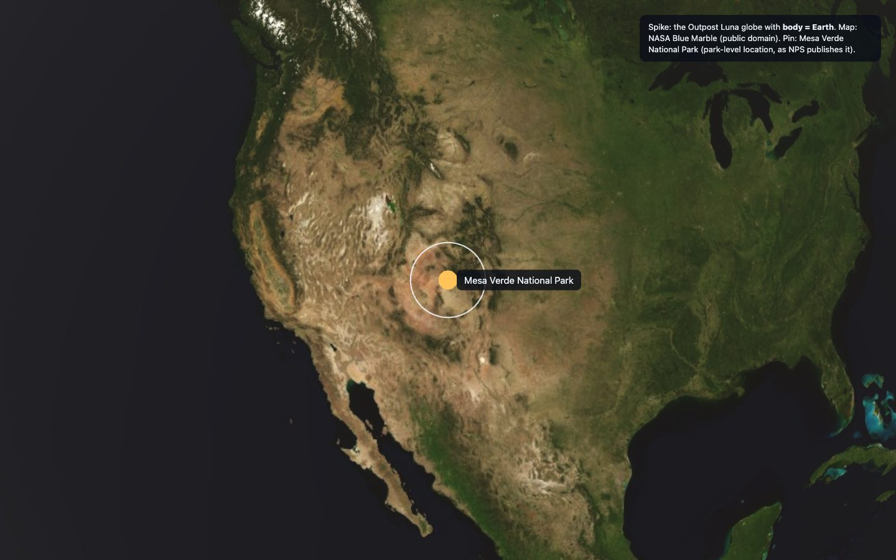
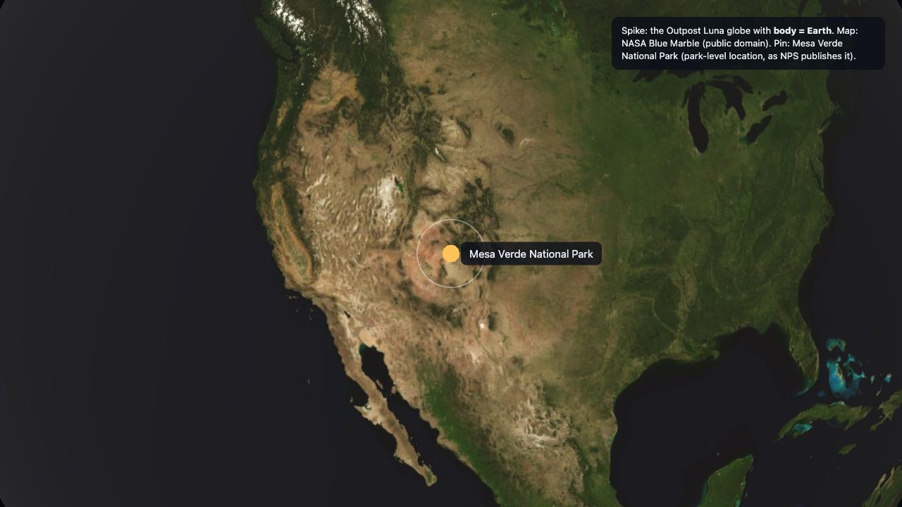
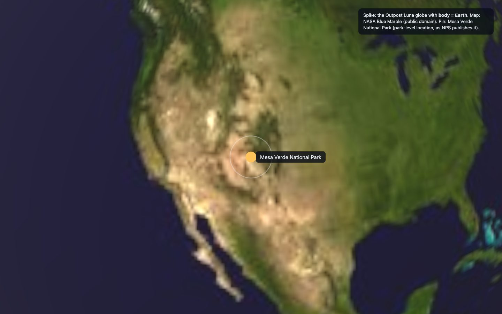

# Courses: from a Moon app to a school of courses

Status: **P1 + P2 built** (courses exist, the Moon is course #1, §4.8; the Earth globe and downloadable course packs,
§4.9). P0 was the plan + spike (§6). P3 (the Archaeology lessons) is the content branch.
**P3 content (#168, merged):** the 10 Archaeology lessons, the `layers` / `rings` / `hillshade` / `decide` step
types, the course pack's data and media (`backend/data/courses/archaeology/`), verified sources and the ear measurement
(`docs/ARC_FEEDBACK.md`). It is the course pack `course_archaeology` (§4.9).
First new course: **Archaeology**, shown to a high-school archaeology teacher in Colorado.
Course drafts: `docs/courses/archaeology/` (`LESSONS.md`, `DEMO.md`, `course.manifest.json`).

The owner's ask, in one line: lessons belong to courses; a course can swap the Moon for Earth (or a site map); courses
download and delete as the user switches; every part of the app (the ear, the Director, the Brain, Progress, For
grown-ups, class lessons, School network mode, iPad) knows which course it is in.

**Contents**
- §0 [Did we blend our architecture for this?](#0-did-we-blend-our-architecture-for-this) (the honest answer)
- §1 [Curriculum research](#1-curriculum-research-us-high-school-archaeology)
- §2 [Open data for an Earth / archaeology course](#2-open-data-for-an-earth--archaeology-course)
- §3 [Archaeology v1 course design](#3-archaeology-v1-course-design)
- §4 [Platform architecture: courses as first-class](#4-platform-architecture-courses-as-first-class)
- §5 [Phased plan](#5-phased-plan)
- §6 [Spike: what was proved](#6-spike-what-was-proved)
- §7 [Decisions for the owner](#7-decisions-for-the-owner)

Source tags in §1–§2: **[read]** = the page was opened; **[search]** = from the search result text for that URL, page
not opened; **[unverified]** = no source found, or our own estimate. Every claim marked [search] or [unverified] must be
opened and checked before it goes on screen (the same rule as `docs/LEARNING_DESIGN.md` §7.3).

---

## 0. Did we blend our architecture for this?

**Partly, and not by design.** Outpost Luna was built as a Moon trainer for the NASA Space Apps brief
(`docs/MISSION_CONTRACT.md`). Some layers came out general because they were written well. Others assume the Moon in
code. Nobody had planned for a second subject. The cadet Brain was designed this week (`feat/cadet-brain`,
`docs/BRAIN.md`) without a course dimension either. It is still unmerged, so this is the cheapest moment to add one.

| Layer | Blended already? | Evidence |
|---|---|---|
| Entity layer: registry, ear names lists, memory | **Yes, in code.** One data file. | `backend/app/entities/` is "app-agnostic". The data is one file, `backend/data/entities/outpost_luna.json` (`docs/ENTITY_LAYER.md`). |
| Lesson engine: steps, grading, hint ladder, voice answers | **Mostly.** | Step types are data (`backend/app/academy/content.py` `ACCEPT_TYPES`, `grade.py`). Some types are Moon-only: `globe_side`, `terminator`, `earth_view`. |
| Class lessons (#165) | **Yes. This is our best precedent.** | A teacher pack compiles into ordinary course lessons with `track: "class"`. It has its own ids, its own patches, its own Progress group, and a loader that skips broken packs (`docs/CURRICULUM.md` §2–3). A course generalises this idea. |
| First-run asset store | **Mostly.** | Each asset has an id, sha256, version, an optional flag, on-demand download, atomic install and resume (`desktop/main/assets.js`). Gaps: `REQUIRED_IDS` is hard-coded, and there is no per-asset delete. |
| School network mode | **Yes.** | It is a host allow-list (`desktop/main/netpolicy.js`, `backend/app/netgate.py`). A course pack is fetched from the same hosts, or imported offline. |
| Privacy, Reset, turn log | **Yes.** | All of it is per device with no accounts (`docs/RESET.md`, `docs/DIRECTOR_LOOP.md` §1). |
| Globe | **No.** | The Moon map path is hard-coded, and so is `MOON_KM` (`frontend/src/globe.js`). Mission overlays assume a lunar site and the Earth in the sky. |
| Gazetteer and places | **No.** | One Moon file (`backend/data/places.json`). `GET /api/class/places` lists Moon places only. |
| Ear | **Partly.** | The names list is sent at runtime, so new names can be biased and linked. But the model is **Arc Transcriber Space**, tuned on space speech (`docs/LOCAL_EAR.md`). Its `kind` set is lunar_feature / site / spacecraft / mission / crew. Deepgram keyterms are lunar lists (`backend/app/keyterms.py`). |
| Director: rules and learned model | **Partly.** | The learned model's features are course-neutral in shape: screen, step type, router, ear link. Unknown step types map to "none" (`director_model/features.py` line 652). The rules hold Moon lines and regexes, such as `GUARD = "... Ask me about the Moon."` and the cheese joke (`backend/app/director.py`). Training data is Moon sessions (`director_model/gen_sessions.py`). |
| Mission sim | **No, and it should not be forced.** | Power, oxygen, dose, ephemerides and DONKI storms are lunar physics (`backend/app/mission/`). The reusable part is its **shape**: chapters, stars, the Now card, the debrief (`docs/GAMEPLAY.md` §5, §10, §11). |
| Progress, Brain, patches | **No.** | Progress hard-codes "Lessons n of 6" and "NASA patches" (`frontend/src/progress.js`, `docs/RESET.md`). The Brain's big ideas and NGSS list are code keyed by lesson id (`docs/BRAIN.md` §4 on the branch). Lesson ids and badge ids live in one global namespace (`atm-academy`). |
| Copy and voice pack | **No.** | CAPCOM, Houston and Moon wording run through `docs/COPY.md` and the recorded voice pack (`docs/VOICE_PACK.md`). |

**What blending means from here.** We add one **course manifest** as the contract, and each subsystem reads its data
through it (§4). We do not fork the app per subject. The Moon becomes course #1 with zero behaviour change (P1). That
is the bar the spike tests.

---

## 1. Curriculum research: US high-school archaeology

### 1.1 What the electives teach

There is no single national archaeology course. High schools offer it as a semester elective, often online, or as
dual enrollment. We found **no Colorado district archaeology elective** [search; gap]. Expect the teacher to run it as
a local elective or as a unit inside world history or anthropology. Ask her (§7).

| Source | Units |
|---|---|
| Edmentum *Introduction to Archeology*, grades 9–12, 0.5 credit (Oklahoma catalog) [read] https://horizon.ok.gov/course/introduction-to-archeology/ | The field and its history; careers; types of archaeology; research and evidence; finding and surveying sites; excavation, geology and recording; **dating methods**; conservation; **"Archeology and Native cultures in the United States"**; public outreach and **ethics**; **protecting sites, federal law** |
| eDynamic Learning *Archaeology: Detectives of the Past*, 8 units (Edgenuity syllabus) [read] https://imaginelearning.com/media/pdf/states/washington/is-electives/Edgenuity-Syllabus-Archaeology.pdf | The World of Archaeology, including science vs pseudoscience; Recording the Past; Unearthing Ancient Civilizations; Cultural Origins; The Fossil Record; Social Organizations; The Survival of Ancient Text; Public Archaeology & Modern Society |
| Marlette HS (Michigan) applied-science elective [search] https://micourses.org/course-details/?id=2349 | Field methods, 3-D mapping with GPS, dating techniques, a research question |
| UF ANT 2140 dual enrollment [search] https://dualenrollment.ufl.edu/courses/ant-2140-intro-to-world-archeology/ | Intro to world archaeology, college level |
| SAA teaching resources and the "Seven Principles for Teaching Archaeology" [search] https://saa.org/education-outreach/teaching-archaeology/teaching-resources; SAA Principles of Archaeological Ethics (revised 2024) [search] https://saa.org/ethicsPrinciples | Stewardship, accountability, consultation; ethics as a core strand |
| Project Archaeology (BLM partnership) [search] https://www.blm.gov/learn/youth-and-educators/project-archaeology. *Investigating Shelter* is a grades 3–5 unit [search] https://kentuckyarchaeologicalsurvey.org/project-archaeology/investigating-shelter/ | Method: investigate a real site from its evidence. No official high-school unit found. A **Western Colorado Archaeology Teacher Institute** exists [search] https://suu.edu/utahprojectarchaeology/western-colorado-archaeology-teacher-institute.html |
| AIA lesson plans [search] https://www.archaeological.org/programs/educators/education/; Schoolyard Dig, middle to high school [search] https://archaeological.org/wp-content/uploads/2024/07/Schoolyard-Dig-Lesson-Plan.pdf | Simulated digs, stratigraphy, recording; leans Classical / Near East |

**The unit spine these share (our synthesis, used in §3):**
1. What archaeology is, including science vs pseudoscience.
2. Survey and remote sensing.
3. Excavation and stratigraphy (the law of superposition).
4. Dating: relative, dendrochronology, radiocarbon.
5. Material culture and site formation.
6. Ethics and law.
7. Indigenous perspectives, consultation and community archaeology.
8. A regional case study.
9. A capstone inquiry.

### 1.2 Law the course must get right

- **Antiquities Act (1906).** The first federal law to protect cultural resources nationwide. **ARPA (1979)** supplements
  it. NPS issues archaeology permits under ARPA and/or the Antiquities Act. **NHPA (1966) Section 106** reviews federal
  undertakings. **NAGPRA (1990)** covers Native American human remains and cultural items.
  [search] https://www.nps.gov/subjects/archeology/laws-regulations-guidelines.htm, https://www.nps.gov/articles/permits_overview.htm
- **NAGPRA regulations, 2024.** The final rule is 88 FR 86452, published 13 Dec 2023, **effective 12 Jan 2024**, at
  43 CFR Part 10 [search]
  https://www.federalregister.gov/documents/2023/12/13/2023-27040/native-american-graves-protection-and-repatriation-act-systematic-processes-for-disposition-or.
  Secondary summaries say it removes "culturally unidentifiable" and adds a duty of care that requires free, prior and
  informed consent [search] https://www.nathpo.org/discussion-on-new-regulations-2-6-2024-final-2. **Check the wording
  against eCFR before it is spoken.**
- **Confidentiality of locations.** NHPA §304 (54 USC 307103) lets agencies withhold the location of historic
  properties [search] https://www.achp.gov/node/7478. ARPA has a parallel provision [unverified wording]. In Colorado,
  site files are confidential and go only to qualified professionals (CRS 24-72-203(1), 24-80-405(2)) [search]
  https://historycolorado.org/node/3925.

### 1.3 Standards

**Colorado Academic Standards, Social Studies (adopted 2022), high school** [read]
https://www.cde.state.co.us/apps/standards/30008,30015,0:

| Code (prepared graduate / grade-level expectation) | What it asks | Course hook |
|---|---|---|
| History 1.1 | Historical method: questions, sources, defended interpretations | every lesson's evidence-then-claim shape; capstone |
| History 2.2 / 2.3 | US and world history incl. Indigenous experiences and sovereignty | Units 7–8 |
| Geography 3.1 | Geographic tools to analyse human and physical systems | survey, remote sensing, lidar |
| Geography 4.2 | People–environment interaction, Indigenous viewpoints | drought, tree rings, the move south around 1300 |
| Geography 4.3 | Names "Indigenous Peoples in Colorado" | Mesa Verde region |
| Civics 6.1 | Positions on local, state, **tribal**, national issues | Unit 6 |
| Civics 7.2 | Tribal–state–federal relations; names the Ute Mountain Ute and Southern Ute governments | Units 6–7 |

The exact "SS.HS.x.x" code format is [unverified]: use the CDE page's own labels in the teacher pack.
**HB19-1192** set up the commission to put American Indian (and other) contributions into the standards [search]
https://leg.colorado.gov/bills/HB19-1192, with a CDE resource bank [search]
https://cde.state.co.us/cosocialstudies/1192resourcebank.

- **C3 Framework.** The inquiry arc: D1 questions, D2 disciplines (His, Geo, Civ), D3 evidence, D4 communicate and act
  [search]. Every lesson in §3 follows D1→D3→D4. Individual D2.His indicators are [unverified].
- **NGSS.** HS-ESS1-6 (radiometric dating) [search] https://www2.cde.ca.gov/cacs/id/web/29168. It fits radiocarbon as
  a *methods analogy*; NGSS dates rocks, not people. Mark it "hook, not alignment", as `docs/BRAIN.md` §4 does for the
  Moon.
- **AP Human Geography.** Unit 1 (maps, geospatial data, remote sensing) and Unit 5 (origins and spread of agriculture)
  [read] https://apstudents.collegeboard.org/courses/ap-human-geography. **AP World** overlap (foundations, c. 1200)
  is [unverified]; check the CED.

### 1.4 Colorado anchors

| Anchor | What we can use | Source |
|---|---|---|
| **Mesa Verde National Park** (Ancestral Puebloans) | Nearly 5,000 known sites, about 600 cliff dwellings [search]. Tree-ring dating with the U. of Arizona lab since 1923. Cores come from beams and lintels. A Long House beam was cut in **1275**. "The last tree-ring date in the region is **1281**", and people had moved by about 1300 [read]. **26 associated tribes** [search]. Ranger virtual programs, mostly K–8 [read]. | https://www.nps.gov/meve/learn/education/tree-rings.htm · https://www.nps.gov/meve/learn/historyculture/upload/26meve_associated_tribes_508.pdf · https://www.nps.gov/meve/learn/education/virtual-learning.htm |
| Mesa Verde dates (NPS pages differ) | Cliff dwellings built "mostly 1180–1300" on one page and "late 1190s to late 1270s" on another [search]. **Say "about 1190 to 1280"** and cite the tree-ring page. | https://www.nps.gov/articles/mesaverde.htm |
| **Crow Canyon Archaeological Center** (Cortez) | Programs for grades 4–12 and a teacher institute [read]. *Peoples of the Mesa Verde Region* is an interactive Pueblo, Navajo and Ute timeline for high school and adults [search]. Research database and tDAR archives, with licences [unverified]. Uses USGS 3DEP lidar [search]. | https://crowcanyon.org/programs-for-school-groups-2/ · https://crowcanyon.org/EducationProducts/peoples_mesa_verde/ · https://crowcanyon.org/resources/lidar-and-the-central-mesa-verde-region/ |
| **Canyons of the Ancients NM** (BLM) | "Highest known archaeological site density in the United States": 8,300+ recorded sites, 30,000+ estimated. It surrounds 3 of Hovenweep's 4 units [search]. | https://www.blm.gov/sites/blm.gov/files/uploads/CANM%20Brochure.pdf |
| **Hovenweep NM** (NPS) | Towers and canyon-head villages. Park-level only. | (NPS park page) |
| **Chimney Rock NM** (USFS): **the Moon bridge** | At the **major lunar standstill** (every 18.6 years) the full Moon rises between Chimney Rock and Companion Rock. Viewings ran in 2024–2025. **Next standstill: 2044.** 25 associated tribes [read]. Present the observatory reading as a scholarly interpretation. | https://fs.usda.gov/r02/sanjuan/recreation/discover-history/northern-major-lunar-standstill |
| **OAHP / History Colorado** | Colorado Archaeology & Historic Preservation Month, every May. Site-file confidentiality. | https://www.historycolorado.org/node/5358 · https://historycolorado.org/node/3925 |

### 1.5 Respect: rules the course follows (product rules, not legal advice)

1. **Park-level locations only.** The globe shows a park or monument at the point its agency publishes (a visitor
   area), never a site's coordinates. Sites go on a schematic or an NPS-published map only. The manifest records this
   (`sensitivity.site_coordinates: "park-level only"`).
2. **No "find a new site" on real land.** The lidar step uses a terrain the park has already interpreted and published
   (Mesa Verde's mesa-top sites), or a synthetic terrain. We never run a hillshade hunt over unsurveyed private or
   public land.
3. **Leave it in place.** The ethics thread runs through every unit: photograph, record, report, never collect. In the
   survey mission, a "pick it up" choice is always the wrong call, with a calm explanation of why.
4. **No human remains, no burials, no sacred objects on screen.** NAGPRA is taught as law and consent, without images.
5. **Descendant voices come from their own sources.** Ancestral Puebloans' descendants are today's Pueblo peoples
   (Hopi, Zuni, the Rio Grande Pueblos and others). Ute and Diné (Navajo) histories are part of the region too. Quote
   and link tribal and NPS / Crow Canyon material that tribes helped write. Never invent a tribal voice. Never let
   CAPCOM speak *for* a tribe.
6. **Words.** Say "Ancestral Puebloans", not "Anasazi" (NPS usage). Say "moved" or "migrated", not "vanished" or
   "disappeared"; the descendants are here.
7. **Review before a classroom.** Before a pilot, the teacher reviews it, and so does a Crow Canyon educator or a
   tribal cultural office if one will. This is a decision in §7.

---

## 2. Open data for an Earth / archaeology course

| Dataset | Licence / terms | What to pack | Size |
|---|---|---|---|
| **NASA Blue Marble Next Generation** (2004 MODIS monthly composites) | Free, credit NASA Earth Observatory [search] https://science.nasa.gov/earth/earth-observatory/blue-marble-next-generation/ | The globe map: 5400×2700 (8 km/px) | **1.6 MB**, measured for the spike (`world.200408.3x5400x2700.jpg`). The 21600×10800 version is about 26 MB [search] |
| NASA GIBS / Worldview | Free and open, acknowledgement requested [search] https://www.earthdata.nasa.gov/earth-observation-data/data-use-policy | Pre-cut tiles only; there is no live tiling offline | small [unverified] |
| **Landsat** (USGS) | No restrictions; citation requested [search] https://www.usgs.gov/faqs/are-there-any-restrictions-use-or-redistribution-landsat-data | One cropped Four Corners scene, natural and false colour (a "see the mesas" step) | a crop is a few MB [unverified] |
| ASTER GDEM v3 (30 m) | No redistribution limits; credit METI and NASA [search] https://www.earthdata.nasa.gov/news/nasa-meti-release-aster-global-dem-version-3 | One 1° tile for regional relief | ~25 MB per tile [unverified] |
| SRTM 1″ (30 m) | US government, open [search] https://www.usgs.gov/centers/eros/science/usgs-eros-archive-digital-elevation-shuttle-radar-topography-mission-srtm | Alternative to ASTER | ~25 MB per tile [unverified] |
| GEDI lidar | Public (LP DAAC, ORNL DAAC). 25 m footprints, sparse [search] https://www.earthdata.nasa.gov/data/instruments/gedi | Skip for v1: too sparse to show structures | — |
| **USGS 3DEP lidar / The National Map** | Public domain. 1 m DEMs as 10×10 km COG tiles [search] https://catalog.data.gov/dataset/1-meter-digital-elevation-models-dems-usgs-national-map-3dep-downloadable-data-collection | **Pre-rendered hillshade PNGs** of a published, interpreted park area, not raw DEMs | a 2048² hillshade PNG is ~2–4 MB [unverified]. Raw 1 m tiles are 100–400 MB, so do not ship them. Montezuma County 1 m coverage [unverified]: check LidarExplorer |
| **NPS media** (Mesa Verde, NPGallery) | NPS-made media is generally public domain; credit "NPS Photo"; check each item for third-party © [search] https://www.nps.gov/aboutus/disclaimer.htm | 10–15 photos (Cliff Palace, Spruce Tree House, Long House beams, a mesa-top pithouse) | ~0.5–3 MB each [unverified] |
| **NOAA NCEI paleoclimate / ITRDB** | US government (licence page [unverified]) | The Mesa Verde Douglas-fir chronology (Stahle et al. 2015, ITRDB CO652, AD 480–2011) [search] https://digitalcommons.memphis.edu/facpubs/3486, and the 1,300-year Mesa Verde moisture reconstruction [search] https://catalog.data.gov/dataset/noaa-wds-paleoclimatology-mesa-verde-colorado-1300-year-moisture-balance-reconstructions | text, < 1 MB [unverified] |
| Smithsonian Open Access 3D | CC0 for most models; per-item usage conditions [search] https://3d.si.edu/cc0 | 2–4 glTF artifacts (pottery, a mano and metate) after a per-item licence check | 5–50 MB each [unverified] |
| Natural Earth | Public domain [search] https://www.naturalearthdata.com/about/ | 1:110m coastlines and borders, state lines (so "Colorado" can glow) | ~1 MB [unverified] |
| NASA archaeology from space | Chaco Canyon: NASA *Spinoff 1978*, "Archeological Surveys". NPS commissioned multispectral scans to find roads and fields not visible in photos [read] https://ntrs.nasa.gov/citations/20070018879. Earth Observatory on Chaco threats and TIMS road detection [search] https://science.nasa.gov/earth/earth-observatory/mapping-modern-threats-to-ancient-chacoan-sites-92224/. "Origins of Space Archaeology" [search] https://science.nasa.gov/earth/earth-observatory/searching-for-the-origins-of-space-archaeology/ | Lesson facts and one Earth Observatory image | small |

**Offline pack estimate for Archaeology v1** [unverified, our arithmetic]:
- Earth map: 1.6 MB.
- Natural Earth lines: 1 MB.
- Four Corners Landsat crop: about 5 MB.
- Three hillshade PNGs: about 10 MB.
- 15 NPS photos: about 20 MB.
- Tree-ring series: under 1 MB.
- Voice lines: about 15 MB at the voice pack's rate (`docs/VOICE_PACK.md`).
- Total **about 55 MB**, optional 3D artifacts +50 MB.
- That is smaller than today's optional `crew` (175 MB) or `videos` (425 MB) assets (`desktop/assets.manifest.json`).

**NASA has more open Earth data than Moon data, but archaeology-specific NASA data is thin.** The best "from above"
data for Mesa Verde is USGS (3DEP, Landsat). NASA supplies the globe, the climate context and the space-archaeology
story.

---

## 3. Archaeology v1 course design

Full step-level drafts: `docs/courses/archaeology/LESSONS.md`. The summary follows.

### 3.1 Shape

- **Program name:** *Field Archaeology: the Mesa Verde region*. The globe is **Earth**. Lessons fly from the whole
  Earth, to the Four Corners, to a park.
- **Voice:** the "CAPCOM" role becomes a **Field Director** (a crew chief at a dig), recorded in the same voice pack
  style. Houston becomes **the Lab** (radiocarbon and tree-ring results come back with a delay, like the Moon's radio
  delay). This is a decision in §7.
- **Course-wide rules** (as `docs/LEARNING_DESIGN.md` §5): a hook first, a predict step early, at most 5 steps, no two
  steps of a type in a row, a patch per lesson, every fact with a `{title, url}` source. High-school register: plain,
  short, no talking down.

| # | Lesson (id) | Unit | Pin | Patch | Standards hooks |
|---|---|---|---|---|---|
| 1 | Clues, not treasure (`what_is`) | What archaeology is | Mesa Verde NP | Field Scout | History 1.1, C3 D1 |
| 2 | Read the land from above (`survey`) | Survey and remote sensing | Four Corners (Landsat) → Mesa Verde hillshade | Sky Surveyor | Geography 3.1, APHG U1 |
| 3 | Layers tell time (`layers`) | Stratigraphy | schematic trench | Layer Reader | History 1.1, HS-ESS1-6 (analogy) |
| 4 | Dating the past (`dating`) | Tree rings and radiocarbon | Mesa Verde: Long House beam (1275) | Ring Counter | Geography 4.2, HS-ESS1-6 (analogy) |
| 5 | Things people left (`stuff`) | Material culture and site formation | mesa-top pithouse (NPS-interpreted) | Object Reader | History 1.1 |
| 6 | Who decides? (`law`) | Ethics and law | Mesa Verde (permits) | Steward | Civics 6.1, 7.2 |
| 7 | Many voices (`voices`) | Indigenous perspectives and consultation | Mesa Verde, 26 associated tribes | Listener | Geography 4.3, Civics 7.2, HB19-1192 |
| 8 | Mesa Verde, around 1280 (`mesa_verde`) | Case study: drought, tree rings, migration | Mesa Verde | Case Builder | Geography 4.2, History 2.2 |
| 9 | Survey season (`capstone`) | Capstone, as the mission (§3.3) | your mesa | Season Lead | C3 D1–D4 |

**Moon ↔ Earth bridge (optional explorer lesson):** *Moonrise at Chimney Rock*. The globe flies from the Moon to Earth
to Chimney Rock, and the cadet predicts how often the standstill comes (18.6 years; next in 2044). It is the one lesson
that uses both bodies. It shows the "the Moon could be replaced by Earth" idea in a single minute of the demo.

### 3.2 Step types

**Reused as they are** (`backend/app/academy/content.py` `ACCEPT_TYPES`): `keywords` (say it), `intent` / `tap` (find a
place on the globe), `choice`, `predict`, `video`, `sequence` (order items), `rounds` (several short rounds), `describe`
(observe and describe, from Field School). The Field School types fit archaeology very well. "Describe a potsherd" is
Copernicus's describe step with new descriptor kinds.

**New, archaeology-shaped** (each is a grader in `grade.py`, a renderer like `frontend/src/academy/field_steps.js`, and
a voice answer in `tools/handsfree_run.answer_for`):

| New type | What the cadet does | Grading | Built from |
|---|---|---|---|
| `layers` (the dig) | A trench cross-section with 4–6 layers and finds. Order the layers oldest → youngest, by voice ("the ash is older than the floor") or by dragging chips. Then answer "how old is the sherd in layer C?" | `sequence` with a stratigraphy rule check: an intrusive pit (a later pit cut down through older layers) is the classic trap | `sequence` + a SVG trench |
| `rings` (tree-ring match) | Slide an undated beam's ring pattern along the master chronology until the wide and narrow rings line up. Then say the cutting year. | the offset within ±1 year; voice says the year | ITRDB Mesa Verde series (real data), `compare` UI |
| `hillshade` (read from above) | A lidar hillshade of an NPS-interpreted mesa top. Tap the 3 room blocks / the reservoir the park describes; a "sun angle" toggle shows why low light reveals relief | tap targets with a radius, like `intent` | pre-rendered 3DEP hillshade PNGs, globe `site` mode |
| `decide` (ethics call) | A short scenario ("A hiker finds a sherd on a trail…") with 2–3 actions; each answer gets a reason | `choice`, but every option has its own reply (never "wrong!"), plus a law card (ARPA, NAGPRA) | `choice` + per-option `reply` |

The Director's learned model sees unknown step types as "none" (`director_model/features.py` line 652), just as
Field School's `describe` / `sequence` / `rounds` are seen today. So new types do not break routing. They only route
less well until a retrain adds `st_layers` and the others (§4.5).

### 3.3 The mission: **Survey season**

The Moon mission's shape is what carries over: chapters, a live clock, the Now card as the single "do this" place,
stars, a debrief with three checks and "data used". It runs on its own small engine, not the lunar sim (§4.6).

**Story.** The cadet leads a two-week survey of a mesa near (not on) a park. This is a fictional tract with real
methods. The player never touches a real site. Chapters follow the order a real project works in:

| Chapter | The Now card asks | Good call (stars) | Trap |
|---|---|---|---|
| 1. Permits and consultation | File for the permit; contact the tribes' cultural offices; wait for replies (time passes) | Consult *before* fieldwork; adjust the plan when a tribe asks to avoid an area | Start digging before replies come |
| 2. Remote sensing first | Pick sources: Landsat, the lidar hillshade, old aerial photos | Lidar at low sun reveals the room blocks; non-invasive first | "Dig test pits everywhere" |
| 3. Walk the survey | Set transect spacing, record finds in place (photo, GPS, describe) | Record and leave it | Pick up the arrowhead |
| 4. Excavate minimally | Choose *one* small test unit where the question is; dig by layer | Smallest dig that answers the question; the layers come out in order (the `layers` step in play) | Big trench, mixed layers |
| 5. Date samples | Send a beam core to the Lab (tree rings) and charcoal (radiocarbon); results arrive after a delay | Tree rings give the exact year; radiocarbon gives a range | Date the sherd by its colour alone |
| 6. Report and share | Write the 3-line report; share with the tribes and the State (OAHP) site file, and don't publish the location | Report to the community and the State; keep the coordinates out of the public | Post the location online |

**Resources** (bars like power / oxygen / dose): **Season days** (time), **Trust** (consultation and community; it
drops on a rushed step), **Site integrity** (it drops with every unnecessary dig or a collected artifact, and never
comes back), and **Knowledge** (questions answered). Stars: integrity ≥ 90, trust ≥ 80, the question answered. The
debrief speaks the same three lines as the Moon's ("Site left intact: 96 of 100 ✓").

### 3.4 Patches, Brain and Progress

- **Patches.** Course-scoped ids (`archaeology:field_scout`), the same round patch shape (`class_patch.js` palette),
  with an earth-tone ring per course.
- **Brain (`docs/BRAIN.md`).** The star map becomes **the course's sky**: a constellation per course (Moon: the current
  big ideas; Archaeology: Evidence, Layers, Time, Stewardship, Voices…). The big ideas move from code (`brain.js`) into
  the manifest's `concepts`. Practice counts gain a course key (§4.7). "Names the app learned" works unchanged ("You say
  'dendro'. The outpost knows you mean dendrochronology.").
- **Progress (For grown-ups).** One card per cadet, then **one section per course**: "Archaeology: 4 of 9 lessons ·
  6 patches · Survey season: 2 stars". Each course has its own standards list, Colorado codes for Archaeology and NGSS
  for the Moon. Print gives one cadet and one course per page, which is what a teacher files.

### 3.5 Teacher demo (15 minutes)

The full script, with what to click and what to say, is in `docs/courses/archaeology/DEMO.md`. The beats:
- 0–2: Moon → Earth. Switch course in the top bar; the Moon globe turns into Earth and flies to Mesa Verde.
- 2–5: Lesson 4, tree rings, played by voice, ending with the real Long House beam year.
- 5–8: the `layers` dig.
- 8–11: Survey season chapters 1–2: consultation first, then lidar at low sun.
- 11–13: For grown-ups → Progress (the Colorado standards list) and Class lessons (she writes one in two minutes).
- 13–15: privacy and offline (School network mode, nothing leaves the computer); questions.

**What we ask her:**
- Does the unit order match her course?
- Which Colorado codes does her course plan list?
- Will she connect us with Crow Canyon or a tribal reviewer?
- Would a pilot class try it?

---

## 4. Platform architecture: courses as first-class

### 4.1 The course manifest (`outpost-luna-course` v1)

One JSON per course: `backend/data/courses/<id>.json` for built-ins, `<assets>/course_<id>/course.manifest.json` for downloaded
packs. Schema, validator and loader: `backend/app/courses.py` (spike). The Moon's manifest:
`backend/data/courses/moon.json`. The Archaeology draft: `backend/data/courses/archaeology.json`.

| Field | Meaning | Read by |
|---|---|---|
| `id`, `title`, `program`, `subject`, `grades` | identity and labels | switcher, Progress, Brain |
| `status` | `builtin` (ships in the app) · `pack` (an asset to download) · `draft` (shape-checked only) | loader |
| `globe` | `{body: moon \| earth \| site, name, km, map, site_maps?}` | `globe.js createGlobe({body})` |
| `gazetteer` | the course's places file (ids, lat, lon, km, aliases) | `gazetteer.py`, `/api/class/places`, the map |
| `entities` | the course's entity registry (`whissle.entities/1`) | `app/entities` → ear names lists, Director link, memory |
| `ear` | `{vocab, names}`: Deepgram / ear vocab; the names-list source | `keyterms.py`, `names_list.py` |
| `lessons` | `{source, tracks, ids}` | `academy/content.py` |
| `missions` | `{kind: outpost \| survey_season, sites}` | mission or season engine |
| `concepts` | sourced facts plus the Brain's big ideas | knowledge cards, Brain |
| `voice_pack` | the course's recorded lines | `tts.py` / voice pack |
| `assets` | `{required, optional}` asset ids | the asset store, Settings → Storage |
| `standards` | `[{framework, codes, note}]` | Progress, Brain, teacher pack |
| `sensitivity` | location and content rules (§1.5) | content checks (tests) |
| `class_packs` | teachers may attach packs to this course | class editor |
| `library` | the course's Library screen: shelves of real pictures, videos and places (§4.11) | `app/course_library.py`, `field_library.js` |
| `videos` | the course's own NASA videos (the `catalog.json` schema), merged into the video catalog while it is active | `app/video.py catalog()` |

### 4.2 Download, delete, switch

- **A course is an asset.** It goes in `desktop/assets.manifest.json`: `course_archaeology`, a ustar tar, sha256 for
  the whole tar and for each file, a version, and Dropbox hosting with the Hugging Face fallback. This is exactly the
  `crew` / `videos` pattern (`desktop/main/assets.js`). The tar holds the manifest, data files, map, photos and voice
  lines. Big optional parts are a second asset (`course_archaeology_lidar`).
- **Switch.** Top bar → course chip → "Moon · Archaeology · Get more courses". Each step:
  1. Switching to an installed course: the backend sets the active course in a per-computer file next to the class
     packs (`<data>/courses/active.json`).
  2. The backend reloads its caches (`content.reload()` already drops the lesson caches for class packs; it widens to
     the gazetteer and registry).
  3. The page fires `outpost:course-changed`, and the globe rebuilds with the new body.
  4. The Moon is always installed. It is built in and cannot be deleted.
- **Download on switch.** When the course is not installed, the store's on-demand path downloads it (the Steer-voice
  pattern: `assets.js` "On-demand"). It shows size and free disk (`freeBytes`) first, then progress with resume.
  - Offline: the **offline pack** zip (`importOfflinePack`) can carry course tars, for schools that pre-load USB sticks.
  - School network mode: no new hosts are needed. Dropbox is already the allow-listed first-run host (`docs/SCHOOL_IT.md`). Locked machines import the offline pack instead.
- **Delete.** Settings → For grown-ups → Storage, per course: "Archaeology · 55 MB · Remove". This removes
  `<assets>/course_archaeology/` (a new `store.remove(id)`, with the same atomic move-aside the installer uses).
  - **Progress stays**: patches and counts are tiny and keyed by course, and Reset's "erase progress too" is still the only thing that erases them.
  - Class packs attached to the course stay, and are hidden until the course comes back.
  - Removing the active course switches back to the Moon first.
- **Versions.** A course tar's version is the asset version. The existing "Check for new models and media" flow
  (`docs/SCHOOL_IT.md`) finds new ones. The manifest `format`/`version` gates compatibility: an app too old for a course
  says "Update the app to open this course" and does not load it.

### 4.3 Subsystem by subsystem: course-agnostic vs per-course data

| Subsystem | Agnostic (stays code) | Per-course (moves to data) |
|---|---|---|
| Globe (`frontend/src/globe.js`) | camera, fly-to, pins, highlight, tap-to-pick, keyboard and gesture reticle | the map, `km`, the sky (stars vs. Earth's sky), Moon-only overlays (Earth in the sky, polar cap, lunar mission frame) switch off for `earth`. `site` body = a flat map plane (lidar hillshade) using the same pin and tap code |
| Gazetteer and places | `gazetteer.py` linking (exact, then fuzzy) | `places.json` per course |
| Entity layer and ear | `app/entities` registry, `ear_list(Moment)`, `EntityMemory`, mishear offers | the registry file; screen profiles; the ear's `kind` values (needs generic kinds: place, term, law, people; ask the Arc team, `docs/ARC_TEAM_CODE_GUIDE.md`) |
| Ear model | libarc, streaming, barge-in, `device_directed` | Arc Transcriber **Space** is a space-tuned model. Archaeology words ("dendrochronology", "Puebloan", "kiva", "metate", "NAGPRA") are **untested**. Plan: measure WER and link rate on a 100-line read-aloud set (`director_model/ear_eval`-style) with the names list on. If they are weak, ask Arc for a general or "Earth science" variant. That would be another ear asset per course (≈460 MB), so avoid it if the names list suffices |
| Router / Director (rules) | floor rules, turn-taking, privacy guard, navigation intents, hint ladder | the content lines: GUARD's "Ask me about the Moon", the hardware and cheese regexes, `EARTHRISE` (`backend/app/director.py`). These move into the course's `lines` table |
| Learned Director | features: screen, step type, router, ear link, entity memory | **training data.** Generated sessions (`gen_sessions.py`) need archaeology content; the gate runs per course (it must not get worse on the Moon *and* must beat the rules on Archaeology). New step types are appended to `STEP_TYPES` (the schema is append-only; old weights read the prefix, `features.py` `F_R*`) |
| Lessons and grading | `grade.py`, hint ladder, `/api/academy/attempt`, the lesson UI | `course.json` per course; new graders (§3.2) are agnostic code once written |
| Mission | the UI shape: chapters, Now card, stars, debrief (`frontend/src/mission/`) | the engine: lunar `mission/sim.py` vs. a new `season/` engine (§4.6) |
| Knowledge cards / answers (`backend/app/knowledge/`) | retrieval, the embedder | the cards (Moon facts today, 28 Moon mentions in `cards.py`) |
| Voice pack | playback, caching | the recorded lines per course |
| Class lessons | editor, validator, compiler, store | `place` lists come from the course gazetteer; each pack gets `course: "<id>"` (old packs default to `moon`) |
| Progress, Brain | rendering, counts store, print | labels ("n of 6" → the course's core count), standards, big ideas, all from the manifest |
| School network, Reset, privacy | all of it | nothing |
| iPad (`docs/IPAD.md`) | the same backend and frontend in-process | course tars ship in the app bundle or come through the Files app import (no asset downloader on iOS v1) |

### 4.4 IDs, progress and privacy

- **Namespacing.** Stored ids are `<course>:<id>` for every course, the Moon included (`moon:scout`,
  `archaeology:dating`); a pre-courses save migrates losslessly (§4.8). Lesson files and the backend keep bare ids inside
  one course. `outpost-brain` practice counts carry their `course`. Class packs already use `c-<pack>-<lesson>`.
- **Per course, on the device.** Nothing new leaves the computer. A course adds data files (read-only) and counts. The
  turn log records `course` as an enum next to `screen` (no words).
- **Reset.** "Start over" and "Reset everything" behave as today (`docs/RESET.md`). "Reset everything" also removes
  downloaded courses (they are first-run downloads). Progress, for every course, is erased only by "erase progress
  too".

### 4.5 The learned Director: training implications

1. Its inputs are course-neutral, so the shipped weights *run* on Archaeology. Their accuracy there is **unknown**.
2. Keep the rules in charge for Archaeology (the runtime's `guarded` mode, `backend/app/director_model/runtime.py`)
   until a gate passes on archaeology data.
3. Collect: generated sessions from the archaeology course, plus the teacher demo and a pilot playtest. Playtests need
   a grown-up's consent and the export flow (`docs/DIRECTOR_LOOP.md` §1b).
4. Gate per course. The retrain ships only if it is no worse on every Moon set and beats the rules on the archaeology
   sets.

### 4.6 Survey season engine

A small `backend/app/season/`, about 400–600 lines, data-driven from `seasons.json`.
- **Chapters** are chapters as `mission/gameplay.py` `_chapters` builds them.
- The **clock** is days, not 6-hour shifts.
- **Choices** come from `decide` steps.
- **Resources** are Days, Trust, Integrity and Knowledge.

The same `State` / `Event` / debrief JSON shapes as `docs/MISSION_CONTRACT.md` let the cabin UI pieces render it:
the Now card, the bars, the debrief.

This is cheaper and safer than generalising the lunar sim. The sim's balance has had dozens of tuning rounds
(`docs/GAMEPLAY.md` §6.4, §13.4) and must not move.

### 4.7 Gap table

Effort: S ≤ 1 day, M 2–4 days, L 1–2 weeks (one agent).

| Today's code | Change needed | Effort | Risk |
|---|---|---|---|
| no course concept | `courses.py` manifest + loader + `GET /api/courses` (**done in the spike**) | S | none (read-only) |
| `globe.js` hard-codes the Moon map and km | `createGlobe({body})` (**done in the spike**, Moon by default); turn Moon-only overlays off for Earth; `frameDistance` / `angRadius` take km | S–M | low: defaults unchanged, covered by `spin_zoom.test.js` |
| one gazetteer, one registry, one ear vocab | load them through the active course; `content.reload()` widened to every cache | M | medium: many lru_caches (`hotlist`, `session`, `names_list`) must drop together |
| `content.py` reads one `course.json` | `course()` = the active course's lessons + its class packs | S | low |
| `atm-academy`, `outpost-brain` keyed by bare ids | `<course>:` prefix for new courses; Moon unchanged | S | low |
| `progress.js` "n of 6", NASA patch counts | per-course sections from the manifest | M | low |
| Brain big ideas and NGSS in `brain.js` (branch) | read from the manifest's `concepts` and `standards`; **do this before Brain merges, or right after** | S | low |
| `assets.js` `REQUIRED_IDS`, no delete | course assets, `store.remove(id)`, Storage UI per course, free-space check before download | M | medium: Windows file locks (the existing `renameRetry`) |
| class packs assume Moon places | `course` field (default `moon`); place list from the course | S | low |
| `director.py` Moon lines and regexes | move content lines to a per-course `lines` table | M | medium: the Director suites pin these lines |
| learned Director trained on Moon only | archaeology sessions, per-course gate | L | medium: data volume |
| ear is space-tuned | WER and link test for archaeology words; Arc ask if weak | M (test) / L (new ear) | **high, unknown** |
| no `layers` / `rings` / `hillshade` / `decide` | graders, renderers, voice answers, tests | L (4 types) | low–medium |
| lunar mission sim | new `season/` engine reusing the UI shape | L | medium |
| voice pack is Moon lines | record course lines (the voice pack pipeline) | M | low |
| knowledge cards are Moon | per-course cards | M | low |
| iPad bundle | ship course tars in the bundle | S | low |

### 4.8 P1 as built: the course contract

**Manifest fields added in P1** (all optional, so the Archaeology draft still validates; `app/courses.py validate`):

| Field | Shape | Read by |
|---|---|---|
| `reading_level` | `{grades, register: kid \| teen, budgets: {prompt, title, hint, success, fail, reveal}}` (words per line) | `content.check()` (`level_problems`), `/api/courses`. Unset budgets keep the Moon's (prompt 20, title 6, hint 12, success 12, fail 8, reveal 20: the longest Moon line today) |
| `labels` | `{course, school, lessons, patches, patch}` short words | the chip, the Flight School tab (`school`), Progress ("NASA patches" → the course's word) |
| `ear.keyterms` | up to 100 names | `listen.keyterms()` (Deepgram). Unset (the Moon): the lunar lists in `app/keyterms.py` |
| `lines` | `{guard: "..."}` content lines for the rules Director | `director._course_line()`. Unset (the Moon): the lines in code |
| `big_ideas` | `{<lessonId>: {star, idea, codes}}` | the Brain's star map (moved from `brain.js SKILLS`; the Moon's are in `moon.json`) |

**Active course.** Per call sign on the client (`outpost-course`, a profile key in `prefs.js`; default and absent = the
Moon), per computer on the backend (`<cache or data>/course_state/active.json`, `ACTIVE_COURSE_FILE` in tests). At launch
`courses.js syncCourse()` reads `GET /api/courses` and, when the backend plays another course, `POST /api/courses/active`.
A course that is missing at launch plays the Moon but keeps the cadet's choice (it comes back when the pack is there again; removing the pack in Course storage clears the choice). Progress reads and writes under the course actually being played (`playingCourse()`), never just the stored key. Switching (`setCourse`) stores the choice, posts it, fires
`outpost:course-changed` and reloads the app, as a profile switch does: every module and the globe start clean.

**The registry.** Built-ins from `backend/data/courses/*.json` (status `builtin`), then packs from
`<COURSE_PACKS_DIR or ASSETS_DIR>/course_<id>/course.manifest.json` (status `pack`, paths relative to the pack folder, which must
be named after the id). A broken manifest is skipped with a reason (`problems`). A pack's own files are served
read-only at `/course/<id>/<path>` (its Earth map).

**One switch drops every course cache together** (`courses.reload_all()`): the lessons (`content.nasa_course`,
`course`), the hotlist lesson titles, the session's tables, the entity registry (so the ear's names list,
`names_list.py`), the ear vocab (`hotlist.vocab`), the Deepgram keyterms, the lesson grader's gazetteer and sites, the
class packs, and the backend's gazetteer (`main.S["gaz"]`, via `courses.on_change`). Class packs carry `course`
(default `moon`) and only the active course's packs join its lessons; the rest stay on disk.

**Ids and the migration.** Ids are course-prefixed, `<course>:<id>`. The progress store `atm-academy` is v2:
`{v: 2, badges: ["moon:scout", …], qualified: ["moon"], steps: {"moon:power": {i, n}}, current: {moon: "moon:power"}}`.
A v1 save (bare ids, before courses) migrates on first read: every bare id becomes the Moon's, unknown fields ride
along, and the original string is kept untouched as `atm-academy.v1` (a profile key and a progress key: "Start over"
keeps it; "erase progress too" and Settings → Cadets → Reset progress remove it). The lesson UI still sees one course
with bare ids (`courseView` / `mergeView`), so its code did not change. Tests: `frontend/tests/courses.test.js`.
Note: an app older than P1 reading a v2 store would not see the Moon's patches (prefixed ids); the v1 copy is still
there for it. The turn log records `course` (an enum) next to `screen`.

**What stays per course (P1)** and what is already agnostic:
- Agnostic: the registry, switching, ids and progress, the lesson engine and grading, the entity layer and the ear's
  names-list derivation, the router and the rules Director's logic (floor, privacy, navigation, hint ladder).
- Per course, read from the manifest: lessons, places, entity registry (names lists), ear vocab, keyterms, reading
  level, labels, standards, big ideas, the guard line.
- Still Moon code, to move when a course needs it: the other content lines and regexes in `director.py` (`EARTHRISE`,
  the hardware and cheese lines), the knowledge cards (`knowledge/cards.py`), the mission sim (a course without an
  `outpost` mission gets the season engine in P4), the keyterm lists in `keyterms.py` (the Moon's), the voice pack
  (one per course in P3), and the learned Director's training data (§4.5; the runtime's guarded mode for new courses).

**The switcher.** A chip by the app name (`course_switch.js`, `#courseChip`), hidden while one course is installed
(since §4.10: shown with only the Moon when the catalog has a course this computer can download).
Tap, Enter / A on it, or say "switch course" (`a11y.js`): a short list, then one confirm ("Switch to Archaeology? Your
Moon patches stay."). Esc or Cancel backs out.

### 4.9 P2 as built: the Earth globe and course packs

**Globe.** `main.js` hands `createGlobe` the active course's `globe` (`{body, name, km, map}`); on the Moon it passes
nothing, so the Moon is `MOON_BODY` exactly as before. `frameDistance` / `angRadius` take the body's radius (default the
Moon's), so places frame by their real size on Earth; `ll2v` and every coordinate maths are unchanged. Moon-only layers
stay off on another body: the real-sky / hardware / rocks / sharp-pole views (`wireViews`), the sample hardware, and
the mission layer (a course without an `outpost` mission never starts one). Pins and the gazetteer are the course's
(`/api/places` reads the active course's places).
- The Earth map ships IN the course pack (`media/<name>`, served at `/api/courses/<id>/media/<name>`), never in the
  installer: Archaeology carries the NASA Blue Marble 5400×2700 (`media/earth5400.jpg`, credits in `media/credits.json`).
  The builder can take another map as `COURSE_EARTH_MAP`.
- Screenshots (the real Archaeology pack, installed through the local fallback): `img/courses/p2_*.jpg`.

**A pack's source and its build.** The content author writes `backend/data/courses/<id>.json` (status `pack`, paths
under `courses/<id>/`) and the folder `backend/data/courses/<id>/` (lessons, places, entities, ear vocab, `media/`).
In the app that source is not a course; `OUTPOST_DEV_COURSE=<id>` plays it from source (the author's dev loop).
`make asset-pack` (scripts/asset_pack.py) turns every such source into the asset `course_<id>`: `course.manifest.json`
rewritten relative to the pack (`courses.to_pack`), every file of the folder, validated as it will load; optional,
`on_demand` (never fetched by the background downloader), a version, a sha256 for the tar, a size and sha256 per file,
in the SAME `desktop/assets.manifest.json` and Dropbox folder (decision 6). `make asset-upload` uploads it.

**Download, remove, switch** (`backend/app/course_packs.py`, `GET /api/courses/packs`, `POST …/<id>/get`,
`POST …/<id>/remove`; Settings → For grown-ups → Course storage, `course_store_ui.js`):
- With the desktop app, the backend asks through the flag files the Steer voice already uses: `.want/<asset>` (the
  desktop downloads it at once: sha256, atomic install), `.active/<asset>` while it downloads, `.failed/<asset>` with
  the reason when it stops (school network, offline, disk), and `.remove/<asset>` (assets.js `store.remove`: move
  aside, delete with Windows retries, drop the state record). The backend moves the folder aside first so the course
  leaves the list at once.
- Without it (dev checkout, tests): a local-file fallback installs the tar from `COURSE_PACK_SRC`, sha256-checked,
  unsafe paths refused, swapped in atomically.
- Before a download: School network mode blocks a host it does not allow and says so ("School network mode is on, so
  this course can't download here. Import the offline pack from a USB stick."); a disk without room for the tar and its
  files says how much is needed. The offline pack zip can carry course tars (they install like any asset).
- Removing the course being played switches to the Moon first. Patches stay. The Moon cannot be removed.
- The top-bar chip appears once two courses are installed, or with only the Moon when a catalog course can be
  downloaded here (§4.10); its "Get more courses" opens For grown-ups.

**Archaeology is the first pack.** Its source is `backend/data/courses/archaeology.json` (moved from the docs draft;
status `pack`, reading level 9-12 / teen, labels "Field School" / "Field patches", 100 Deepgram keyterms from its ear
vocab, hard terms first) plus `backend/data/courses/archaeology/` (#168). `course_archaeology` (4.6 MB, 19 files, with
the NASA Blue Marble 5400×2700 in `media/`) is in the catalog with `url: null` until it is uploaded. Lessons of another
course are served with `<course>:` ids (`content.prefixed`), and the client keeps them as they are. A bonus lesson may
name `unlock_after: <lesson id>` (explorer.js: it opens once that lesson's patch is earned; Chimney Rock after Mesa
Verde). The content branch's stopgaps are gone: `OUTPOST_DEV_COURSE` now just loads and plays a pack source through the
registry, and `academy/dev_course.js` / `?course=` are removed (the globe reads the active course).

**Reset.** "Start over" keeps downloaded courses and the cadet's course. "Reset everything" deletes the assets folder
(course packs included) and the backend's active-course file, so the computer plays the Moon. Progress for every course
goes only with "erase progress too".

**iPad** (`docs/IPAD.md`): unaffected. The shell runs the same backend with no desktop downloader, so `GET
/api/courses/packs` reports `managed: false` and nothing downloads; a course would ship in the app bundle (point
`COURSE_PACKS_DIR` at it). The chip stays hidden with only the Moon.

### 4.10 First-run course pick

**What a new cadet sees.** Call sign → Start → **"Pick your course"** (same home look over the globe, `course_pick.js`,
mounted by `academy/ui.js` after the call sign and before the welcome):
- **The Moon** first: "Junior Astronaut Academy · grades 3-8 · Built in · starts now". It has focus, so Enter / A (or
  "Skip", or saying "skip") starts it at once, exactly as before.
- **Every catalog course**: its title, one line (`program`) and "grades · size" ("Field Archaeology: the Mesa Verde region",
  "grades 9-12 · 4.6 MB"). The catalog entry carries a `course` card (`program`, `subject`, `grades`), which
  `scripts/asset_pack.py course_card` copies from the source manifest (metadata only: the tar and its sha256 do not change);
  `GET /api/courses/packs` returns it per pack, plus `downloadable` (the desktop downloader or `COURSE_PACK_SRC`).
- Picking a pack course downloads it through the same path as Course storage (`POST …/<id>/get`: the desktop's `.want`
  flag, or the local-file fallback), shows **real progress** (the desktop writes `"<done> <total>"` bytes into
  `.active/<asset>` at most once a percent; the listing's `progress`), then switches (`setCourse`: the app reloads on the
  course and the map says "Copy that, Comet. Welcome to Field School.").
- **Can't get it:** offline (`navigator.onLine`, or the desktop's offline reason), School network mode (`blocked`, or a
  403), a failed download (the desktop's `.failed` reason, no source, a damaged tar), or 3 minutes without finishing: the
  plain reason ("School network mode is on, so Archaeology can't download here. Starting on the Moon."), then "You can
  get it later in For grown-ups → Course storage." and **Start on the Moon** (focused). "Start on the Moon instead"
  during a download stops waiting (the desktop may still finish it; the chip then offers it).
- Reach: keys (1-2, arrows, Enter; `input/keys.js` / `choices.js` / `spatial.js` know `.a-crs-opt`), the controller (the
  same focus), voice (the router's `coursepick` screen takes a course name or a skip word: `turn_router.course_pick_word`;
  the ear's step list biases the names, `hotlist.py`).

**Who gets it.** A cadet with no stored course (`outpost-course`, the per-call-sign profile key) on the call-sign screen,
when there is more than the Moon to offer: a catalog course this computer can download, or an installed one. The choice
is stored for the call sign, "moon" too, so a cadet who picked is never asked again; a second call sign created later
(Settings → Cadets → Add) gets the same pick. No catalog, no downloader (the iPad shell) or a slow backend (2.5 s):
straight to the welcome, as before. Leaving Flight School while the pick is open brings it back on return.

**Policy.** This is the one place a kid may download a course: once, at first run, from our catalog only. Removing a
course stays behind the grown-up hold (Course storage). After first run, the course chip shows even with only the Moon
installed whenever a catalog course can be downloaded, and its "Get more courses" opens For grown-ups → Course storage
(behind the hold), so the feature can be found; the hold's list names "Get or remove courses".

**Tests.** `frontend/tests/course_pick.test.js` (options, who gets it, voice, the download, offline / school / failed /
timeout / refused → the Moon, the controller), `course_switch.test.js` (the Moon-only chip), backend
`test_course_packs.py` (the card, `downloadable`, progress), `test_turn_router.py`, `test_hotlist.py`, desktop
`assets.test.js` (the progress bytes). End to end: `frontend/tests/e2e/course_pick_e2e.py` (keys, voice, the progress,
offline, School network mode, a failed download, a second call sign, the Moon-only chip; the real Archaeology pack
through `COURSE_PACK_SRC`), and `keys_e2e.py` walks the pick by keys.
Screenshots: `img/courses/first_run_*.jpg` (the pick, the progress, offline, School network mode, a failed download, the
Archaeology welcome, the Moon-only chip; 1440x900 and 1280x720).

### 4.11 Course library: real NASA Earth views, sites and videos

The Moon's Library is its hardware, crew audio and the NASA views pack. A non-Moon course brings its own, as data in its
folder (no course ids in code):

- `library.json` (`outpost-luna-library` v1): shelves of items (`image`: a file in `media/`, credited in
  `media/credits.json`; `video`: an id in the course's `videos.json`; `place`: a gazetteer id), each with an optional
  `place` or `lat`/`lon` (a labelled marker on the globe) and `source` (a `sources.json` id). Plus `overlays` (an
  equirectangular picture draped on the globe between its bounds), `tour` (gazetteer stops), `chips` (the askbar),
  `featured` (the Field School map's "Real views" ribbon), `home` (where the Library's camera starts) and `moon` (the
  context Moon in Earth's sky, not to scale). `app/course_library.py` validates every file, credit, id and bounds and
  serves the resolved library at `GET /api/course/library` (`{"shelves": []}` on the Moon or a pack without one).
- `videos.json`: NASA files in the base catalog's schema (`app/video.py validate()`), each marked `course: <id>` and
  merged into `/api/video/catalog` only while that course is active. They stream through the backend on first play
  and are pinned for the background download; an installed course pack may carry them as `video/<id>.mp4|.vtt|.jpg`
  (`scripts/asset_pack.py` with `COURSE_PACK_VIDEOS=1`), which the backend copies into the cache instead.
  - The pack carries lighter re-encodes, as the video pack does: each item's `pack` = `{derive, bytes, sha256}`
    (`uv run python tools/video_catalog.py --pack --catalog data/courses/archaeology/videos.json` in `backend/`,
    written to `VIDEO_LOCAL_SRC/pack/<id>.mp4`). `app/video.py pack_copy_ok` accepts the NASA file or that copy.
    Captions and posters are NASA's own; the re-encode keeps the timing. Archaeology v2 (`course_archaeology` version
    2): H.264 CRF 28, 640x360, AAC copied, 147 MB of video down to 32 MB, a 38 MB pack.
  - A course switch starts getting them at once (`courses.on_change` → `app/video.py kick`), not only at launch: the
    pack's copies are copied (no network); otherwise they download with the launch prefetch's rules (`VIDEO_PREFETCH`,
    NASA reachable, School network mode = nothing, size + sha256, paused while a mission runs or a video streams). A
    course video on its way answers `/available` with `downloading`: the player shows a calm "still downloading" card
    and plays it once saved, instead of streaming. An installed pack older than the catalog's `min_version` is asked
    for again on the switch (`course_packs.ensure_active`, the desktop's `.want` flag; the old copy plays meanwhile).
    `GET /api/courses/active/progress` says how far; the course chip shows a thin progress line and Course storage a
    note + bar ("Getting its videos… 2 of 5 (40%)"). The Moon never shows any of it. Tests:
    `backend/tests/test_course_switch_prefetch.py`, `frontend/tests/course_switch_prefetch.test.js`,
    `frontend/tests/e2e/course_switch_prefetch_e2e.py`.

Archaeology's library: Earth from orbit (Landsat 8 Mesa Verde, two ISS astronaut photos of the Colorado Plateau, the
Blue Marble), Mesa Verde sites (seven NPS photos), lidar (two USGS 3DEP hillshades), Watch (NASA: remote sensing from the
space station, GEDI lidar from orbit, Landsat's pushbroom sensor, tree rings and Southwest drought) and The Moon, from
here (Chimney Rock's lunar standstill, Landsat's monthly Moon calibration). USGS orthoimagery of the Four Corners
(110.2-106.9 W, 35.7-38.0 N) is draped on the globe, so the Library zooms into the region with real imagery.
Client: `frontend/src/field_library.js` (+ `globe.js setOverlay / setMarkers / setMoonContext`, all opt-in). Tests:
`backend/tests/test_course_library.py`, `frontend/tests/field_library.test.js`, end to end
`frontend/tests/e2e/field_library_e2e.py` (Archaeology at 1440x900 and 1280x720; `--moon-base` checks the Moon's
Library is unchanged).

**Open data beyond NASA** (`docs/OPEN_DATA.md`).
- Archaeology adds a Sentinel-2 shelf (ESA Copernicus, true colour and near-infrared) and a Climate record shelf
  (NOAA's CO652 tree rings as a chart).
- A library may now list `layers`: whole-globe maps that the Library's **Maps** button swaps onto the globe
  (`frontend/src/map_layers.js`, `globe.setBaseMap`).
- The Moon's `library.json` has layers only: Age (USGS Unified Geologic Map, CC0) and Height (USGS LOLA colour relief,
  public domain). It ships in the app.
- Tests: `backend/tests/test_open_data.py`, `frontend/tests/map_layers.test.js`, and the two runs of `field_library_e2e.py`.
### 4.12 Archaeology flow fixes (QA 0.5.2, pack v3)

- **A typed try is a try.** On a lesson step, a turn the kid clearly meant (typed, Space held, or, on a keywords /
  intent step, Arc sure it was for us: dd >= dd_strong) counts any content word as a real try
  (`turn_router` `sure` -> `grade.plausible(sure=True)`; the client sends `input.sure` with the router's "answer"):
  "history", "Colorado", "show me Denver" are misses with the next hint, then the reveal. Filler ("um", "okay"), our own
  echo and unsure room words are still ignored. Guess / ethics-call / video steps and the check ride keep their rules.
- **Course words, not Moon words.** The keywords intro is per course (`guide.introFor`: the Moon keeps "radio
  practice"); no "cadet" outside the Moon (no learner label: "Here we go."); My Brain and Progress show the course's
  school ("Field School") and no "Missions" stat without an outpost mission; the class editor names the course's school.
- **The map frames the region.** An Earth course lands at `pins.REGION_DIST` on its next stop (SW Colorado), and a
  lesson flies to its place. Lessons that share a spot (`pins.clusterOf`) fan out round it (leader lines to the true
  spot) only while the fan covers at most 4 degrees of ground (`pins.fanFits`); zoomed further out one count pin stands
  in for them (tap: zoom back in). Before, nine fanned pins at continent zoom put Chimney Rock's pin in Mexico.
- **First download says what it is doing.** The desktop app writes the phase after the bytes into `.active/<asset>`
  ("<done> <total> verify|install"); `GET /api/courses/packs` returns it as `phase`; the pick shows the percent, then
  "Checking the download…", "Installing…", "Opening Archaeology…". Course storage shows the percent too. Removing the
  playing course says so on the Moon map after the reload.
- **Progress for grown-ups.** The manifest's `big_ideas` (one factual line per lesson, with the lesson's standards
  codes) fill "What it teaches"; the footer lists the course's standards frameworks and codes.
- **Pack v3** (`outpost-luna-v2-course_archaeology-3.tar`, built with `COURSE_PACK_VIDEOS=1`): course.json (two describe
  pictures) and the manifest's `big_ideas`. `min_version` stays 2 until v3 is uploaded (RELEASING.md "First-run
  assets: upload to both").
- Tests: `backend/tests/test_arch_qa_tries.py`, `frontend/tests/arch_qa.test.js`, end to end
  `frontend/tests/e2e/arch_qa_e2e.py` (+ `arch_patches_e2e.py`).

---

## 5. Phased plan

Each phase is one or two PRs. "No behaviour change" phases must keep every suite green and pass `play_mission.py` and
`keys_e2e` unchanged.

| Phase | What ships | Tests | Accept when |
|---|---|---|---|
| **P0 (this PR)** | Plan; `courses.py` + Moon manifest + `GET /api/courses`; `globe.js` `body` option; Earth globe spike page | `test_courses.py` (9), `globe_body.test.js` (3) | suites green; the Moon unchanged |
| **P1. Courses, Moon as #1** | active course (per computer), `outpost:course-changed`, cache reload, id namespacing, Progress and Brain read labels from the manifest; switcher showing only "Moon" (hidden until a second course is installed) | backend: switch, reload, unknown course; frontend: namespacing, Progress per course; full e2e | every Moon flow identical (`play_mission.py`, `keys_e2e`, `flows_e2e`) |
| **P2. Earth globe + course packs** | `body: earth` (overlays off, Natural Earth lines, Colorado glow), course assets in the store, download / delete / switch UI in Storage, offline pack import, School network wording | assets tests (download, sha mismatch, remove, low disk); globe screenshots 1440×900 and 1280×720 | a dummy course installs, switches, deletes and returns to the Moon; Windows rename path covered |
| **P3. Archaeology v1 lessons** | 9 lessons with the reused step types + `rings` + `layers`; registry, places, ear vocab; Field Director voice lines; facts with sources; teacher-reviewed copy | content checks (every fact sourced, park-level coordinates only, banned words "Anasazi" / "vanished"), hands-free flight of every lesson by voice (as `test_field_school.py`), ear WER/link eval | a cadet finishes all 9 lessons by voice, by keys and by taps |
| **P4. Survey season** | `season/` engine, 6 chapters, stars, debrief; `hillshade` and `decide` steps | engine unit tests, a strategy sim (`tools/strategy_sim.py` style), `play_mission.py --course archaeology` | a novice run finishes; no dominant strategy; integrity/trust lessons land |
| **P5. Teacher pack + demo polish** | Colorado standards on the Progress sheet, a print view per course, class packs per course, the demo script rehearsed, a reviewer pass (§1.5 rule 7) | print view snapshot; class pack with `course` | the teacher can run the demo herself |

**For the Colorado demo first** (the smallest set that tells the story honestly):
- P1 and P2, plus lessons 1, 3 and 4 (`what_is`, `layers`, `dating` with the `rings` step).
- The Chimney Rock bridge lesson.
- Survey season chapters 1–2 as a scripted preview, labelled "preview".

That is about 2–3 weeks of agent work at the efforts in §4.7. The rest is a pilot conversation with her.

---

## 6. Spike: what was proved

**Riskiest assumptions:**
1. Can the app's own globe draw Earth with correct geography and pins, without touching the Moon?
2. Can a course manifest describe today's app exactly, so P1 can be a pure refactor?

**1. The globe draws Earth.** `createGlobe` takes an optional `body` (`{name, map, km}`). Left out, it is the Moon as
before (`MOON_BODY`, the same map path and radius; `frontend/tests/globe_body.test.js`). The spike page
`frontend/tools/spike_earth_globe.html` runs on the dev server only and is not in the build. It creates the real globe
with Earth's map and a park-level Mesa Verde pin (37.18, −108.49). Run `frontend/tools/spike_earth_globe.py` to take the
screenshots. The pin lands in south-west Colorado: the globe's `ll2v` convention matches an equirectangular Blue Marble
with no change.

| 1280×720 | the bundled 1024×512 Earth (`/terrain/earth.jpg`) |
|---|---|
|  |  |

What the screenshots show:
- The 1k map the app already bundles (for the Earth in the Moon's sky) is too blurry at state level.
- The 5400×2700 Blue Marble (1.6 MB) is sharp to the Four Corners, so the course pack ships that one.
- Below state level (a mesa), the globe hands over to a `site` map (the hillshade), as planned in §4.3.
- To reproduce the sharp shot, the 5400 map was copied into an untracked `frontend/public/spike/` and passed as
  `?map=/spike/bm.jpg`.

**2. The Moon as course #1, with zero behaviour change.** `backend/data/courses/moon.json` points at the files the app
already reads. `backend/app/courses.py` validates and loads it. `GET /api/courses` answers
`{"active": "moon", "courses": [moon], "problems": []}`. Nothing calls it yet. `backend/tests/test_courses.py` proves:
- the manifest's lesson ids equal `course.json`'s, in order (`content.nasa_course()`);
- its assets equal the desktop manifest's (4 required + 5 optional);
- its globe equals `globe.js`'s `MOON_BODY`;
- the Archaeology draft has the right shape, with its files listed as planned;
- broken manifests are skipped with a reason;
- a path escaping `backend/data` is refused.

**Not proved (next risks, in order):**
1. The space-tuned ear on archaeology words (§4.3).
2. Dropping every cache at once on a switch (P1).
3. The asset store's per-asset delete on Windows (P2).

---

## 7. Decisions for the owner

1. **Brain and courses together.** Should the course key go into `outpost-brain` and the Brain's big ideas before
   `feat/cadet-brain` merges, or as a follow-up right after? We recommend before; it is a small change now.
2. **Voice roles.** For Archaeology, rename CAPCOM to Field Director and Houston to the Lab, keeping the same voice?
   Or keep CAPCOM across all courses as the app's brand?
3. **Audience and copy.** Archaeology is a 9–12 course in an app whose copy is written for 7–12 year olds
   (`docs/COPY.md`, no age words). Should a course carry its own reading level, so Archaeology is written denser?
4. **Review.** Before a classroom pilot, ask Crow Canyon's education team and/or a tribal cultural office to review
   Units 6–8 (§1.5 rule 7)? We recommend yes, and the teacher may make the introduction.
5. **The ear.** If the WER and link test shows archaeology words are weak, ask the Arc team for a general or
   "Earth science" ear (≈460 MB more per course), or accept names-list biasing only?
6. **Demo scope.** Should the Colorado demo be the cut in §5 (P1, P2, three lessons, the Chimney Rock bridge, a season
   preview)? Or lessons only, with no mission preview?
7. **Course hosting.** Course packs on the same Dropbox folder as today's assets (`/Outpost Luna/assets/v2/`), listed
   in the same manifest? Or a separate course catalog (`whissleai.github.io`, the existing update feed)?
8. **Product name.** "Outpost Luna" is a Moon name. With more courses, does the app keep it (Archaeology as an
   "outpost" on Earth), or does the app get a school-wide name with Outpost Luna as the Moon course?
