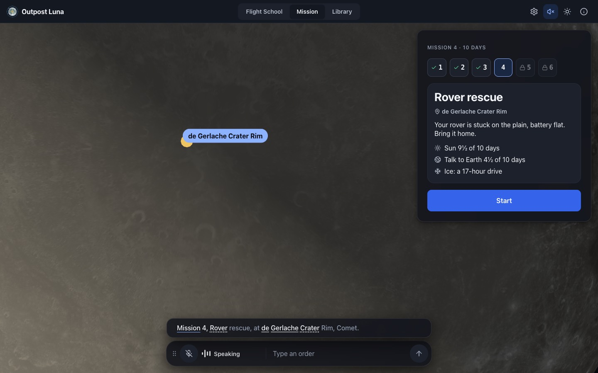
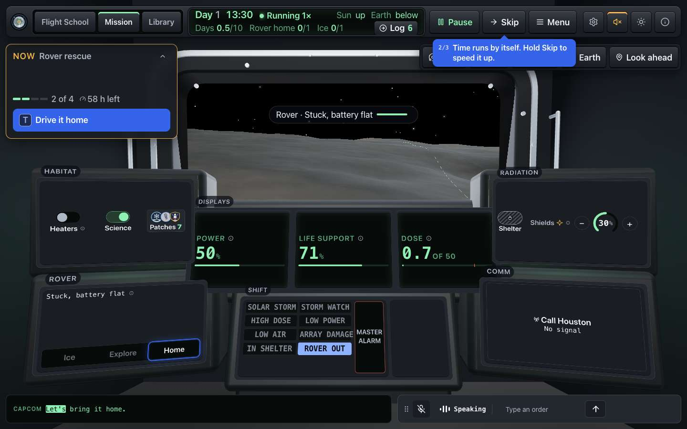

# Mission gameplay: the live clock, tasks and the story

Owner: `feat/mission-gameplay`. The owner played the first Cadet mission at Malapert Massif and wrote: *"as a user i am
lost again... it should be simulated in time... and in between that too, we should keep a user busy with some actual
tasks."* The NOW strip kept saying "Set power, then End shift." after they changed the shield power.

The mission used to be turn-based: set loads, press End shift, read a report. Now the mission time runs, short real
jobs fill the long waits, and the story moves through beats.

| Before | After |
|---|---|
| End shift jumps 6 hours | A live clock: about 12 s of real time per sim hour at 1x, with Pause, 1x/2x/4x warp and **Skip ahead** (to the next event). End shift stays as "End shift early". |
| The NOW strip is a static line from the state | The **Now task card**: task, step, progress (2 of 3), time left, the lesson that helps, readouts and the button that does the step. It reacts to every action ("Shields up. Good."). |
| Long things (rover runs, storms, 132 h comm gaps) just pass | Each one is a task with a countdown, or a skip ("Rover driving. Back in 7 hours." with **Skip ahead** lit) |
| No arc | Story beats with a CAPCOM line, a window moment and an objective; progress always on; a mission log |

## 1. The stuck objective (fixed first)

`nowCard(state, clock)` (`frontend/src/mission/objective.js`) is driven by the sim state plus what the kid did:

- The sim counts orders in `State.acted` (`{allocate: n, ...}`). The first job (`first_power`, a gameplay task) is
  "Shields up to 30", but **any** power change completes it, and the sim answers `ack: "Power set. Good."`.
- The card then says "Power set. Now press Play to start the clock." (Play glows), and once time runs, the next live
  task.
- `State.ack {t_h, text, n}` carries the latest acknowledgement. The card shows it for about 4 s, and CAPCOM says it
  once.
- Tests: `backend/tests/test_gameplay.py::test_first_job_reacts_to_any_power_change`, `frontend/tests/story.test.js`.

## 2. The live clock

**Sim** (`backend/app/mission/sim.py`): one hourly tick (`_tick`) is the only place mission time moves. The three ways
to move time all share it:

| API | What it does |
|---|---|
| `sim.step(m, dt_h)` / `POST /api/mission/{id}/step {dt_h}` | Any fraction of an hour (≤ 24). The physics ticks at each whole hour, so the result never depends on how time was sliced. Returns `{state, events, live}`, where `live` is the telemetry frame at the fractional hour (Sun, Earth, bars, rover between hours). |
| `sim.skip_to_event(m)` / `POST /api/mission/{id}/skip` | Run until a `SKIP_STOPS` event (storm warning, storm, storm end, sunset in 6 h, sunset, sunrise, comm open or closed, low power, rover back, failure, a new task, a story beat), for at most 24 h. It never reads the schedule: it runs the hours and stops. |
| `sim.advance(m, n)` / End shift | Run to the next shift boundary: "end shift early". |

New sim event `sunset_soon` fires 6 h before a Horizons sunset (`SUNSET_NOTICE_H`). This is where the night checklist
starts.

**Client** (`frontend/src/mission/clock.js`): `HOUR_MS = 12000`. A shift is 72 s of clock. With its tasks, a shift
takes about 2–4 minutes of play. The clock posts the hours that passed about once a second.

- Controls in the window's top bar: **Play/Pause**, **1x 2x 4x**, **Skip ahead**. A held state shows its reason
  ("Paused for the tour", "Paused: your call").
- **Auto-hold** (`held()` in `mission/ui.js`): the tour, a pending yes/no, a task choice (`State.task.decision`), a
  CAPCOM offer card with live buttons (for up to 30 s), a Cadet offer, the app hidden (`document.hidden`), and any
  screen but the cabin.
- **Warp drops to 1x** when something happens (a storm, a warning, sunset, Earthrise or Earthset, the rover back, a
  beat), as in a console game.
- The mission starts paused. The first jobs are to set power and press Play.
- What moves with the clock: the clock reads `Day 2 · 14:15` and the shift; the Sun and Earth elevations (terrain
  lighting via `tv.setSun` / `setEarth`); the rover along its route (`setRover` with the fractional hour); the resource
  bars (from the `live` frame).

**Strategy guarantees** (`docs/LEARNING_DESIGN.md` §6): stepping a shift in quarter-hour frames is bit-identical to
`advance()`. `test_live_clock_is_the_same_game_as_shifts` checks this, and the old turn loop gives exactly the old
results. `tools/strategy_sim.py --clock shift|live|event` plays every policy under the turn loop, the live clock
(acting at any hour) and skip-to-event. `tests/test_strategy.py` asserts every guarantee under all three:

| Clock (10 seeds × 5 sites) | planner surv / score | best fixed rule score | always_shelter goals | idle surv (Commander) |
|---|---|---|---|---|
| live, Commander | 1.00 / 660 | 407 (reactive) · fixed max 359 (rover_spam) | 0.00 | 0.40 |
| live, Cadet | 1.00 / 680 | 380 (rover_spam) | 0.00 | — |
| event, Commander | 1.00 / 627 | 370 (always_shelter) | 0.00 | 0.40 |
| event, Cadet | 1.00 / 589 | 380 (rover_spam) | 0.00 | — |

The policies never touch a task. Task rewards are small (+2 science per logged reading, 0.5 to 2.5 per sample
station, +2 for the science stop's rock, a few per mission), and the kid only gets them by pressing. Only the kid's own
play can earn them, so no fixed rule gains from them. The table above is the older tuning; §13.4 has today's numbers.

## 3. Tasks (`backend/app/mission/gameplay.py`)

Tasks come from the sim state and the goals, never at random. Each step is one of four kinds:

- **order**: a real sim command. Its `done` re-checks the state, so a voice order, a panel tap, the card's button, a
  key or a gesture all count.
- **choice**: the clock holds while the kid picks.
- **press**: the kid presses the step's button to do it.
- **wait**: the rover is driving, or the storm isn't close yet. **Skip ahead** glows.

| Task | Comes from | Steps (Cadet / Commander) | NASA basis | Lesson |
|---|---|---|---|---|
| Set your power | arrival | Shields up (any power change counts) | — | 4 Power |
| Storm prep | a `storm_warning` | Rover home → (Cmdr: shields to 40) → **the storm procedure** (§15) when the shelter opens **6 h before** a likely storm; a "possible" storm is a choice: Shelter now / Wait and watch. Countdown = the forecast. | DONKI SEP forecasts; Orion's shelter is good for about a day | 5 Radiation |
| Storm! Shelter the crew | a particle storm hits, crew outside | Rover home → **the storm procedure** (§15): Houston's order, read it back → crew into the shelter → "In the shelter, copy" | DONKI; flight-loop readbacks | 5 |
| All clear: crew out | shelter, no storm, no warning | Crew out of the shelter | (always_shelter fails the goals) | 5 |
| Night power-down | `sunset_soon`, or dark with night mode off | Night mode on → heaters to 10 → (long night ≥ 48 h, e.g. Malapert: air system to 45) → rover home before dark. Countdown = sunset. | Horizons sunset; landers hibernate (Chang'e 4) | 4 |
| Sunrise: wake the outpost | Sun up, night mode on | Night mode off | Horizons | 4 |
| Save power (Cmdr) | battery < 20% | Science down to 5 (or night mode) | — | 4 |
| Life support check | air < 55% | Cadet: air system to 40, else send the rover for ice; Cmdr: choice Recycler up / Ice run | LCROSS ice | 6 Air, water and ice |
| Comm window | Earth up with science waiting | Radio to 10 (downlink) → call Houston. Countdown = Earth sets. | Horizons Earth elevation; 1.3 s each way | 3 Radio |
| Ice run (rover drive) | ice goal open, calm, rover parked | Cadet: send the rover. Cmdr: pick a route on the **LOLA slope map** (Ridge: flat, +2 h, −2% battery; Crater slope: −2 h, +3% battery). Then **steer past the boulders** (left/right; the slope-map hint names the flatter side; right saves 1 h, wrong costs 1 h, no answer = the rover finds its own way). [0.5] The **low-Sun calls** (§13.2): tack away from the glare, lights on before the shadow. Then the rover comes back with ice. Readouts: ETA, battery, dose rate, the Sun, the shadow. | LRO LOLA slopes plan real traverses (VIPER); NTRS 20240011393 | 6; Field: Eyes of a geologist |
| Science stop (§13.3) | mid rover drive, Earth up, the drive's calls made (once a mission) | Pick what to give up for 15 min at a bright rock (the drive's light margin / one sample), then read back Flight's call | JETT5 science ops | Field: Moon rocks tell time |
| Fix the solar array (Cmdr) | the micrometeorite failure | Check the array → send the rover → test the power | — | 4 |
| Sample station / Read the radiation sensor | nothing else to do (every 8 h; Cadet ≤ 4, Cmdr ≤ 6); [0.4.1] the first science job is always the station, and a mission with none by hour 48 gets one on a drive (§15.3) | [0.5] The **sample station** (§13.1): pick the tool, describe it in one line, call in the bag number (0.5 to 2.5 science). The sensor: read it, then log it Normal / High (+2 if right; quiet Sun < 0.1 mSv/h) | Artemis sampling (Naids 2021); Chang'e 4 LND baseline | Field: Field kit / 5 |

Cadet gets fewer, simpler tasks with big buttons (no repair, no low-power task, no sensor quiz, no route choice).
Commander gets the trade-offs. A task with a deadline that passes is logged as missed. A storm prep the storm overtakes
becomes "Storm! Shelter the crew". Only the highest-priority open task shows. `tasks_waiting` counts the rest.

**State fields** (additive): `task {id, kind, title, lesson {id, n, title}, panel, level, steps [{id, kind, label, done,
ready, target, cmd?, options?, hint?, wait?}], step, done_count, total, time_left_h, readouts, decision, say}`,
`tasks_waiting`, `ack`, `acted`, `clock {mission_time_h, frac, hours_total, shift_ends_in_h}`, `story`, `mission_log`,
`progress {day, days_done, days_total, science_sent, science_goal, ice, ice_goal}`, and `env.comm_closes_in_h`.

**Commands** (additive): `{"type": "skip"}`; `{"type": "task", "task", "step", "choice?"}` for a press or a choice;
dispatch takes `"route": "ridge" | "slope"` for an ice run.

## 4. Story and pacing

| Beat | When | CAPCOM (≤ 20 words) | Window moment |
|---|---|---|---|
| Arrival | start | Outpost Luna is online. Set your power, then start the clock. | — |
| Settling in | hour 2 | Systems steady. The clock is running. Your jobs show on the Now card. | site |
| On our own | Earth down for 12 h or more | Earth is below the horizon. No radio until it rises. We're on our own. | Earth view |
| First sunset | the first sunset | Sunset. The long dark starts. Night mode keeps the lights on. | dusk tint |
| Storm forecast | the first warning | Houston sees a storm coming. Get ready before it hits. | storm glow |
| Solar storm | the first particle storm | Storm's here! Particles are hitting the outpost. Keep the crew sheltered. | storm glow |
| All clear | that storm ends | Storm's over. Crew out of the shelter. Back to work. | calm |
| Earthrise | Earth back after the gap | Earthrise! Houston can hear us again. Send the science home. | Earth view, blue tint |
| Ice home | first ice delivered | Rover's home with ice. Water and air for the crew. | rover view, rover lights |
| Last downlink | day 9+ with Earth up | Last days. Send every bit of science home. | Earthrise tint |
| Mission complete | survived | Day ten done. The crew made it. Time for your debrief. | — |

- Each beat shows its title and objective over the glass for about 5 s. The view turns to the Earth or the rover for
  6 s, but only from the seat's site view.
- The beat goes into the **mission log**, the Log button on the progress strip. The log also gets each finished task
  ("Ice run complete. Life support up."), each missed one, and each good call.
- The session Director speaks the beats with no sim line of their own (`SPOKEN_BEATS`). Without a session the cabin
  speaks them.
- **Progress is always on**: days survived, science sent (of 120) and ice (of 1), each with a bar.
- **No dead air**: after about 20 s with a job waiting and nothing done, CAPCOM names the job ("Storm prep. Next: Crew
  into the shelter"), at most twice per job. Any order, tap, clock control or word restarts the wait.

## 5. The Now task card

The card shows the task title, the step, step dots ("2 of 3"), the time left (`6 h left`, amber under 2 h), a "Lesson 5
helps here" chip, readouts, the ack, and the buttons. The first button is the hot one and carries `data-intent="yes"`.
The step's control glows on its panel too. On Cadet only that panel stays bright. When nothing is urgent the card says
"All steady. Time warp?" and offers **Time warp 4x** and **Skip ahead**. When the kid has paused the clock it says
"Clock paused. Press Play when you're ready."

## 6. Every input

| Action | Voice | Tap | Keys | Controller | Gesture |
|---|---|---|---|---|---|
| Do the Now step | "yes", "do it", or the order itself | the card's button, or the glowing control | **T** or **Y** | A on the focused button | thumbs up (the card's `data-intent="yes"`), point + dwell |
| Pick a choice | its name ("left", "ridge", "shelter now"; router `task_choice`) | the option | **1–4** | D-pad + A | point + dwell |
| Pause / run | "pause the clock", "start the clock", "resume" | Play/Pause | **K** | View / Share | open palm pauses (and stops speech) |
| Time warp | "time warp four", "normal time" | 1x 2x 4x | **W** | LT / L2 | — |
| Skip to next event | "skip to next event", "skip ahead", "fast forward" | Skip ahead | **E** | RT / R2 | — |
| End shift early | "end shift" | Menu → End shift early ([0.4.1] off the console) | **Esc**, then the arrows | Start, then the D-pad | — |

The router adds the cabin-only intents `skip_event`, `time_pause`, `time_resume`, `time_warp {1|2|4}` and
`task_choice` (`backend/app/turn_router.py`). The screen frame carries `offer: "task"` and the choice labels as
`step_options`, so a "yes" is never taken for an echo or a sim confirm.

## 7. Verify

- `backend/tests/test_gameplay.py`: the first job, step/skip/end-early, sunset notice, the API, storm prep, the
  possible-storm decision, the ice run (route, steer, return), samples, the Malapert long night, Cadet < Commander task
  count, copy budgets, and a careful player surviving every site with the full arc.
- `backend/tests/test_strategy.py`: every guarantee × {shift, live, event} clocks, plus bit-identical shifts.
- `frontend/tests/gameplay.test.js`: clock timing, warp, holds, the card model, keys, controller, router intents.
- `frontend/tools/play_mission.py`: a novice plays the whole first mission from the screen only. It logs, per moment,
  what to do, whether it was obvious (a visible, uncovered hot button or glow) and whether the app reacted.
  Screenshots and logs go to `docs/img/gameplay/`.
- `backend/tools/handsfree_run.py`: the voice run now starts the clock, does the card's jobs by "yes" or by naming a
  choice, says "time warp four", "skip to next event" ×3, "pause the clock" and "end shift".

## 8. Round 2: novice playthroughs (fix/gameplay-r2)

Three full first missions were played from the screen only (`frontend/tools/play_mission.py`): Cadet at 1280×720, Cadet at 1440×900, and Commander at 1280×720. Each reached the debrief, and every press got a reaction. Where a kid would get lost, and the fix:

| Where | What a kid would hit | Fix |
|---|---|---|
| Storm prep, waiting for the shelter | The card said "Shelter 6 hours before it hits. Keep working till then." A 7-year-old can't work out when that is, and Skip ahead jumped past it. | The card counts down ("Shelter opens in 4 h. Keep working, or skip ahead."). When the step opens, a `task` event fires with `phase: "ready"`, which stops a skip and drops the time warp to 1×. |
| After a storm | A held CAPCOM "Go to shelter / Set shields to 40" offer arrived hours of sim time late (held on the voice floor for up to 30 s at 4× warp), while the card said "Crew out of the shelter". | The session drops held storm decisions when no storm or warning is on (`Session._overtaken`). The cabin drops a stale storm or night-mode offer (`staleOffer`). |
| Commander life support check | "Recycler up" set 40% when the recycler was already at 40%. It did nothing, and the check came back every 12 h, four times. | The option is a real raise ("Recycler to 50%"). Past 60% only the ice run is offered. |
| An ice run open when a storm came | "Send the rover for ice" during the storm, then a risky-order confirm hidden behind an open panel | The ice run waits out storms and warnings. A Cadet offer returns the seat view once answered. The Now card shows a pending yes/no first. |

## 9. The cabin layout (fix/mission-ui-polish)

The owner played at 1440×879 and found four problems:
- The Now card floated over the windshield and the gauges ("this covered everything").
- Its text collided with the clock strip, and "1x" and "Skip ahead" showed twice.
- The Steer left/right choice had one ring round both buttons ("like i can't control").
- Monospace and sans fonts were mixed.

**Layout.** The glass carries only what belongs to the view: the alert strip, the rover pill and the story moments.
The view tabs and **Look ahead** (R; it was "Center view") are screen-docked on the right wall under the deck, so they stay on screen
whatever the camera does; the look is bounded and springs back to the seat (docs/GESTURES.md). A story banner ("Day 1 / On our own") has the glass's centre to itself, and the rover pill
steps aside while it shows. The sky readout ("Sun up · Earth below") sits in the deck after the clock, because the
bottom of the glass is behind the consoles. During a storm, Up from the seat goes straight to the alert strip's main
action ("Shelter the crew"). The cabin has two fixed places:
1. **The deck**: one overhead bar with the clock (Day, time, shift and site), the clock state (a lamp and its word:
   Running 2× / Paused / On hold: your choice), Pause/Play, the speed, Skip ahead, the goals (days, science, ice) and
   the mission log. Each control is shown once. The Now panel never repeats a deck control: it lights the deck's
   button and names its key ("Skip ahead is in the clock bar (E)").
2. **The Now panel**: a side display docked on the left wall, under the deck, clear of the windshield and the gauges.
   It has a title, the step, step dots, the countdown, "Lesson N helps here", read-outs and the buttons. A choice puts
   each option on its own numbered button and says what to say ("Say “left” or “right”, or press 1 or 2."). It fits
   itself to the wall above the Habitat console by dropping details in three levels (read-outs and hint, then the meta
   row, then everything but the step and its buttons). It folds to one line (⌃), and that is remembered.

- When a panel is open, the Now panel keeps its step and buttons and drops the rest.
- On a wide window the glass's alert strip starts where the Now panel ends.
- Paused dims the glass a little, and the clock digits stop glowing.

**Type.** Sans for words, tabular figures for numbers; mono only on the instrument read-outs.

**Mute** (top bar, right after Settings): every sound off (voice, chimes, crew clips, media, YouTube embeds), captions
and text kept, mic untouched. The state persists in prefs. Keys: Shift+M (M is the mic). Voice: "mute" / "unmute".

**Checks**
- `frontend/tools/mission_ui.py` is the overlap test. At 1280×720, 1440×879, 1440×900, 1920×1080 and 1024×640 it
  drives the app to the owner's moment (the Steer choice, with a fixed storm schedule). It then asserts:
  - no two HUD elements intersect, including inside the deck;
  - the deck and the Now panel are clear of the windshield centre, the gauges and the consoles;
  - nothing is clipped or off-screen;
  - every control is shown once;
  - no window text (tabs, rover pill, alert strip, story banner) is covered by a 3D console; the check runs again with
    a story banner forced on;
  - the top bar has the Mute button next to Settings and no overlaps.

  Screenshots go to `docs/img/mission-ui/`.
- `frontend/tools/choice_card.py` checks the choice card by mouse (hover and click), keyboard (one ring on one button,
  the arrow moves, Enter presses, the card doesn't rebuild under focus), the number key, a controller (D-pad + A) and
  voice ("right").
- Every Playwright tool imports `frontend/tools/silent.py`, so runs are muted (audio-output flags plus a muting init
  script, with the app's Mute on) and headless.

## 10. One instruction at a time (Mission polish 3)

docs/MISSION_POLISH_SPEC.md, problem 3: the Now card, the CAPCOM card, the alert strip, a console's offer buttons and
the spoken line could each name a different action at once. Now the **Now card is the only place that says what to
do**:

- **The alert strip has no buttons.** It says what is happening (the storm, its real date, NASA DONKI, when it ends).
  A particle storm on an unsheltered crew always puts "Crew into the shelter" on the Now card, even over another job
  the sim offers (`objective.js` `nowCard`; the sim's own storm task, which first brings the rover crew home, keeps
  its steps). A forecast without a sim task offers "Shields to 40", then the shelter.
- **CAPCOM's questions are the Now card.** A yes / no (a risky order, one the Director holds) and the Director's offers
  ("Shelter now, or wait a shift?") replace the card's job until answered (`ui.js` `cardNow`). The window shows no
  second card and the consoles no offer buttons. A yes / no waits for its answer; an offer holds the clock for 30 s,
  then the sim's job comes back. Y / N, "yes" / "no", thumbs up / down and the buttons all answer it.
- **Event takeover.** A question, a storm, or a caution choice with a deadline dims the cabin around the Now card
  (the voice bar and the captions stay bright, the deck dims but works). The card grows a little, its buttons get
  taller, and a ring shows the game hours left. Up from the seat lands on its first button.
- **No repeats.** A step whose one button says the same words shows just the button (the line stays for screen
  readers). A CAPCOM line that is the card's own words goes to the radio log, not the caption line. A story moment
  shows its title only (its objective line was a second instruction).
- `frontend/tools/play_mission.py` counts, at every action, buttons that tell the player what to do anywhere but the
  Now card (`competing`), and how many moments were takeovers.

## 11. Hub, briefing, teach by doing, debrief (Mission polish 4)

docs/MISSION_POLISH_SPEC.md waves 4 and 5, with the owner's decisions 4 (start at the recommended site, the navigator
one press away) and 5 (the 12-step tour only in Help).

- **Mission hub** (`ui.js` `hub`). The Mission tab opens one card: "Mission N · 10 days", the site (Shackleton Rim, the
  best first pick, on a first mission; the next site after Next mission), its sun, radio and ice in mission days, and
  one big **Start**. **Choose site** opens the navigator (docs/SITE_NAVIGATOR.md); LB / RB, N / P or "pick Malapert"
  show another site's mission in place; **What's this mission?** reads one line. A saved mission adds Resume above it
  (Start then reads New mission). NASA's Moon Base video is a small "Watch the 1-min briefing" chip on the card
  (`mission_learning.js`, only when the clip is saved), never a yes / no before the cabin.
- **Briefing** (`toPlan`): Goal "Keep the crew safe for 10 days." · Danger "Solar storms and long nights." · Bonus
  "Bring back ice and science." and **Take command**. Esc / B / Back returns to the hub. The navigator's primary is
  Start too, so both roads go through the same briefing. Fly again from the debrief skips it (same mission).
- **Teach by doing** (`mission/coach.js`). The first mission per call sign shows three prompts, one at a time, beside
  the control: the Now card's button ("Your job is always here. Press T to do it."), Skip ahead ("Time runs by
  itself. Hold F to speed it up.") once the clock runs, and Menu ("Esc pauses. The menu has speed and restart."). The
  words follow the input (keys, controller, touch / mouse). Each goes when the player does it (a Now-card press or
  any order; a fast-forward or skip; opening the menu); the last two also step aside after 25 s / 15 s. They have no
  buttons and no pointer events, hide during a takeover and while the Now card has nothing to press, and never hold
  the clock. The 12-step tour is Settings → Help → Show me around ("show me around").
- **Debrief, stars first** (`showDebrief`). The sheet is a column: the three stars (big, one by one), the title and
  the grade; then **Next mission** (a won mission: the next site, on the hub) or **Fly again** (otherwise), with the
  other one beside it and **The numbers**; then a body that scrolls on its own (what happened, the numbers with
  sources, the chart, Learn more, Data used). The buttons are on screen without scrolling at 1440×900, 1280×720 and
  1024×640 (`frontend/tools/mission_shots.py` checks it with a hit test).
- **One wording for the storm's orders.** The Director's offer uses the sim's labels ("Crew into the shelter",
  "Shields to 40", was "Go to shelter" / "Set shields to 40"), and CAPCOM says them: "Storm coming. Crew into the
  shelter, or shields to 40?"; "Storm's here! Crew into the shelter."
- **A story moment** ("Day 3 · On our own") never prints over a window marker: a marker under it hides while it shows
  (`cabin.js` `clearMarks`).

## 12. First-time-player playtest fixes (docs/playtest/NOVICE_PLAYTEST_2026-11-16.md)

- **The Now card tells the truth about time** (`objective.js` `clockTruth`). A card that only waits never says time is
  moving when it isn't: on a clock that is ready (a resumed mission) it says "Welcome back. Press Play to pick up where
  you left off." with a **Play** button on the card; on a clock the player paused, "Clock paused. Press Play…". A held
  clock (a decision, Settings) keeps its own card. The first order after a resume starts the clock, like a new
  mission's first order. Wait cards say "Time skips ahead" (the auto-skip does), and the clock bar reads
  "Fast-forward" while a skip runs.
- **Science follows Earth, honestly** (`gameplay.py` `_chapters`). Earth visibility is real data (JPL Horizons + the
  LOLA skyline): at Shackleton Rim, Earth is below the horizon until Day 6. A chapter with no Earth window (under 4 h)
  scores the Science star on science **gathered**, which waits on board (store and forward) and goes home at
  Earthrise; the bar follows the chapter's lab hours (night mode and the shelter put the lab to sleep). A chapter with
  a window scores science **sent**, as before. The chapter card says which ("Gathered. Saved on board for
  Earthrise"); CAPCOM's tip says "Do the science jobs. They wait on board for Earthrise." The progress strip shows
  "+N on board" under the sent count; a sample's line says "Science +2, saved for Earthrise". Once the ice is home,
  the Now card offers up to three **science drives** (the rover's explore trip, +25), so a first mission that follows
  the card reaches the 120 goal (`tests/test_mission_playtest.py`).
- **Storm card**: a crew already in the shelter under a warning gets "Crew is safe in the shelter. Wait for the
  storm.", never the shelter order again; the Director's storm offer drops orders already carried out ("You're ready"
  when none are left); a skip under a warning or a storm never says "a quiet day".
- **Time waits behind Settings**, About and a video (`held()` → "settings").
- **Readable consoles**: in the 3D cabin every label a task points to is at least 12 px on screen at 1280×720; the
  folded Now card keeps its button.
- **Debrief for kids**: stars, title, grade; then three lines with a tick or a cross (crew, ice, "Science home: 58 of
  120"), the try line for the goal that was missed, and the numbers, chart and sources behind "For grown-ups".
- **Cadet site briefing**: three bars (sun, radio, ice) and three lines per site in mission days; the scores, presets
  and sources behind "More". Commander and Engineer keep the full navigator.
- **Earth view** with Earth below the horizon says so, and the day it rises.

## 13. Field School in the mission: three tasks (0.5 part 2, `feat/05-mission-field`)

Field School (docs/LEARNING_DESIGN.md §12) teaches what crews go out to do. These three mission tasks use it. Each is
voice-first, with tap and keys that do the same thing. Each is tied to its Field School lesson: the Now card says
"Field School: Field kit" where a core task says "Lesson 5 helps here". A step can carry its own lesson, so the ice
run's glare and lights calls point at Eyes of a geologist. The clock holds while the kid decides, describes or reads
back (`State.task.decision` covers the new step kinds, so `held()` reads "choice"). No step is a fail state.

**Two new step kinds** (`gameplay.py`, beside order, choice, press and wait). They reuse Field School's graders
(`academy/grade.py`):

- **describe**: the kid's own words, graded on the descriptor kinds they cover (size, shape, bright or dark, texture,
  shadows). A turn that adds a kind is progress, never a miss ("Good: size. What shape is it?"). The buttons are
  chips (the sample's own words, such as "Fist-size", "Rounded" or "Bright", one per kind still missing) and
  **Bag it**. Three kinds end the step by themselves.
- **sequence**: a readback in order (the items' names in the words, over one turn or several). Its one button reads
  it back ("Bag 14", "Read it back").

Voice gets to both kinds through the router. When the screen frame carries `step_type: describe | sequence`
(`ui.js screenFrame`), any cabin turn that isn't a clock or panel word comes back as `task_choice` with the text
(`turn_router.TASK_FREE`). The card then sends `{"type": "task", "task", "step", "text"}`. A chip or button sends
`choice`. A plain press finishes the step with what it has. Keys 1 to 4 reach every button, because a describe card
shows at most three chips plus Bag it.

### 13.1 Sample station (lesson: Field kit)

This replaces the "Take a sample" +2 press: the "sample" turn of the science rotation is now the station. Basis:
Artemis sampling (Naids et al. 2021: rake, tongs, hammer, scoop, drive tube, numbered bags) and the station order the
lesson teaches (photo, describe, sample, bag, call it in).

| Step | Kind | What the kid does | Effect |
|---|---|---|---|
| Which tool? | choice | "A fist-size rock. Which tool?" Cadet sees 3 tools, Commander 4 (pebbles: rake; a rock: tongs; a boulder: hammer; soil: scoop; layers: drive tube) | A wrong pick teaches ("Rake? Tongs grab one rock.") and the job goes on |
| Describe it in one line | describe | "It's small and round and really bright", or tap the chips | Kinds covered, up to 3 |
| Call it in: bag 14 | sequence | "Bag fourteen", or the Bag 14 button | CAPCOM reads it back: "Copy, bag 14: tongs, size, shape and bright or dark. Science +2.5." (Earth down: "Logged: bag 14, tongs. Science +2.5, saved for Earthrise.") |

**Science** = 0.5 for the bagged sample, + 0.5 for the right tool, + 0.5 per descriptor kind (up to 3). That makes
0.5 to 2.5 per station, where the old press gave +2. A first-time player who presses the first button of every card
gets 2.0 (three chips), so the playtest's 120 goal still holds (`tests/test_mission_playtest.py`). The card's readout
shows "Science +2 so far". Bag numbers and the target are seeded per mission and station.

### 13.2 The low-Sun drive (lesson: Eyes of a geologist)

This extends the ice run's existing route and boulder steering; it doesn't duplicate them. Basis: NASA's south-pole
lighting study (Litaker et al., NTRS 20240011393). The Sun sits 1–2° up. Glare and long shadows hide hazards, so
drivers tack ±20–30° off the sunline, and lights go on before the rover enters shadow. The navigator calls the
direction while the driver watches the terrain. The cadet is the navigator.

- **Tack left or right?** ("Glare: Sun 41° left. Tack left or right?": the bearing is in the line, because a small
  window drops the card's readouts first) The Sun's place is real: its elevation comes
  from JPL Horizons at the site, it must clear the real LOLA skyline, and its bearing off the nose uses the window's
  own azimuth convention (`terrain.js sunLon`, the route toward the Shackleton floor). The readout says "Sun 12° left,
  1.4° up" (or "on the horizon"). The right call is away from the Sun; within 2° of the nose either way works.
  - The glare comes on the leg that faces the Sun: going out to the crater, or coming home (the opposite heading).
    With the Sun more than 60° off both headings, or below the skyline (the Shackleton floor never sees it), the ice
    run has no tack step.
  - Right: "Sun off the nose. The drivers can see." (no cost). Wrong: +1 h on the drive.
- **Lights on** ("Shadow ahead. Lights on before we enter.", one option, so "lights" says it). The call opens 2 h
  before the rover reaches the crater's shadow (the ice is in permanent shadow, `rover_to_ice_h` out). The readout
  says "Shadow in 2 h".
- **No call:** once a call is the card's step and ready, 2 h without it costs the drive: the driver slows in the glare
  (+1 h), or the rover stops at the shadow's edge (+1 h, −1% battery). That cost is sim-consistent: a longer drive
  means more crew time outside (EVA dose ×1.5) and later ice. It is never a fail state. On the live clock the choice
  holds time, so only skips (and the policies) ever miss a call.

### 13.3 The science team's replan (lesson: Moon rocks tell time)

Basis: JETT5 science ops. The science room asks for more time at a stop, the Flight Director approves, one CAPCOM
voice relays, and adding time at one stop costs time elsewhere.

- **When:** a rover drive (ice or science) is 4 h or more out with at least 2 h to go, Earth is up (the science room
  is on Earth, so there's no replan behind the Moon), it's calm, and the drive's own calls are made. Once a mission.
- **CAPCOM** (the task's line, one voice): "Science Officer: unusual bright rock. The science room asks for 15
  minutes."
- **Choice** "15 min at the bright rock. What do we give up?" The numbers come from the sim:
  - **Use the margin**: the hint is the light margin, meaning the hours of Sun (Horizons on the LOLA skyline) left
    after the rover's ETA ("Light margin 5 h."; "Sun stays up all day."; "Sun is down: no margin.").
  - **Drop a sample**: "−2 science later." (or "No samples left. Free."). It uses up one of
    the mission's science jobs.
  - Flight keeps at least 2 h of light. With less, choosing the margin gets "Flight: negative, sunset in 4 h. We skip
    one sample instead." A roomy margin takes the 15 minutes (`rover.late_min`; every 60 adds an hour to the
    ETA).
- **Readback** "Flight approves. Read back: 15 minutes at the rock, copy." By voice, the three parts in order, over one
  turn or several ("Copy 15 minutes. Then: at the rock."), or the Read it back button. Done: "Readback correct. Bright
  rock bagged: maybe anorthosite. Science +2."

### 13.4 Balance (tools/strategy_sim.py, 10 seeds × 5 sites)

The policies never touch tasks. The only change they see is the nav-call cost on a Cadet ice run they send (the
"send" step latches on their dispatch). Scores against `origin/main`, before → after:

| Clock, level | planner | cautious | best fixed rule (rover_spam) |
|---|---|---|---|
| live, Commander | 599 → 599 | 591 → 591 | 181 → 181 |
| event, Commander | 598 → 597 | 585 → 585 | 181 → 181 |
| live, Cadet | 619 → 619 | 610 → 610 | 164 → 164 |
| event, Cadet | 620 → 618 | 608 → 607 | 164 → 164 |

`tests/test_strategy.py` passes under all three clocks. Reading the data still beats every fixed rule by more than 150.

### 13.5 Verify

- `backend/tests/test_gameplay.py`:
  - the station: tool, describe by voice and by chips, bag number by words, points, a lazy station;
  - the low-Sun drive: the right tack is free, a wrong or missed call costs an hour, lights before the shadow, the
    Sun from real data, and the glare leg varies by site and time;
  - the replan: the hints carry the sim's numbers, the readback over two turns, Flight's no with no margin, never
    without Earth, once a mission;
  - the router: free text reaches `task_choice`, while clock words still win.
- `backend/tests/test_mission_playtest.py`: a first-time player who presses the first button still earns every star.
- `frontend/tests/gameplay.test.js`: the three cards (choices, free steps, the say line, the field lesson chip, copy
  budgets).

## 14. Voice signals in play (0.6 part 1, `feat/06-voice-signals`)

The ear already sends per-turn signals with every final transcript (`model_server/app/arc_ear.py`, relayed by
`backend/app/listen.py`, kept on the session as `k["ear"]`, `session.EAR_ABI2`): `eot`, `barge`, `disfl`, `uconf`,
`min_wconf`, `speech_s`, `max_pause_s`. Before 0.6, gameplay ignored them: they fed only the Director's features and
the on-device pace and pause habits (`app/learn/habits.py`). Part 1 uses three of them in play, with no camera and
no new UI. None of it adds a reward, a cost or a score.

### 14.1 Radio readback (`backend/app/mission/readback.py`)

On the radio, a crew reads an order back so the sender knows it was heard right. In the cabin, Houston's order is the
Now card's order step ("Shields up to 30"). A **radio turn** ("copy", "roger", "wilco", "read back") is graded by keyword
overlap with `sim.readback(cmd)`, the order in plain words. Numbers count either way ("forty" or "40"), and the
card's own words count ("air system" for life support, "home" for return).

| The cadet says | Cadet | Commander |
|---|---|---|
| "Copy, shields to thirty" (every part) | the card's order runs, then "Good readback." | the same |
| "Copy" / "copy shields" (a part missing, no other order) | nothing, and no order runs | "Read back: Shields up to 30." (the card's words), once per step |
| "Copy, send the rover for ice" (another order) | runs that order; no readback line | the same |
| "Shields to thirty" (no radio call) | an order, as before | the same |
| "Roger" while a yes / no waits | yes, as before | the same |

- **A good readback runs the card's order**, not a re-parse of the words. "Copy, shields thirty" without "to" would
  otherwise parse as +30 (`nlu`: a bare number after a load is a change).
- **Never blocks, never costs.** The order still runs from the panel, a tap, a key or a plain order. Praise comes once
  per step, and the Commander nudge comes once per step. The sim never learns that a readback happened.
- **`eot` closes a split readback.** The ear ends a turn after 0.5-0.8 s of silence, so "Copy, shields ... to
  thirty" can arrive as two turns. When the second starts within `CUT_GAP_S` (1 s) of the first, and the first's
  end-of-turn probability was under `CUT_EOT` (0.5), the two are graded as one. This is the on-device learner's
  cut-off rule (`app/learn/live.py`).
- "Good readback." is its own `say`, `after` CAPCOM's line, so every spoken line stays under 20 words (docs/COPY.md).

### 14.2 Talking over CAPCOM

`barge_in` (the kid talking while the app speaks) keeps its job: the kid wins the floor (docs/SESSION_CONTRACT.md §3
rule 2). It adds **no line on any level**. "Wait for 'over'" would only fit a dedicated check-ride radio step, and the
check ride has none (its steps are a predict and four orders). So nothing was added, and there are no penalties
anywhere (`test_talking_over_capcom_never_adds_a_line`).

### 14.3 Hesitation on the Now card (`backend/app/hesitation.py`)

When a heard turn in the cabin shows hesitation, the session puts `hes: true` on that turn's `heard` decision.
Hesitation means:
- two disfluent words, or one in a turn of four words or fewer ("um ... shields?"), from the ear's `disfl`
  (filler / repeat / fragment), or the filler words in the text for an ear without `disfl`;
- `max_pause_s` >= 2.5 s;
- `uconf` < 0.45, the bottom decile of real kid turns (docs/ARC_V2.md).

The client then brings the job's nudge (the "no dead air" line, §4) **now instead of in 20 s**, once per job. It does
this only if the card is still the same 1.5 s later, meaning the turn didn't do the job itself. It counts as one of
the job's two nudges, never an extra one. The line never says why it came early, and the flag is never stored, logged
or shown. Lessons use the same flag (docs/LEARNING_DESIGN.md §13).

Honest limit: the shipped ear ends a turn after 0.5-0.8 s of silence, so `max_pause_s` inside one turn can't reach
2.5 s today. That branch is for an ear with a longer end silence. In practice, fillers and `uconf` drive it.

### 14.4 Haptics (`frontend/src/haptics.js`, docs/ACCESSIBILITY.md §Haptics)

| Moment | Event | Feel | Paired with |
|---|---|---|---|
| Storm warning | `storm_warning`, or a near-miss `solar_storm` (`sep: false`) | short (160 ms) | the alert strip, CAPCOM's warning |
| Storm hit | `solar_storm` | long (900 ms) | the alarm, the flash, the storm card |
| Boulder field | `task` ready, step `steer` | bump (90 + 60 ms) | the steer card on the Now card |
| Rover home | `rover_back` | two soft taps | CAPCOM's line, the rover pill |

A game controller rumbles through `vibrationActuator.playEffect("dual-rumble")` (Chromium) or `hapticActuators[0].pulse`
(Firefox), one pulse at a time. Phones and tablets use `navigator.vibrate`. Laptops do nothing. Settings → Sound →
"Vibrate for alerts" turns all of it off. "Less motion" (or the OS reduced-motion setting) keeps only the two storm
alerts, at 60 %. The same moment arriving from two paths (the clock step and the session's state) buzzes once.

### 14.5 Balance

Nothing here touches the sim: no reward, no cost, no new order. `tests/test_strategy.py` passes unchanged.
`test_readbacks_add_no_reward` pins that a readback leaves the same mission as the plain order.

### 14.6 Verify

- `backend/tests/test_voice_signals_06.py`:
  - readback grading (numbers either way, aliases, bare acks);
  - Cadet praise only, and the Commander nudge once per step;
  - the card's order runs, another order runs as itself, and a waiting yes / no keeps "roger";
  - the `eot` join;
  - barge-in adds no line;
  - hesitation signals, `hes` only on a lesson or cabin turn and never kept, and the lesson ladder one rung sooner.
- `frontend/tests/haptics.test.js`:
  - patterns, settings and reduced motion;
  - the vibrate pattern and event mapping;
  - dual-rumble sequencing, the Firefox pulse, the de-duplication;
  - the single call site.

## 15. Mission and voice clarity (0.4.1, `fix/041-b`)

### 15.1 The storm procedure (mission storms and the check ride)

Before, a storm asked the cadet to guess one order out of six buttons. Now it runs the way flight controllers work a
call: Houston gives the order, the crew reads it back, acts, and confirms.

1. **Houston calls it.** "Houston: all crew into the shelter. Read it back." (9 words; `gameplay.HOUSTON_SHELTER`). In
   a mission storm it is the task's spoken line; on a likely storm's prep it is the card's step once the shelter opens.
2. **Read it back**: a `sequence` step (All crew → into the shelter). Voice ("all crew into the shelter", over one turn
   or two) or the card's one button. A readback is words: nobody moves yet.
3. **Act**: "Crew into the shelter", the real order (the shelter switch, the card's button, or the order by voice).
4. **Confirm**: "In the shelter, copy" (a `sequence` step, voice or one tap). Houston copies.

One grader: the spoken readback and confirm are graded by `mission/readback.py` (the 0.6 radio readback, §14.1)
against the shelter order (`order` on the step); the confirm also needs the radio word ("copy"). The chips are the tap
path (`grade._sequence`). Once the readback is done, the shelter order is an ordinary order step, so "Copy, crew into
the shelter" there runs it with "Good readback." as in §14.1.

Safety first: a crew sheltered straight away (an order, a tap on the switch) is never held back. The readback is
marked skipped ("Sheltered. No readback this time."), and the confirm settles itself an hour in (or when the storm
arrives on a prep). Rewards are unchanged; tests/test_strategy.py policies never touch tasks.

**Check ride** (`tools/build_course.py`): the storm step is now three steps. Read it back (`sequence`, `readback:
true`: its chips in the order heard, `alert`), get the crew in (`command`: the console's order buttons, still graded,
so "Leave the shelter" or "Shields up" during the alert is a miss with its reason), and "In the shelter, copy"
(`sequence`, then the storm passes). A readback that adds words is progress, never a miss
(`routes._ride_attempt`). The result line counts steps ("7 of 7 steps right"). In a ride the cabin's controls answer
only the act step, never a readback.

### 15.2 Crew talk

On a guess or a choice (a lesson's `predict` / `choice` step, a choice on the Now card) a spoken answer counts only
when Arc rates it device-directed ≥ `dd_strong` (0.7 at Normal; the Settings listening filter moves it). Lower, the
router ignores it with reason `crew_talk` (`turn_router.crew_talk`) and the voice bar shows **Crew talk** briefly.
Typed, tapped and Space-held turns carry no score and are never gated.

A quiet kid's exact answer is never dropped silently (the round-7 "stuck kid" fix stays): when the gated words name
one option exactly (its label or say phrase, its key such as "B" or "two", or on the Now card a short turn the
matcher pins to one option), the router adds `pick` ({label, choice, heard}) and the bar shows "Crew talk" with one
chip, **Heard “B” · Use it** (`frontend/src/crewpick.js`). A click, Enter or controller A uses it as a tap on that
option; saying it again, clearly, answers as usual. The chip takes focus while it shows, goes after 8 s or on the next
turn, and gives focus back. Chatter that names no option gets no chip. Navigation, questions and other step kinds keep
their own rules. Room talk that names no option stays silent as before.

### 15.3 Every mission gets a Field School task

The first science job is always the sample station (a replan's dropped sample used to rotate it away). Where the lab
never gets a quiet hour (Malapert's long drives and nights), a mission with no station by hour 48
(`STATION_DUE_H`) gets one on a drive whose calls are made: "Rover crew: a quick sample stop on the way." It sits
above the drive's card and below a replan; rewards are the station's usual 0.5 to 2.5. The low-Sun calls stay on ice
runs, and the replan stays once a mission. `tests/test_mission_variety.py` flies every site and level.

### 15.4 Cockpit clarity

- **Look ahead** (R, or say "look ahead" / "center"): the seat view. It was "Center view".
- **End shift early** moved off the console next to the master alarm into the Menu (Esc), under Restart shift. The
  keyboard path is Esc, then the arrows. The check ride keeps its own End shift.
- Plain words: the progress strip says "Science home 0/120 +1 to send" (it was "+1 on board"). The hub and the
  briefing say "Talk to Earth 4½ of 10 days" (it was "Radio 4.5 of 10 days") and "Ice: a 7-hour drive" (it was "Ice
  7 h away"). The radiation readouts say "1.2 of 50" and "0.06 an hour", with millisieverts (mSv) in the tooltip.
  Engineer keeps the units on the face.
- The voice bar's state word ("Starting voice…", "Didn't catch that", "Crew talk") is never cut. The typing field and
  the "Hold to talk" hint give way first.

## 16. The campaign: Missions 2 to 6 (`feat/mission-variety`, `backend/app/mission/campaign.py`)

After Mission 1 the game had nothing new to offer but another site. Now five more missions follow it, each at another
real south-pole site, with its own two goals and one twist, unlocked one at a time by winning the one before. They
are the same campaign: the same hub, briefing, chapter cards, Now card, debrief and stars.

| # | Mission | Site | Twist | Goals |
|---|---|---|---|---|
| 1 | First light | any (Shackleton Rim recommended) | the classic | 120 science home · ice |
| 2 | The long night | Malapert Massif | starts in a 71-hour night (Horizons + LOLA), another 74 h at the end; tanks full | battery never empty · air and water never under 25% |
| 3 | Storm season | Shackleton Crater Floor | four real 2024 particle storms (DONKI: 03-23, 05-09, 09-17, 10-09), two back-to-back pairs | dose under 25 mSv · ice |
| 4 | Rover rescue | de Gerlache Rim | the rover starts stranded 17 h out with a flat battery | rover home by day 3 · ice |
| 5 | Far-side relay | Connecting Ridge | Earth is up only 33 h here; a relay satellite passes every 12 h for 4 h (a game schedule; the idea is Chang'e 4's Queqiao) | 3 calls to Houston · 80 science home |
| 6 | Power budget | Shackleton Rim | no backup generator; the 53-hour night | battery never under 15% · 80 science home |

- **Hub** (`mission/ui.js` `hub`, `mission/campaign.js`). "Mission N · 10 days", then the mission strip (1 to 6: open
  ones lit, the one on the card outlined, won ones ticked, locked ones dimmed with a lock and "Locked: win Mission N
  first"), then the card: the mission's title over its site, its one-line briefing and the site's sun / radio / ice
  facts, and Start. Mission 1 keeps Choose site and What's this mission?; a later mission flies its own site. LB / RB
  (N / P) step through the open missions once there is more than one (with only Mission 1 open they step sites, as
  before). Wins are kept on this computer per call sign (`outpost-campaign:<call sign>`).
- **Briefing**: "Mission 4: Rover rescue" with Goal (the first goal), Danger (the twist) and Also (the second goal);
  CAPCOM says the mission's line. Start sends `campaign` with the site (`POST /api/mission/start`).
- **In the cabin**: the progress strip shows the mission's two goals instead of science and ice ("Rover home 0/1",
  "Battery never empty OK"); the chapter cards and their three stars are unchanged. Rover rescue adds a job
  (`gameplay._rescue`): find the beacon → wait for sunlight on its panels → drive it home → rover home; the stranded
  rover has no crew aboard, so the shelter never waits for it (`sim.crew_out`). The relay's passes open a "Relay pass"
  card (radio to 10, call Houston). On a long night the Engineer's heater duty card marks Low as "pipes may freeze".
- **Debrief**: stars = the mission's goals met + one for two good calls, as before; the checklist is the crew and the
  two goals; "Missed: rover home by day 3." and the try line for that goal. A win says "Mission 5 is open: Far-side
  relay." and Next mission puts it on the hub. After Mission 6, Next mission goes back to Mission 1's site list.
- **Deterministic**: a mission's twist is data applied once at `new_mission` (`campaign.apply_start`, fixed storms in
  `_schedule`); the sky tables key on `sim.sky_key` (`connecting_ridge|relay`). The autosave and Restart shift carry
  the campaign id and replay the same mission. `GET /api/mission/campaign` lists the missions; `GET /api/mission/saved`
  says which one is saved ("Resume Mission 5, Day 3 at Connecting Ridge").
- **Tests** (`tests/test_campaign.py`): every mission at every level and four seeds is won by a player who follows the
  card (the main goal always, both goals in at least half the runs), and every chapter card comes; a player who only
  skips time misses the goals; each mission's goals and main goal are its own and Missions 2 to 6 fly five different
  sites; the twists; determinism; the autosave and Restart shift; the API. Mission 1 and `tests/test_strategy.py`
  are unchanged.

 

## 17. The Systems drawer and the feedback moments (wave 3 and wave 5, `feat/mission-systems-drawer`)

docs/MISSION_POLISH_SPEC.md wave 3 (the drawer) and the thin part of wave 5 (the pulses, the chapter moment). Shots:
`docs/img/systems/` (each level at 1440×900, 1280×720 and 1024×640; `frontend/tools/systems_shots.py`).

### 17.1 The drawer (`mission/systems.js`)

The cabin's systems as one big panel at a time, on the right wall under the window keys, down to the radio row. It
uses the cockpit bar's look (bezel keys, phosphor read-outs). Every label is 20 px or more; the main read-out is 44 px.

| Level (Settings → Level) | Panels | Extra |
|---|---|---|
| Cadet | Power, Radiation, Rover | Power has three switches: Night mode, Heaters, Science |
| Commander | + Life support, Radio | Power has Night mode and the power split (each system, − and +) |
| Engineer | the same five | real units (kWh, kW, mSv, K) and each gauge's equation with today's numbers (the Why card's line) |

- **Ways in.** The **Systems** key (the end of the window-key row, its word always shown), LB / RB on a controller,
  <kbd>[</kbd> / <kbd>]</kbd> on the keyboard (docs/KEYBOARD.md), and voice: "show power", "show the shields", "open
  life support", "the radio panel", "systems", "next panel", "previous panel", "close systems". A console's name ("the
  power panel", "open the comms") opens its drawer panel when the level has it, else the 3D console as before. "Show me
  the rover" is still the rover window view; "check the power" is still a question for CAPCOM.
- **Where it opens.** At the panel of the Now job's control (Shields up to 30 opens Radiation), else the last panel,
  else Power. LB / RB step through the level's panels and wrap. The tabs (one icon key per panel) jump straight there.
- **The same orders.** Every control calls the order its 3D twin calls (`commandFor`): Shields − / + (0 to 60 in
  tens), the shelter, Night mode, the heaters and science switches, the power split's ±5, the rover's Ice / Explore /
  Home (with the console's own disabled rules) and Call Houston.
- **One instruction.** The drawer never says what to do. When it is open and the Now job's control is in one of its
  panels, that panel comes up and the control wears the cabin's glow (`.is-point`). When it is closed, it stays closed:
  the Now card's button does the job. A control a level hides (a Cadet's Call Houston) is never a dead end, because
  the Now card's button always works. During a takeover the drawer dims with the deck.
- **Why cards.** Each gauge has its (i). A controller's Y, or <kbd>I</kbd>, with the drawer open opens the Why card of
  the focused (i), else the panel's gauge. The card sits beside the drawer, never on it. B or Esc closes the card first,
  then the drawer.
- **Focus.** Opening by key or pad moves focus inside (the glowing control, else the first control). The arrows move
  within the drawer, the Now card and the window keys. Esc / B closes it, and focus goes back to the Systems key. The
  drawer never holds the clock.
- **The 3D cabin stays as the art.** While the drawer is open the consoles go quiet (half opacity, desaturated) but
  stay clickable; opening a console closes the drawer, and opening the drawer brings the camera back to the seat.
  With the drawer closed the consoles are unchanged: in the screenshots the Now card and the bar already sit above
  them, Cadet's focus dimming quiets the panels a job doesn't need, and a console dimmed all the time would work
  against the storm-contrast floor the cabin keeps (`mission_ui.py storm_checks`). Quiet while the drawer is open,
  full strength otherwise.

### 17.2 Feedback (wave 5)

- **Objective done.** When the sim acknowledges a step ("Shields up. Good.") or a job moves on a step, the Now card
  and the control that did it pulse once (about 1 s): a small lift and a phosphor ring. The control is the one the
  player last used (a drawer key, a console switch), else the job's own control, in the drawer when it is open.
  Less motion (Settings or the OS) keeps only the colour: no lift, no scale.
- **Chapter complete.** The chapter card is an event: a "Chapter complete" stamp, then the stars land one by one
  (450 ms apart). Each earned star drops in with a ring and its plate flashes gold; a missed one fades in grey. A cue
  plays through `sound.js` (`starCue`): one rising note per star on the beat it lands, and a soft chord for three. No
  stars still gets one soft note. Mute and the muted test runs play nothing. With less motion the stars fade in on the
  same beat.

### 17.3 Verify

- `frontend/tests/systems.test.js`: the level disclosure, targets to panels and controls, LB / RB stepping, the voice
  words, the same orders as the consoles, the panels' HTML per level, the keys and the controller wiring, Esc order,
  the 20 px floor in the drawer's CSS, the pulse and the cue's beat.
- `backend/tests/test_router_panels.py`: the router sends the drawer's words as `systems` in the cabin only, and keeps
  "show me the rover" and "check the power".
- `frontend/tests/e2e/keys_e2e.py` and `gamepad_e2e.py`: open, step, a control by the arrows, the Why card, Esc / B order.
- `frontend/tools/systems_shots.py`: every level and size, the 20 px floor, the drawer clear of the Now card and on
  screen, the Why card beside it, the pulse and the chapter card.
