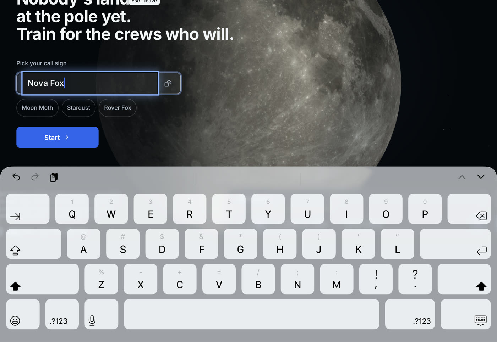
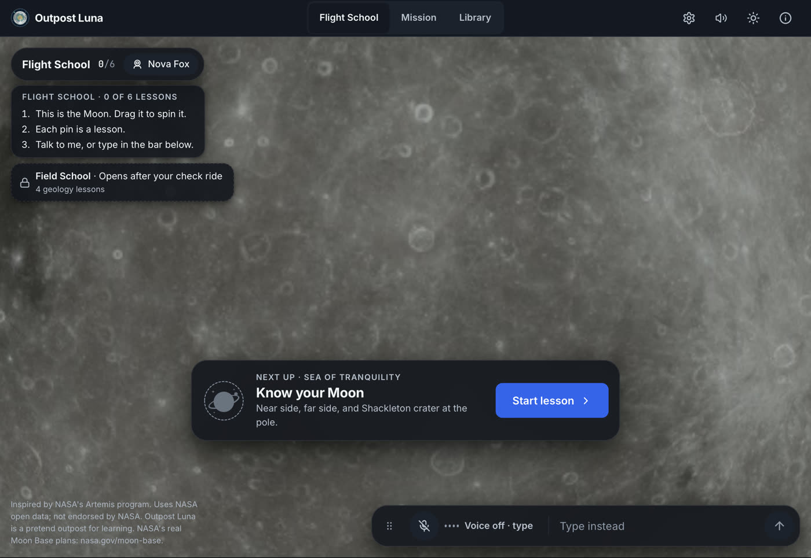
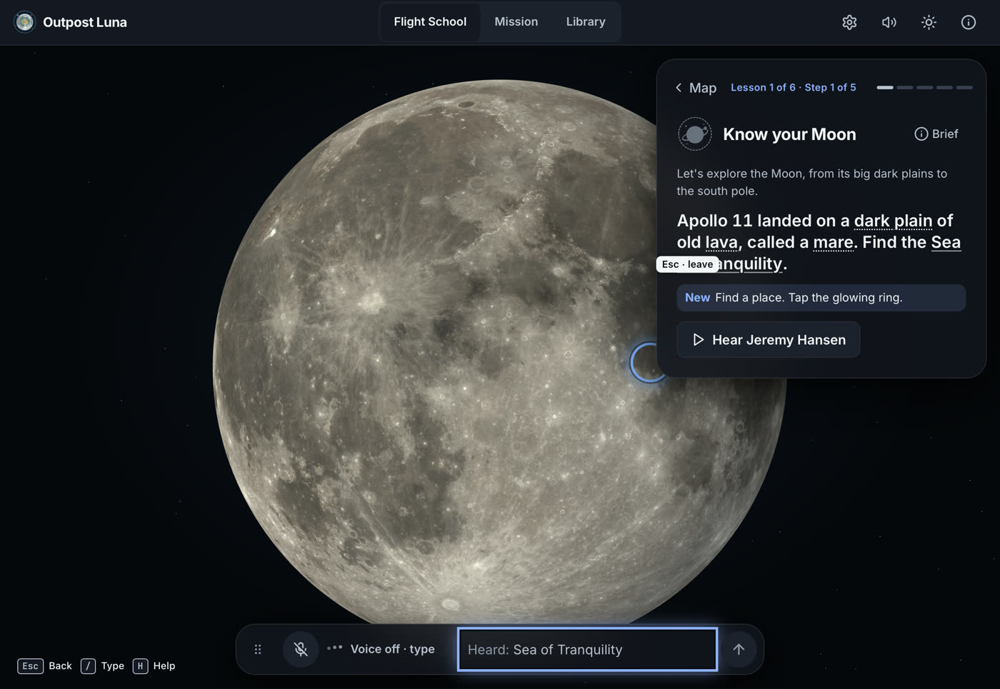
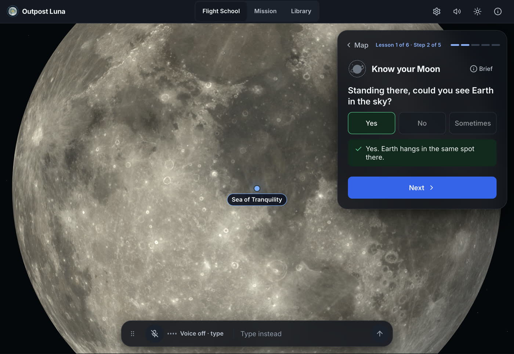
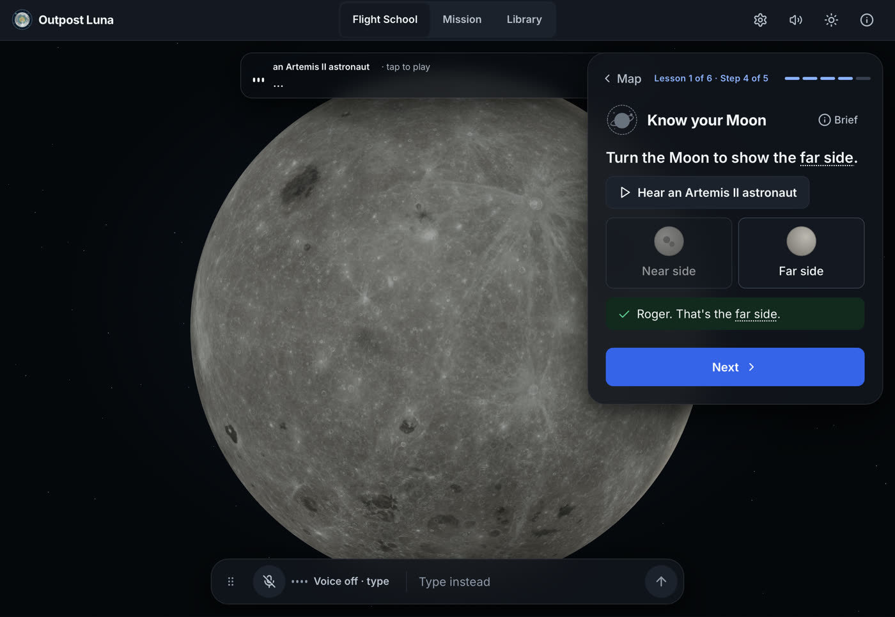
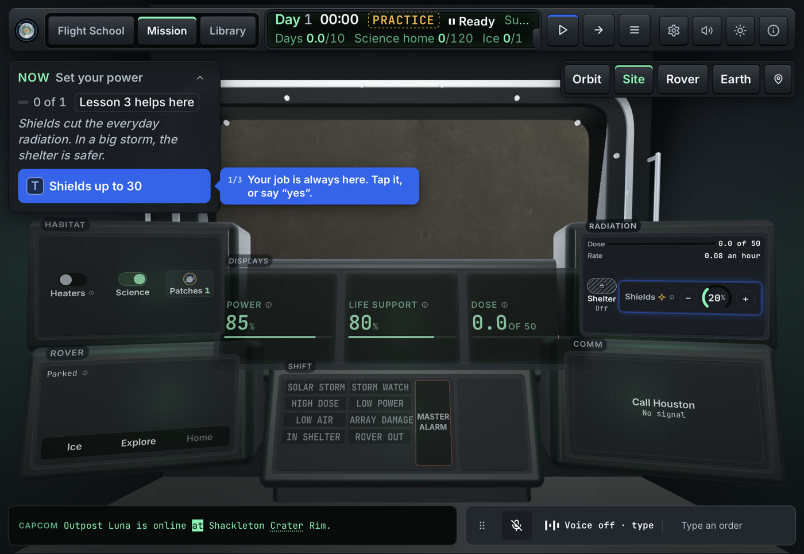
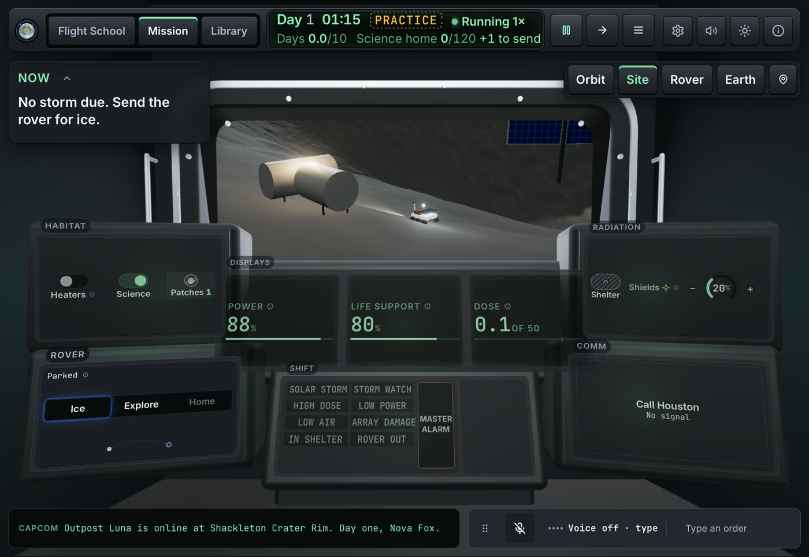
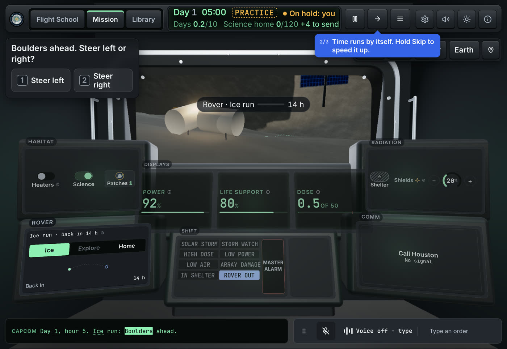

# Outpost Luna for iPad

A real offline iPad app (iPadOS 17+), not a remote screen for a Mac. It runs the **same backend and the same frontend**
as the desktop app, inside one iPad process, on `127.0.0.1` only (no LAN serving). Code: `ios/`.

```
Outpost Luna.app (iPad)
 └─ Swift shell (ios/OutpostLuna)
     ├─ WKWebView: the desktop's own splash (desktop/main/splash.html) until the backend answers
     ├─ PythonHost.m: embedded CPython 3.13 (BeeWare Python.xcframework, PEP 730) on a background thread
     │    └─ ios/python/luna_ios.py -> uvicorn -> backend/app + the built frontend at /   (127.0.0.1:<free port>)
     └─ WKWebView -> http://127.0.0.1:<port>/   (luna_token cookie set first, HttpOnly, SameSite=Strict)
```

## 1. Spike: which route (decided)

The brief listed three routes. Decision: **A, native shell + embedded CPython**. Evidence:

| | A. Swift shell + embedded CPython | B. Everything in the WebView (Pyodide) | C. Native Swift ports |
|---|---|---|---|
| Backend code reused | all of `backend/app`, unchanged | Python logic yes, but no server: Pyodide cannot listen on a socket | none |
| Frontend reused | all of it, unchanged except one additive flag (§4) | the page talks to `/api/*` **and** to WebSockets (`/ws/session`, `/ws/mission/{id}`, `/ws/listen`); a service worker can answer `fetch` but **not a WebSocket**, so every socket call would need a rewrite | rewrite |
| Dependencies on iOS | every one found or built (table below) | numpy/pydantic exist for Pyodide; FastAPI/uvicorn are pointless without sockets | n/a |
| Measured | backend ready in **3.2 s**, page in **3.9 s** (simulator, debug build, Mac under load ~40) | not built: the WebSocket wall rules it out before measuring | not needed |

So B fails on architecture, not on speed, and C is only for when both fail. A works today.

### Dependencies on iOS (route A)

| Package (backend/uv.lock) | iOS | How |
|---|---|---|
| CPython 3.13.18 | yes | BeeWare `Python-3.13-iOS-support.b18` (pinned URL + sha256) |
| numpy | yes | BeeWare's iOS wheel `2.5.2.post1` (cp313, ios_17_0 arm64, device + simulator; pinned sha256). numpy's PyPI release has no iOS wheels for cp313 |
| pydantic-core 2.50.4 (Rust) | **built here** | no published iOS wheel anywhere (PyPI, BeeWare index): `ios/scripts/build_pydantic_core.sh` cross-compiles it with cargo for `aarch64-apple-ios` and `aarch64-apple-ios-sim` against the Python framework (~4 min per target, 4.7 MB each) |
| fastapi, starlette, pydantic, pydantic-settings, anyio, h11, httpx, httpcore, idna, certifi, click, dotenv, typing-* | yes | pure Python, the locked versions |
| uvicorn | yes | pure Python core; runs with `loop="asyncio"`, `http="h11"`, `ws="websockets"` |
| websockets, rapidfuzz | yes | their C speedups are dropped; both fall back to their own pure-Python code |
| uvloop, httptools, watchfiles, pyyaml (uvicorn[standard] extras) | not needed | dropped |

Every `.so` (Python's own modules, numpy, pydantic-core) becomes a framework in the app at build time
(`Python.xcframework/build/utils.sh`), as the App Store requires. The backend uses no `subprocess` or `fork`.

### The ear on iPad (not in v1)

The ear is Arc Transcriber Space on libarc + ONNX Runtime (docs/LOCAL_EAR.md). On the Mac it runs in the model server,
a second process, which iOS does not allow. The path is the in-process build from docs/EMBEDDING.md:

- `libarc.a` with `-DARC_BUILD_STATIC=ON -DARC_ORT_LINKED=ON` (iOS cannot load a library by path) + Microsoft's ONNX
  Runtime iOS xcframework (C API 23+), linked into the shell;
- a small native module in the shell that speaks the model server's `WS /v1/stream` contract on loopback, so the
  backend's `/ws/listen` relay works unchanged;
- the 461 MB model as a first-run download, like the desktop's `ear` asset.

Reference numbers (not measured on an iPad): native decode RTF ~0.3 on 4 Mac cores; the WebAssembly spike decodes a
3–4 s clip in 720 ms in Chromium (RTF ~0.2) with the same output. Memory is the constraint: the ear needs 0.6–1.0 GB
RSS, fine on M-series iPads (8–16 GB), too much for the 3–4 GB iPads that iPadOS 17 still supports. Arc Tagger
(safety) and the embedder are the same story; without them the backend's local Director and lexical search answer.

## 2. What v1 does

| | v1 on iPad | Desktop |
|---|---|---|
| Flight School, Mission, Library, the Moon, the cabin | the same app | |
| Typing to CAPCOM | yes: the voice bar's text field, on-screen or hardware keyboard | yes |
| Voice in | **type instead.** No local ear yet: the voice bar says "Voice off · type" from the first frame and never "Starting voice…". The mic button falls through to WebKit's own speech recognition (present in WKWebView); not tested on a device and it may need Apple's servers | the local ear |
| Voice out | the iPad's own voice (the page's `speechSynthesis`, which WKWebView runs on AVSpeechSynthesizer), like the Mac app's OS voice. `/api/tts` answers 503 at once (`TTS_ENGINE=deepgram`, no key) so the page uses it from the first line. The recorded Nora pack needs the model server: not in v1 | OS voice + Nora pack |
| Touch | taps on every control, drag to spin and pinch to zoom on the Moon (Three.js controls), the cabin's Now card, the lesson answers. The shell raises `--control-sm` (36 px on desktop) to 44 px and the section tabs to 44 px, so the top bar, chips and voice bar meet Apple's 44 pt target; the page itself never zooms or bounces and a long press is not a text callout. **Still small in the cabin** (measured, §5): the "why?" dots, the habitat toggles, shields -/+ and the Now panel's fold | mouse, keys, controller |
| Camera gestures | off (the shell denies the camera) | on |
| Crew audio, NASA videos | not bundled (the desktop's optional assets); videos stream when online. The Moon map ships | first-run assets |
| Network after install | none: video prefetch off, cloud keys dropped, links leave only to Safari for nasa.gov and the project's GitHub pages | same rule |

Saves, the turn log, logs and on-device learning live in the app's `Application Support/Outpost Luna/` (backed up
with the iPad, never shared). The local guard (docs/SECURITY.md) is on: a fresh 32-byte token per launch, set as the
page's HttpOnly cookie; nothing else on the iPad can reach the loopback port without it for writes and WebSockets.

## 3. Build and run (headless simulator)

```bash
bash ios/scripts/build_python.sh       # once: Python, numpy, pydantic-core (needs rustup + iOS targets), backend, frontend
                                       # MOON_MAP=<moon4k.jpg> if backend/data/media/img has none (`make data` fetches it)
DERIVED=<dir> bash ios/scripts/sim.sh build     # xcodebuild, Debug, iPad simulator
DERIVED=<dir> bash ios/scripts/sim.sh run       # creates/boots "Luna iPad" (iPad Pro 11-inch M5, iOS 26.4), no Simulator.app
DERIVED=<dir> SHOTS=<dir> bash ios/scripts/sim.sh test    # the touch walkthrough (XCUITest) + screenshots
bash ios/scripts/sim.sh stop
```

`ios/project.yml` is the XcodeGen spec; the generated `ios/OutpostLuna.xcodeproj` is committed. Tip for a shared
machine: the first boot of a new simulator indexes media at ~300% CPU; `xcrun simctl spawn <id> launchctl disable
system/com.apple.mediaanalysisd` and reboot it.

### Simulator walkthrough

`ios/OutpostLunaUITests/Walkthrough.swift` drives the app by touch and the on-screen keyboard in landscape: call sign,
Flight School, drag + pinch on the Moon, a lesson (typed answers and a tapped guess), then Mission. Screenshots
(`docs/img/ipad/`, landscape):

| | |
|---|---|
|  |  |
|  |  |
|  |  |
|  |  |

## 4. The one frontend change

`frontend/src/engine.js` reads `window.__lunaEngineBoot` once at load. The iPad shell sets `{ear: "none"}` before the
page's scripts run: `noEar()` is true, `warmState()` is "ready" (no "Starting voice…"), the bar gets `is-ear-down`
("Voice off · type"), and `voice.js` never opens the mic for the ear's WebSocket. The desktop shell and a browser never
set it, so their behaviour is unchanged (`frontend/tests/engine_noear.test.js` checks both).

## 5. Measurements

iPad Pro 11-inch (M5) simulator, iOS 26.4, on the build Mac while five other agents ran test suites (load 40 to 120).
The shell logs `luna: backend ready in N ms` and `luna: page loaded at N ms {...}`; the walkthrough logs the rest.

| | v1 |
|---|---|
| Startup: tap to backend answering / page loaded (debug build) | **3.2 s / 3.9 s** |
| Startup as XCUITest sees it (fresh install, launch to the home's Start button) | 16 to 21 s under that load |
| Memory, app process (shell + CPython + backend + numpy) over the walkthrough | 174 MB average, 311 MB peak; WebKit's page process is extra (not separable on the simulator) |
| App size, Release, arm64 device | **170 MB** installed, **66 MB** zipped: Python stdlib 50, app 58 (backend data 28, frontend 25, Moon map 2.5), site-packages 23, frameworks 36 (Python, numpy, pydantic-core) |
| Ear real-time factor | not run: no ear in v1 (§1 has the desktop and WebAssembly numbers) |
| What the page has (probe after load) | `speechSynthesis` yes (voices load after the page), `getUserMedia` yes, `AudioWorklet` yes, `SpeechRecognition` yes; 1194 x 834 pt landscape, 2x |
| Walkthrough by touch (`sim.sh test`) | passes: call sign (chip + keyboard), Moon drag + pinch, lesson 1 all 5 steps (2 typed, 3 tapped), Mission: practice shift, briefing, shift running (clock, Now card), the Now card's job by touch (rover sent) |
| Controls under 44 pt (hittable, measured) | home 1 (a call-sign chip, 32 pt tall), Mission picker 0, the cabin 17 (above) |

Voice output was not listened to: the build Mac's rule is silent testing. The voice path is the page's own
`speechSynthesis` fallback, the same code a browser without server TTS runs.

## 6. On a real iPad (owner steps)

The Mac has only a Developer ID certificate, which cannot install on an iPad. Signing is set to automatic with team
XXK95K57U5, so Xcode makes the Apple Development certificate and the profile itself once the team's Apple ID is in Xcode:

1. Connect the iPad with a cable, unlock it, tap **Trust** and enter the passcode.
2. On the iPad: Settings -> Privacy & Security -> **Developer Mode** -> on, restart, confirm. (The switch appears after
   the iPad has been connected to Xcode once; if it is missing, open Xcode with the iPad connected, then look again.)
3. On the Mac: Xcode -> Settings -> **Accounts** -> + -> Apple ID: sign in with the Apple ID that is a member of the
   Whissle LLC team (XXK95K57U5). Close Settings.
4. Then:

```bash
bash ios/scripts/build_python.sh
xcodebuild -project ios/OutpostLuna.xcodeproj -scheme OutpostLuna -configuration Release \
  -destination 'generic/platform=iOS' -derivedDataPath ios/build/DerivedData-device \
  -allowProvisioningUpdates DEVELOPMENT_TEAM=XXK95K57U5 build
xcrun devicectl list devices                     # note the iPad's identifier
xcrun devicectl device install app --device <identifier> "ios/build/DerivedData-device/Build/Products/Release-iphoneos/Outpost Luna.app"
xcrun devicectl device process launch --device <identifier> ai.whissle.outpostluna
```

## 7. Left for TestFlight

- An App Store Connect record for `ai.whissle.outpostluna` and an Apple Distribution certificate (Xcode makes it on
  the first archive with `-allowProvisioningUpdates`); `xcodebuild archive` + `-exportArchive` with an
  `ExportOptions.plist` (method `app-store-connect`).
- A privacy manifest (`PrivacyInfo.xcprivacy`) for the app: no tracking, no data collected; the "required reason"
  APIs Python uses (file timestamps, disk space, boot time).
- Trim the bundled Python stdlib (50 MB: tests, idlelib, ensurepip, tkinter, unused codecs), as the desktop build does.
- A cabin touch pass: 44 pt targets for the "why?" dots, habitat toggles, shields -/+ and the Now panel's fold.
- An opaque 1024 px icon with no white corners (today the desktop icon on white), launch artwork.
- Export compliance is declared (`ITSAppUsesNonExemptEncryption = NO`); age rating, screenshots at the iPad sizes.
- Content rights: CC BY-NC models (the ear, when it lands) need the licence check for App Store distribution.
- Then the ear (§1), the Nora voice pack, crew audio and videos as on-demand downloads, and camera gestures.
