# Novice playtest: Flight School through a 7-year-old's eyes

The owner got stuck on "The crew named a crater. Trace it: Orientale, then up to Ohm." with about 12 unlabelled
orange and blue dots on the Moon, nothing showing where Orientale or Ohm were, and the feedback "Not that one. Start at
Orientale." The bar: **nobody gets lost.** A 7-year-old who knows nothing about the Moon must always be able to tell
where they are, what to do, and what happens next.

How this was run: `frontend/tools/playtest.py` drives the real app headless (Playwright, 1280x720) against a backend on
:8399 and Vite on :5299. For every step it shoots the step as it opens, then makes up to three wrong tries a novice
would make (a tap on a dot that isn't it, a wrong card, a mumble), shooting after each, and logs the prompt, the "do
this" line, the feedback, whether each place the step names is on screen and labelled, and whether unlabelled dots
show. Then the check ride, a mode switch in the middle of a step, the site picker, the first shift and the debrief.
Verdicts below are mine, judged harshly from the screenshots and the log.

**Verdicts:** clear = a novice does it without help · confusing = they get there, but only by guessing or after a
miss that didn't tell them what to do · stuck = they can't do it without knowledge the app never gave them.

## Summary

| | clear | confusing | stuck |
|---|---|---|---|
| **Before** (57bd674) | 20 | 17 | 6 |
| **After** (`fix/guidance`) | 41 | 2 | 0 |

43 entries: 33 steps (6 lessons + the 5-step check ride), plus home, map, lesson card, patch, picker, first shift,
debrief, Library, the mode switch and the open-mic check. The two "confusing" after the fix are justified at the end.

## The guidance system (what changed)

1. **Never ask for unknown knowledge without showing it.** A step that names a place it doesn't test shows it with a
   ring and a label (`show` in `build_course.py`), turned into view (Orientale and Ohm on the western limb: the camera
   turns to longitude -100). The south-pole step draws the gold ring its prompt promises (`ring`). After the answer,
   what the step taught is labelled (`after_place`: Integrity, halfway along the route).
2. **Hint ladder on every interactive step** (`backend/app/academy/guide.py`, drawn by `frontend/src/academy/guide.js`):
   - rung 0: the prompt plus one "do this" line (`do`, or the type's default);
   - rung 1 (first real miss): what the tap hit and where the target is, and the target glows; the globe turns to it
     if it's round the back or on the edge. "That's Copernicus. Orientale is the big bullseye. Ohm is above it.";
   - rung 2: the label appears on the target, one wrong card is crossed out, the order button glows, or the words
     to say appear on the card (on screen only, never spoken: the open mic would hear them back);
   - rung 3: CAPCOM shows it and moves on (`SHOW_AFTER`; the 20 s rule is `fix/rc-polish`'s).
   No miss line is ever just "Not that one." (`test_every_miss_line_short_and_actionable`).
   A route is graded per tap: a right stop is progress ("Yes, Orientale. Now Ohm."), not a miss.
3. **No unlabelled dots.** Lessons no longer turn on the place dots; a step draws only its own labelled marks.
4. **Intros.** The first time each kind of step appears, one "New:" line says how it works (and is spoken once):
   "New: trace a path. Tap the glowing places in order." The route's stop 1 pulses first, then stop 2. The lesson's
   one-line brief shows on step 1.
5. **Where am I / what do I do / what's next** on every screen: "Lesson 2 of 6 · Step 4 of 5" on the card (the check
   ride is "Check ride", never "Lesson 7"; patches count n/7), the do line, Next after an answer, a do line on the site
   picker, the first-shift line kept on CAPCOM's strip.
6. **Hands-free parity.** Every hint is spoken. "Help", "hint", "what do I do", "I'm stuck", "I don't know" route to
   the screen's current hint on every screen (router a11y intent → `a11y.js` → `window.__outpost.help`); in a step with
   nothing tried yet it also lights the rung-1 glow, without counting a miss.

## Lesson 1 · Know your Moon

| # | On screen | A 7-year-old thinks | Can do it cold? | Wrong tries → what happens | Before | After |
|---|---|---|---|---|---|---|
| 1 | "Find where Apollo 11 landed." ~12 orange/blue dots | "Which dot is Apollo 11?" | No: never told where, or that it's a dark patch | Taps a dot. "Not quite. Try the near side." (they are already looking at the near side) | **stuck** (img 1) | clear: "Apollo 11 landed on a dark patch, the Sea of Tranquility. Find it." + "Tap it on the Moon, or say its name". Miss: "That's Sea of Rains. It's the dark patch right of the middle." + glow; then label |
| 2 | "Could you see Earth in the sky?" Yes / No / Sometimes | Guesses | Partly | "Not quite. Which side faces Earth?" | confusing | clear: place labelled, do line "Tap Yes, No or Sometimes", hint "This side of the Moon always faces Earth." |
| 3 | Predict: far side, 3 cards | Guess | Yes (any guess is fine) | Any guess reveals | clear | clear (+ "New: a guess. There's no wrong guess here.") |
| 4 | "Turn the Moon to show the far side." Near / Far + Check this view | Taps Far | Yes | "Not yet. Keep turning." | clear | clear (rung 2 lights the Far button) |
| 5 | "Find the south pole, inside the gold ring." No gold ring is drawn; a leftover "Mare Orientale" label from the crew clip | "What ring?" | No | "Not quite. Look at the bottom." (the pole is in the middle of the pole view) | **stuck** (img 2) | clear: gold ring drawn and pulsing; the last step's clip stops at Next, its label with it; "Tap inside the gold ring." then the "Shackleton" label |

## Lesson 2 · Lessons from Apollo

| # | On screen | A 7-year-old thinks | Can do it cold? | Wrong tries → what happens | Before | After |
|---|---|---|---|---|---|---|
| 1 | "Apollo 11 landed on a mare. What does mare mean?" Globe shows a "Surveyor 3" ring (the vocab step never ran its fly-to) | "Is mare that thing?" | Partly: the dark patch isn't shown | "Not quite. Look at the dark patch." No patch is shown | confusing | clear: step directives now run for every step type; Sea of Tranquility labelled |
| 2 | "What did the Apollo 12 crew take home from Surveyor 3?" | "What's Surveyor 3?" | No | "Not that one. It took pictures." | confusing | clear: "Robot Surveyor 3 took photos here. Apollo 12 took one part home. Which?"; Surveyor 3 labelled once (not twice) |
| 3 | Predict: did Artemis II beat Apollo 13? | Guess | Yes | reveal | clear | clear |
| 4 | **The owner's step.** "The crew named a crater. Trace it: Orientale, then up to Ohm." 12 unlabelled dots, "Stop 1 of 2" | "Which dot is Orientale? Which crater? Named what?" | No | Taps a dot; "Not that one. Start at Orientale." x2; then shown | **stuck** (img 3) | clear (img 3 after): "Artemis II's crew picked a crater name: Integrity. Tap Orientale, then Ohm." Orientale (1) and Ohm (2) ringed, numbered and labelled; stop 1 pulses; "Tap 1: Orientale" on the card; a wrong tap: "That's Copernicus. Orientale is the big bullseye. Ohm is above it."; a right stop: "Yes, Orientale. Now Ohm."; after: Integrity labelled halfway, "Name not official yet." |
| 5 | "Listen to Charlie Duke. Who landed with him?" A "Hear Charlie Duke" button the kid may not press | Guesses a name | Only if they press the button | "Listen again for the name." | confusing | clear: the clip plays after the question; do line "Tap Hear Charlie Duke, then pick a name"; rung 2 crosses one name out |

## Lesson 3 · Talk on the radio

| # | On screen | A 7-year-old thinks | Can do it cold? | Wrong tries → what happens | Before | After |
|---|---|---|---|---|---|---|
| 1 | "What does copy mean on the radio?" | The brief said it | Yes, if they heard the brief | "Not quite." (no direction) | confusing | clear: brief shown on step 1; "Not that one. Copy is about hearing."; one crossed out |
| 2 | Readback: "Read it back." | "Read what back? To whom?" | No: "readback" is unknown | "Say again? Repeat the order." twice | confusing | clear: "Say it back.", "New: radio practice. Say the order back.", rung 2 shows "Say: set the heaters to 40 percent" on the card |
| 3 | Predict: radio delay | Guess | Yes | reveal | clear | clear |
| 4 | "Which outpost can talk to Earth more often?" Two pins on a grey polar close-up | No clue which | No | "Not that one. Which faces Earth?" | confusing | clear: "Earth hangs over the Moon's near side. Which outpost sees Earth more?"; miss: "Malapert sits on the side facing Earth." |
| 5 | "Static! You missed the last order. What do you say?" | "Huh? What?" | No | "Ask CAPCOM to repeat it." | confusing | clear: "Ask CAPCOM to repeat it, radio style."; hint "Radio talk for repeat: two words, ending in again." |

## Lesson 4 · Power from the Sun

| # | On screen | A 7-year-old thinks | Can do it cold? | Wrong tries → what happens | Before | After |
|---|---|---|---|---|---|---|
| 1 | "Tap the line where day meets night." Half-lit Moon | Taps the edge | Yes | "Not quite. Find the shadow's edge." | clear | clear (rung 1 glows dots along the line, rung 2 labels "Day meets night") |
| 2 | Predict: Sun height at the pole | Guess | Yes | reveal | clear | clear |
| 3 | "Which site stays sunny for our 10-day mission?" two labelled pins | Guess | It's a guess | "Not that one. Check the sun days." (no sun days shown yet) | confusing | clear: "Pick a site card or pin", miss names the clue, rung 2 crosses one out |
| 4 | "Move power to the heaters." Order buttons | Taps Heaters up | Yes | "Negative. The heaters need more power." | clear | clear (rung 2 lights Heaters up) |

## Lesson 5 · Radiation and storms

| # | On screen | A 7-year-old thinks | Can do it cold? | Wrong tries → what happens | Before | After |
|---|---|---|---|---|---|---|
| 1 | Predict: magnetic shield | Guess | Yes | reveal | clear | clear |
| 2 | "When do you shelter?" Now / When it hits / Never | Reasonable | Yes | "Not quite. Particles move fast." | clear | clear |
| 3 | Alert: storm. Order buttons; the alert banner covers the card's Map button | Taps Into the shelter | Yes | "Say again? Radiation is climbing." | clear | clear (hint names the button) |
| 4 | "What is an mSv?" | "A what?" | No | "Not quite. It measures something." | **stuck** | clear: "Doctors count radiation in mSv. So what is an mSv?" |

## Lesson 6 · Air, water and ice

| # | On screen | A 7-year-old thinks | Can do it cold? | Wrong tries → what happens | Before | After |
|---|---|---|---|---|---|---|
| 1 | Predict: why crash a rocket | Guess | Yes | reveal | clear | clear (success now glosses regolith for step 5) |
| 2 | "Find where the LCROSS rocket hit, near the south pole." The lesson's own label already marks it | Taps the label | Yes, by luck | "Not there. Look lower." (it is in the middle, not lower) | confusing (img 5) | clear: "The LCROSS rocket hit Cabeus crater, near the south pole. Find it."; hint "It's close to the south pole, in the middle." |
| 3 | "Which outpost is closer to Shackleton's ice?" Pins, Shackleton unmarked | "Where is the ice?" | No | "Not that one. Look at the map." | **stuck** | clear: "Ice hides in Shackleton crater. Which outpost is closer to it?" with Shackleton ringed and labelled |
| 4 | "Send the rover for ice!" Order buttons | Taps Rover: get ice | Yes | "Negative. The rover needs to fetch ice." | clear | clear |
| 5 | Fill the blank: regolith / albedo / ejecta | Three unknown words | No (never glossed) | "Which word means Moon soil?" then "It starts with r." | confusing | clear: regolith glossed in step 1; hint "The word for Moon dust starts with r."; one crossed out |

## Check ride

| # | On screen | A 7-year-old thinks | Can do it cold? | Wrong tries → what happens | Before | After |
|---|---|---|---|---|---|---|
| 1 | Cabin + card: "Earth is up. Can you call Houston?" | Guess | Yes | reveal | clear | clear |
| 2 | "Ask Houston about space weather." Call Houston pulses | Taps Call Houston | Yes | "Negative. Call Houston." | clear | clear |
| 3 | Storm alert, shelter cued | Taps Shelter | Yes | "Say again? Radiation is climbing." | clear | clear |
| 4 | "Bring the crew out." Shelter cued | Taps it | Yes | "Negative. Bring the crew out." | clear | clear |
| 5 | "Send the rover for ice." Rover cued | Taps it | Yes | "Negative." | clear | clear |

The ride already lit one control at a time (`rideCue`). Header said "Lesson 7 of 7"; now "Check ride · Step k of 5".

## Screens

| Screen | Where am I / what do I do / what's next | Before | After |
|---|---|---|---|
| Home (call sign) | Title, a call-sign field with three suggestions, Start | clear | clear |
| Moon map | "Flight School 0/7", the next pin big and labelled, a Next-up card with Start lesson | clear | clear: lessons read "Lesson n of 6", the ride pin has no number, patches n/7 |
| Lesson card | Title and dots only; the brief hidden behind "Brief"; "Say it, or tap the Moon" | confusing | clear: "Lesson 2 of 6 · Step 4 of 5", the brief on step 1, a do line, a New: line on first use |
| Patch | Big patch, "Next: <lesson>", Map | clear | clear |
| Stale answer card | A CAPCOM answer card from the map ("I don't know that one yet…") stays over every lesson after it | confusing (img 4) | clear: a lesson opening closes it |
| Site picker | "Pick your outpost site", columns 10/10 4.5/10 No | confusing: the numbers aren't explained in kid words | clear: "Tap a site to compare. Then tap Take command." |
| First shift | A dense cockpit; "Set your power, then end the shift." spoken once, gone from screen | confusing | clear: the line stays on CAPCOM's strip; "what do I do" says it again |
| Debrief | Grade, score, chart, Fly again | clear | clear |
| Library | Place chips (Where did Apollo 11 land?…) | clear | clear |
| Switch Flight School → Mission mid-step | **The lesson card stays on top of the site picker**; from Library, the card stays over the explorer (img 6) | stuck | (`fix/rc-polish` owns the leak; re-check after merge) |
| Voice bar error | "Voice hiccup: local ear closed: sent 1011 (internal error) keep…" shown to the kid | confusing | (reported to `fix/rc-polish`: `voicebar.js`) |
| Open mic on 2-option steps | Room speech "yes", "no", "yeah right" is routed as an answer (router: answer/step). A predict passes on any named option, so a parent's "no" answers "Does the Moon have a shield?" before the kid has read it. Seen in the router directly for every predict/earth_view step (moon 2–3, history 3, radiation 1, life 1, ride 1) | confusing | not changed here (gating is `fix/rc-polish`'s). Recommendation: in a lesson, a one-word yes/no counts only when Arc's device_directed ≥ 0.7 or after the prompt has finished playing plus ~1 s; otherwise ignore it |

### The two "confusing" that remain

- **Open-mic answers on yes/no steps**: needs the rc-polish gating (above), not copy.
- **Mode switch mid-step**: the card leak is being fixed on `fix/rc-polish`; after merge, each switch should land on a
  screen that says what to do (picker do line, Library chips, Flight School map card), which the guidance work covers.

## Before / after

| | Before | After |
|---|---|---|
| 1. Find Apollo 11 | 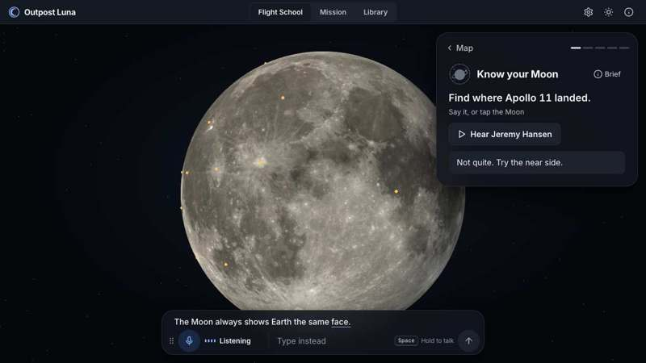 | 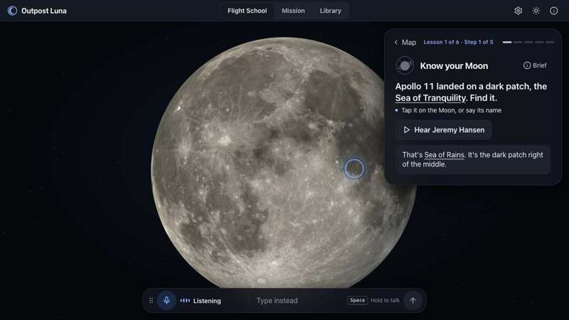 |
| 2. South pole "gold ring" | 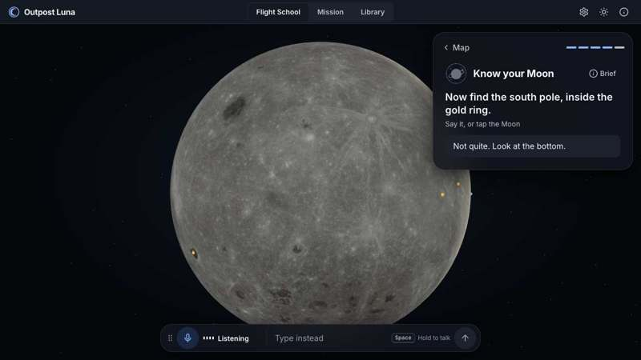 | 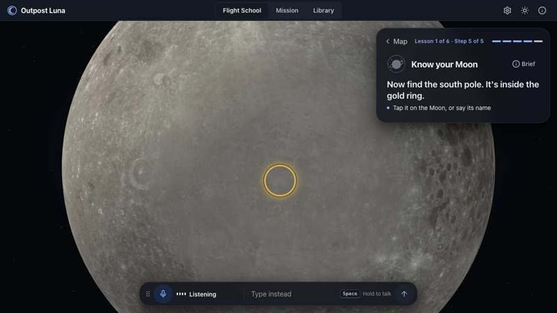 |
| 3. Trace Orientale → Ohm | 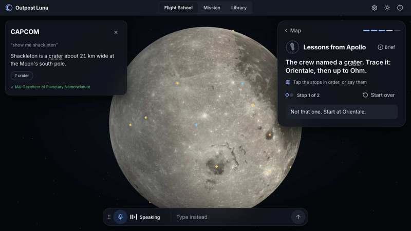 | 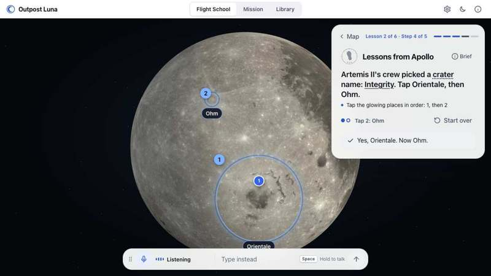 |
| 4. Stale card / readback | 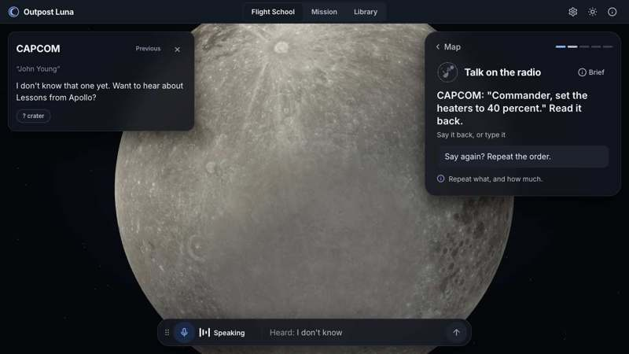 | 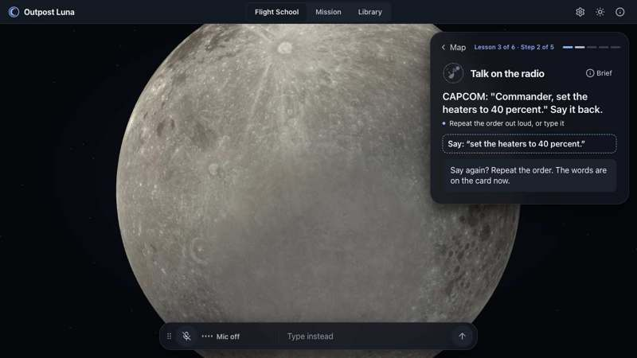 |
| 5. LCROSS "look lower" | 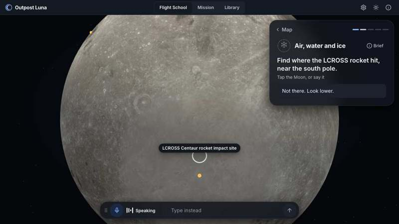 | 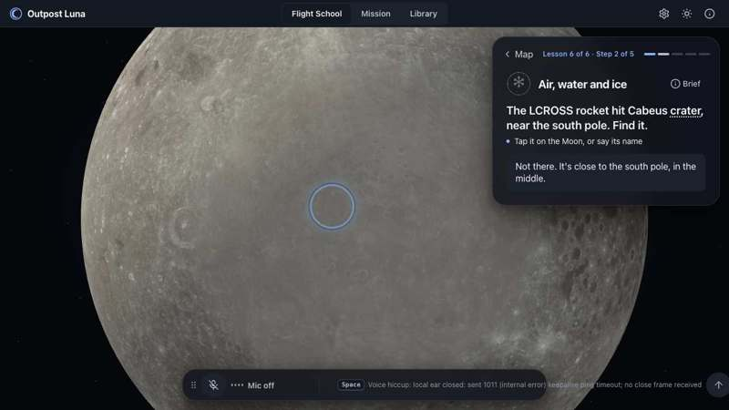 |
| 6. Shackleton's ice | 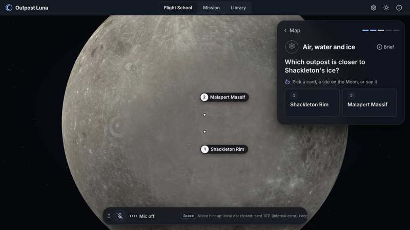 | 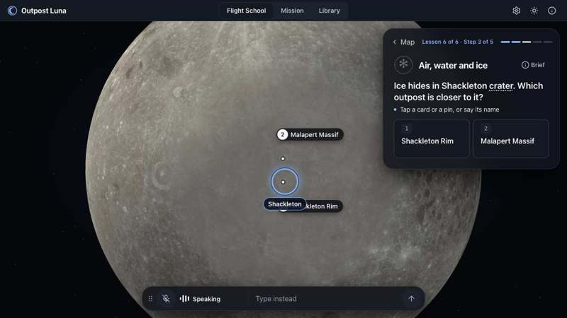 |

Re-run: `uv run --with playwright --with pillow python frontend/tools/playtest.py --base http://localhost:5299 --out /tmp/pt --tag after`
(from `backend/`, with the backend and Vite running).
