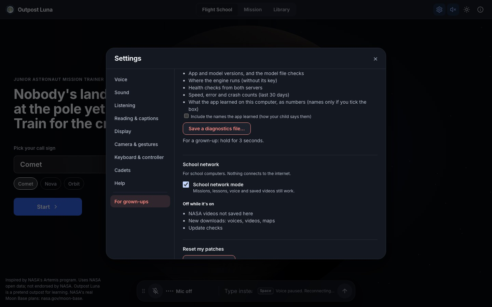

# Outpost Luna on school computers: a page for IT

Outpost Luna is a voice-first Moon trainer that runs entirely on the computer. It does not listen on the network, does
not look for other devices, and after setup it works with no internet at all. **School network mode** stops even the
few optional internet uses (below), for one account or the whole machine.

## What runs

| Process | macOS | Windows |
|---|---|---|
| The app (Electron) | `Outpost Luna` + its helper processes | `Outpost Luna.exe` + helpers |
| Model server (speech, voice, safety tagger) | `python3 launch.py models` | `python.exe launch.py models` |
| Backend (the page, missions, lessons) | `python3 launch.py backend` | `python.exe launch.py backend` |
| The computer's own voice | `say` (built in) | Windows voices (WinRT / SAPI) |

Both Python processes are children of the app, use its embedded Python (not one installed on the machine), and quit
with it. No service, no driver, no login item, no admin rights at run time. Windows installs per user
(`%LOCALAPPDATA%\Programs\Outpost Luna`) without asking for Administrator; macOS is a signed, notarized app you drag
to Applications.

## Ports: loopback only

| Port (TCP) | What | Bound to |
|---|---|---|
| 47310 (else 47311, 47312, else one the OS picks) | backend | `127.0.0.1` only |
| 47210 (else 47211, 47212, else one the OS picks) | model server | `127.0.0.1` only |

Nothing listens on `0.0.0.0`, the LAN or IPv6. Another computer cannot connect, and binding to loopback does not
trigger the macOS or Windows Defender firewall prompt. Even on this computer, both servers refuse any web page but the
app's own, check the `Host` header and need a per-launch secret for anything that changes state (`docs/SECURITY.md`).
If any code in either server ever tried to listen on a network address, it is refused (`app/netgate.py`).

No mDNS / Bonjour, SSDP / UPnP, Cast discovery, LAN scanning, peer discovery, file shares (SMB) or printers. The
app's Chromium runs with the media router (Cast) off and spell-check off (no dictionary download).

## Every outbound host, and why

All of these are optional after setup. In School network mode none of them is contacted (unless you allow it).

| When | Host | Why |
|---|---|---|
| First run only (or import the offline pack instead) | `www.dropbox.com`, `*.dropboxusercontent.com`; mirror `github.com` (`/WhissleAI/Outpost-Luna/releases/download/assets-…`) which redirects to `release-assets.githubusercontent.com` (older links: `objects.githubusercontent.com`); fallback `huggingface.co` | the speech model, safety tagger, search model and recorded voice (about 510 MB), checked by SHA-256. The same files are on Dropbox and on GitHub; the app tries Dropbox first, then GitHub. To allow the downloads, allow one set or both |
| After first run, in the background, once | the same | optional parts: crew audio, the NASA video pack, map layers, NASA views (about 630 MB) |
| Only if a grown-up presses "Check for new models and media" or turns on the daily check (off by default) | `whissleai.github.io` | the list of model and media updates |
| Only if a grown-up presses "Check for updates" or turns on the daily check (off by default) | `api.github.com` | is there a newer version? Nothing is downloaded or installed by the app |
| When a NASA video that is not saved yet is played | `images-api.nasa.gov`, `images-assets.nasa.gov`, `svs.gsfc.nasa.gov`, `nssdc.gsfc.nasa.gov` | the video file, saved for next time |
| When a hand-picked YouTube video is played | `www.youtube-nocookie.com`, `www.youtube.com`, `*.ytimg.com`, `*.googlevideo.com`, `www.gstatic.com`, `fonts.gstatic.com`, `yt3.ggpht.com`, `www.google.com` (`/js/th/` script only), `jnn-pa.googleapis.com` | the privacy-enhanced embed; never a YouTube page inside the app |

Never contacted: analytics, crash reporting, ads, accounts, cloud AI. The app ships no API keys; ONNX Runtime's
telemetry is switched off. A link (a NASA source, a credit) opens in the computer's normal browser, where your web
filter applies, and only for the science sites the app cites; YouTube links ask for a 3-second grown-up hold first.

## Turn on School network mode for the whole machine

Put this file in place (admin rights; students cannot change it), then start the app:

```json
{ "school_network": true, "allow_hosts": [] }
```

| OS | Path |
|---|---|
| macOS | `/Library/Application Support/Outpost Luna/policy.json` |
| Windows | `%ProgramData%\Outpost Luna\policy.json`, or `policy.json` next to `Outpost Luna.exe` |

Or set a machine-wide environment variable: `OUTPOST_SCHOOL_NETWORK=1` (Windows: System Properties or Group Policy;
macOS: `launchctl setenv OUTPOST_SCHOOL_NETWORK 1` in a login script). `OUTPOST_POLICY_FILE` points at a policy file
somewhere else.

- **allow_hosts**: hosts the app may still reach, e.g. `["nasa.gov"]` for NASA videos (an entry also allows its
  subdomains). Empty means nothing. For the first-run and optional downloads, allow
  `["www.dropbox.com", "dropboxusercontent.com"]` or the GitHub mirror `["github.com", "release-assets.githubusercontent.com",
  "objects.githubusercontent.com"]` (each redirect hop is checked, so a mirror needs its download host too).
- **open_links**: `false` stops the app opening links in the browser.
- A machine policy locks the mode on: Settings shows "Turned on by this computer's IT admin" and the switch is off
  limits. A policy file that cannot be read counts as on, with nothing allowed.
- Changes to the file apply the next time the app starts.

A teacher can also turn it on for one account: Settings → For grown-ups (hold 3 seconds) → School network. It applies
at once and stays on.

**What it does.** In each of the three processes, one gate refuses every connection that is not loopback or allowed,
before it is made: the page's requests (Electron's `session.webRequest`), the app's own downloads, and both servers'
HTTP clients and WebSockets, with a socket-level audit hook behind them for any code that skips those. Mission, lessons, the Moon,
voice, captions and saved videos work as before. What needs the internet says "Off on the school network" where it
would be: unsaved NASA videos, new downloads, update checks. Do the first run before deploying, or import the
offline pack (a `.zip`, e.g. from a USB stick) with **Import offline pack…** on the first-run screen: with the mode on, nothing downloads.

## Course packs

A grown-up can download a course pack (Settings → For grown-ups → Course storage). It comes from the same hosts as the
first-run downloads (Dropbox, with the GitHub mirror), so no new host is needed. In School network mode a download whose host is not allowed is
refused with a plain message; locked machines import the offline pack (it can carry course packs) instead.

## What stays on the computer

Nothing below leaves the computer, ever. All of it is in the user's own folder:
macOS `~/Library/Application Support/Outpost Luna/`, Windows `%APPDATA%\Outpost Luna\`.

| What | When |
|---|---|
| Mission autosave (`cache/saves/`): the orders given, not recordings | always, so a mission resumes |
| Settings, cadet call signs, lesson progress and patches | always (the app's local storage) |
| What the app learned about how a cadet says names (small JSON, no audio) | always; Settings → For grown-ups shows and clears it |
| The voice-guide turn log: what it heard, as text, no audio, no names | on by default, 30 days (then deleted; `docs/SECURITY.md` "Retention"); a grown-up can switch it off (Settings → Listening → "Help improve the voice guide") or delete it |
| Playtest audio clips | only during a playtest a grown-up starts, with permission (Settings → For grown-ups → Voice log and playtest), exported as one zip to a place they choose; deleted after 30 days |
| Saved NASA videos, logs (scrubbed, capped at 75 MB), local counters | always; logs never hold words or audio |
| Weekly talk and safety counts per cadet (`cache/brain/counts.json`): numbers by kind and channel, never words | always, 12 weeks; Reset and "Clear this cadet's safety counts" erase them (`docs/BRAIN.md` §9, `docs/DPIA.md`) |
| Care notes (`cache/brain/care.json`): kind and day only | until a grown-up marks them seen, 30 days at most |
| The teacher PIN, as a salted hash (the app's local storage) | only if a grown-up sets one (Settings → For grown-ups → Teacher PIN) |

**Audio and camera are never sent, and audio is saved only in a playtest a grown-up starts.** The mic is turned into
words in memory on this computer; the camera
(only if gestures are turned on in Settings) is read frame by frame and never stored. A diagnostics file is made only
when a grown-up saves one, to a place they choose; nothing is uploaded.

## Teacher PIN

In a classroom, set a teacher PIN (Settings → For grown-ups → Teacher PIN, 4 to 8 digits). After the 3-second hold the
app asks for it before For grown-ups opens: progress, the class summary, safety counts and notes, reset and the school
network switch. Five wrong tries wait 30 seconds. **Forgotten PIN:** quit the app and delete the user's data folder
(below); the cadets' progress goes with it, so print the class summary first if you can. A school's safeguarding lead,
not the app, owns the follow-up of a safety note.

## Uninstall cleanly

| | macOS | Windows |
|---|---|---|
| The app | drag `Outpost Luna` from Applications to the Trash | Settings → Apps → Outpost Luna → Uninstall |
| The user's data | delete `~/Library/Application Support/Outpost Luna/` | delete `%APPDATA%\Outpost Luna\` |
| A machine policy | delete `/Library/Application Support/Outpost Luna/` | delete `%ProgramData%\Outpost Luna\` |

Nothing else is left: no service, no scheduled task, no registry run key, no kernel extension. Settings → For grown-ups
→ Reset → Reset everything also clears the user's data from inside the app.


