# Novice playtest, 2026-11-16 (main 477ceca, 0.3.9)

I played the first hour as a new player who knows nothing about the Moon or the app. Before each action I wrote down
what was on screen and what a kid would try next, and I chose only from what the screen showed. I read the code only
afterwards, to explain a failure. Every test in the repo already knows the right answer; this pass does not.

## How it was run

- **Build:** a fresh worktree off `origin/main` (477ceca). Backend on :8231 and Vite on :5231, each with its own
  `LUNA_DATA_DIR`, `MISSION_SAVE_DIR`, `TURNLOG_DIR` and cache, so it was a real first run.
- **Browser:** headless Chromium (a persistent profile, so "quit and relaunch" really quit). It ran muted through
  `frontend/tools/silent.py`, at 1280x800. No window was shown, no sound played, and the installed app was not
  touched.
- **Input:** headless has no mic, so the app said "The mic didn't start. Type instead, or tap the mic." Every spoken
  answer below went through that **Type instead** box (the voice-text path). Taps and drags were real mouse events
  at screen coordinates.
- **What I covered:**
  - first launch and call sign;
  - Flight School lessons 1 to 6, including 2 find-a-place steps and the day/night-edge step;
  - the check ride;
  - Mission 1 at Shackleton Rim through all 10 days: 2 storms, every chapter card and the final debrief;
  - Settings;
  - quitting mid-mission (Day 6) and relaunching;
  - Mission 2, played by doing whatever the Now card said, only to unlock *Lessons from Apollo*;
  - the Flight School map after the mission.
- **Kid mistakes I tried:** wrong taps, wrong answers, "i dont know", "I don't know", "help", "where is it?",
  "what?", "what do I do?", "i dont have a lamp", "come out", 40 s of silence, collapsing cards, closing videos
  early.
- **The trace step from the owner's report** ("Trace it: Orientale, then up to Ohm") is in *Lessons from Apollo*.
  That lesson stays locked until the **second** mission, so a novice can't reach it in the first hour (finding 22).
  I ran a second mission to unlock it, then played it. It now works well (finding 22).

**Environment, not app bugs** (left out of the findings):

- `/api/tts` returned 502 (no OS voice on my model server), so the voice was silent. Captions still worked.
- JetBrains Mono fonts returned 403 (a Vite `fs.allow` problem from my symlinked `node_modules`).
- "Map layers are not on this computer yet" appeared on the site picker (dev checkout, no layers pack).
- `phases_loop` video returned 502 (the video cache is not prefetched in dev).

**Machine load:** load average was 26 to 43 the whole time (Director training).

- Typed answers took 8 to 16 s to come back on the cabin screens.
- Screenshots sometimes timed out after 30 s.
- Playwright reported pulsing buttons (`is-hot`) and cabin cards as "not stable" for more than 5 s.

I don't count any of that as a bug. One thing to check on a normal machine: if the cabin's lesson card really never
settles, a kid's tap can land mid-animation.

## Severity key

- **blocker:** a kid is stuck, or can't do the step without knowledge the app never gave.
- **confusing:** a kid gets through, but only by guessing, or the app contradicts itself.
- **polish:** wording, overlap, or size.

**Area:**

- **FS** = Flight School, explore or setup.
- **M** = Mission. The Mission polish part 4 stream owns these.

## Counts

| | blocker | confusing | polish | total |
|---|---|---|---|---|
| Flight School / explore / setup (FS) | 2 (1, 2) | 9 | 7 | 18 |
| Mission (M) | 2 (3, 4) | 7 | 1 | 10 |
| Both (FS + M) | 0 | 1 (10) | 3 (27, 28, 31) | 4 |
| **Total** | **4** | **17** | **11** | **32** |

---

## Blockers

### 1. "Help", "I don't know" and "where is it?" never climb the hint ladder. They repeat the last miss line, or say nothing (FS, blocker)

**Where:** any find-a-place step after one miss. Seen in Lesson 1 step 1, "Find the Sea of Tranquility".

**What the kid sees and thinks:** I tapped a dark patch and the app said "That's Kepler. It's the dark plain right of
the middle." I don't know what "right of the middle" means on a ball, so I typed:

- "i dont know": the same line again, "That's Kepler…"
- "I don't know": the same line again.
- "where is it?": the same line again.
- "help": the same line again, still naming Kepler, which I'm no longer touching.

Nothing new appears on the Moon: no label and no camera turn. The only way to get the label was to tap wrong twice
more. A kid who stops and asks, which is exactly what we want, gets the least help. In Lesson 4, "what?" got no reply
at all.

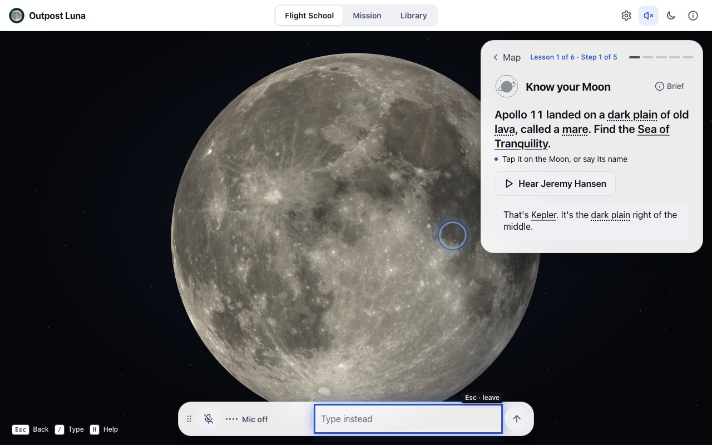

**Why:** `frontend/src/academy/ui.js` `whatNow()` has `if (gs.rung >= 1 && feedback && feedback.text) return
feedback.text;`. After the first miss, "help" replays the last feedback and never moves `gs.rung` up. "where is it?"
and "what?" are not in the help pattern in `a11y.js` / `turn_router.py`.

**Fix:**

- Make help and "I don't know" act as a free rung. Rung 0 to 1 is the glow plus turning toward it, 1 to 2 is the
  label, 2 to 3 is the reveal.
- Add "where is it", "where", "what", "huh", "I can't find it" to the help pattern.
- Never replay a "That's X" line as help.

### 2. Day/night edge step: the Moon looks fully lit, the hint dots sit on the rim, and "Here it is" shows nothing (FS, blocker)

**Where:** Lesson 2 step 3, "The bright part's edge moves every night. Tap where day meets night."

**What the kid sees and thinks:** A full, evenly lit Moon with no dark side anywhere, so there's no "edge" to tap.
I tapped the middle and got "That's Copernicus. Where the bright part turns dark." I tapped again and a column of
rings appeared along the left rim, half off the Moon, labelled "Day meets night". That's the edge of the ball, not a
shadow. The card said "Tap the glowing line" but there is no line, only circles. On the third miss CAPCOM said "Here
it is. That's the terminator." and every marker vanished, so "here" points at nothing. The kid leaves without ever
seeing a terminator.

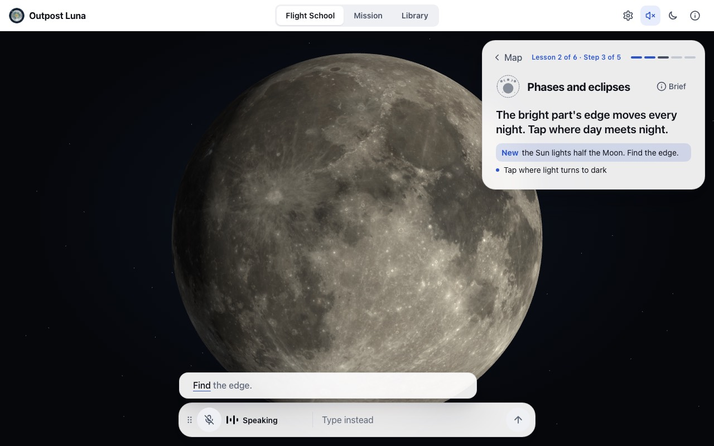 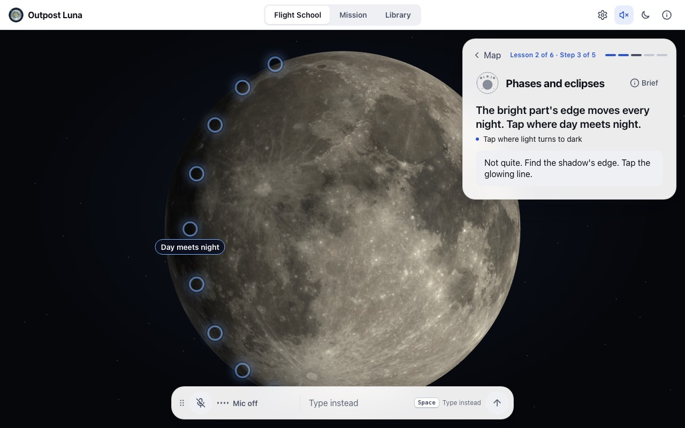 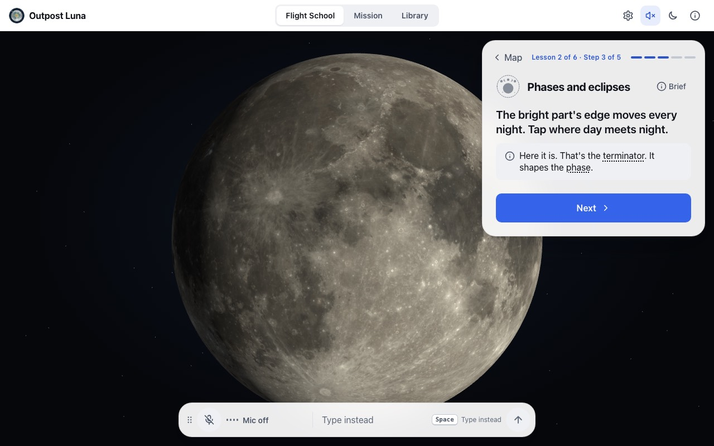

**Why:** in the course data the step sets `sun_lon: 45` and `globe_steps.js` calls `globe.setSunDir(0, 45)`. In my run
the rendered Moon showed no visible night side. I used headless SwiftShader WebGL, so **re-check this on a real GPU
first**. Even with a correct night side, the rung-3 reveal clears the markers (`setSunDir(null)` and the focus are
dropped when the step locks), so nothing is "here".

**Fix:**

- Check that the night side renders clearly dark (darken the night half if the shading is subtle).
- Draw the terminator as a real glowing line, not rings, and keep it on screen at rung 3.
- Turn the globe so the edge sits mid-disc, not on the rim.

### 3. After "Resume", the clock waits for Play, but the card says "All steady. Fast-forwarding to the next event…" (M, blocker)

**Where:** quit mid-mission, relaunch, Mission, then **Resume Day 6**.

**What the kid sees and thinks:** "Welcome back. Day 6, chapter 3." The Now card says "All steady. Fast-forwarding to
the next event…" so I wait. The clock bar says **Ready** with a **Play** button, and nothing tells me to press it.
The day stayed at **Day 6 09:00** for over 10 minutes of waiting (and of tapping the Now button). Resume itself was
exact and well done: right day, right chapter, "Saved automatically". This dead end comes straight after it.

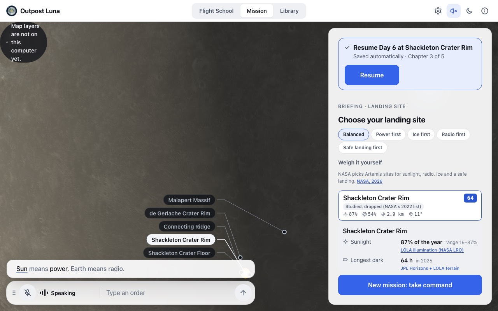 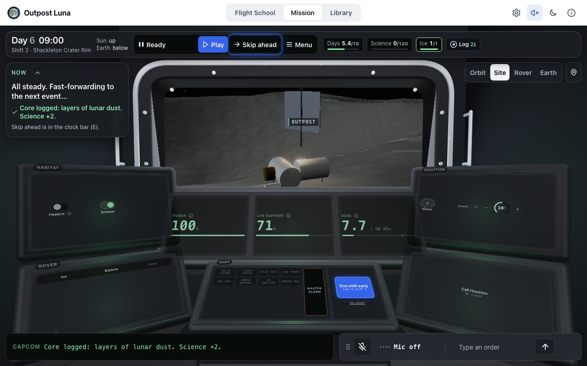

**Why:** `frontend/src/mission/objective.js` `legacy()`.

- `start_clock` ("press Play") fires only when `mission_time_h === 0`.
- `paused` needs `clock.started`.
- A resumed mission has a fresh, unstarted clock with time > 0, so it falls through to `steady`.

**Fix:** after a resume (`clock` not started and time > 0), show "Press Play to pick up where you left off" with a
Play button on the Now card. Or start the clock on the kid's first action, the same way a new mission does.

### 4. The Science star can't be earned in chapters 1 and 2 at the "Best first pick" site (M, blocker)

**Where:** Mission 1 at Shackleton Crater Rim, the site the briefing labels **Best first pick**. Chapter cards after
Days 1 to 2 and 3 to 4.

**What the kid sees and thinks:** "First light: 2 of 3 stars … Science: Missed. CAPCOM: Send science home whenever
Earth is up." The kid can't act on that tip:

- The header said "Earth below" for 5 days.
- The Comm panel said "Next window 134 h".
- "Call Houston: No signal".
- Science stayed **0/120** even though CAPCOM said "Sample logged. Science +2" and "Moonquake logged. Science +2".

The same star was missed again in chapter 2. Earth first rose on Day 6. The kid did everything the Now card asked and
still loses a star twice, with advice they can't follow. The final debrief then says "Try next: … send science home
when Earth is up."

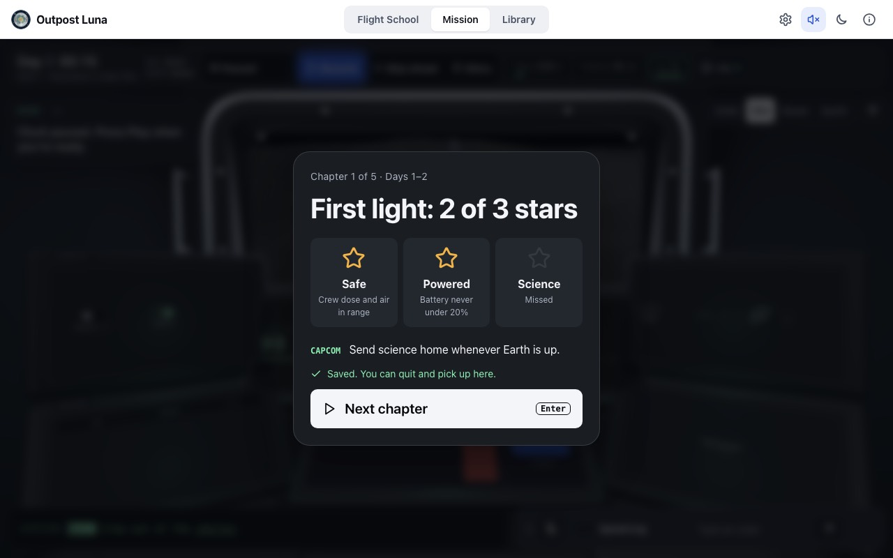

**Fix:**

- Score the Science star on science *collected* while Earth is down (it is sent later).
- Or, at a site with no early Earth window, swap the chapter goal for one the kid can reach, and say why: "Earth
  is below the horizon until Day 6. Your science is saved for later."
- Make the 0/120 counter show stored science too, so "+2" visibly counts.

---

## Confusing

### 5. Find-a-place steps ask for a place the kid has never seen, and rung 0 shows nothing (FS, confusing)

**Where:**

- Lesson 1 step 1, "Find the Sea of Tranquility". This is the first thing the app ever asks.
- Lesson 6 step 3, "The LCROSS rocket hit Cabeus crater, near the south pole. Find it."

**What the kid sees and thinks:** a bare grey Moon with no ring, no label and no camera turn. "Tap it on the Moon,
or say its name." I have no idea where the Sea of Tranquility is. I tap something dark. The ladder after misses is
good: the first miss names what I hit and adds a ring, the second adds a label, and the third zooms in and shows
it. But the very first ask is a test of something never taught.

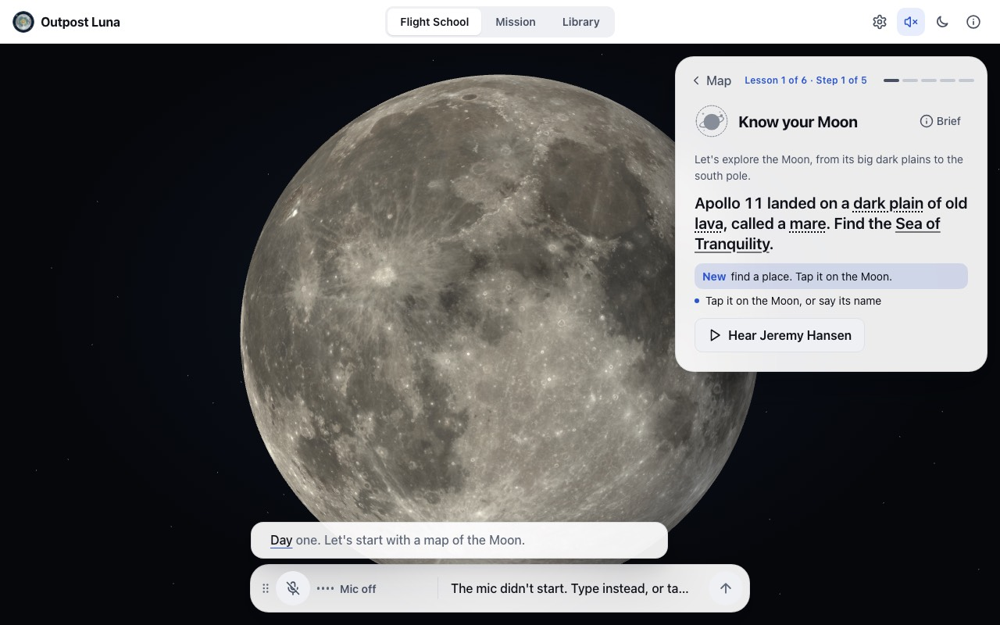 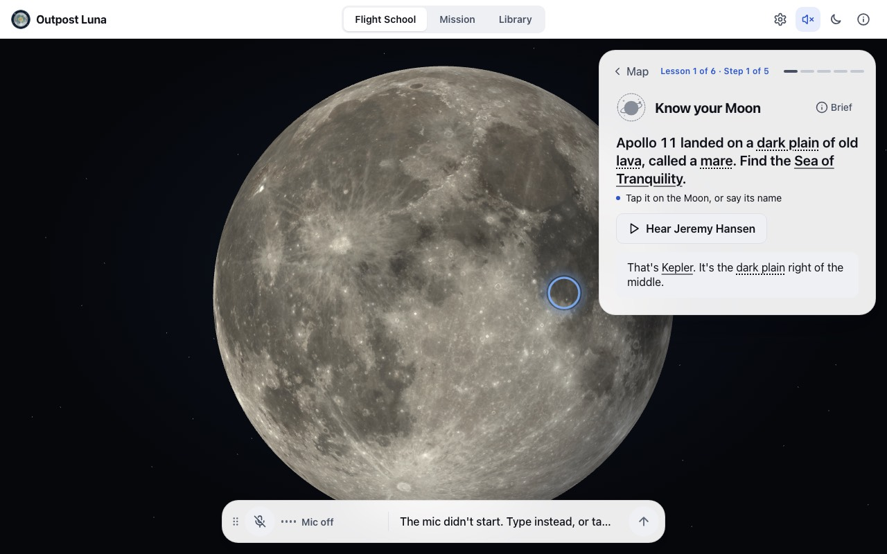 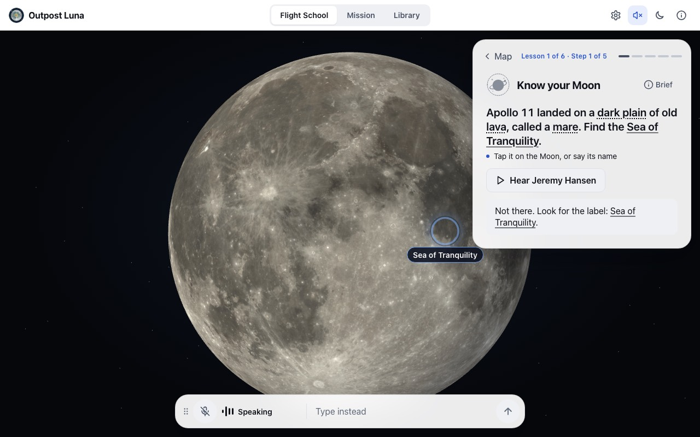 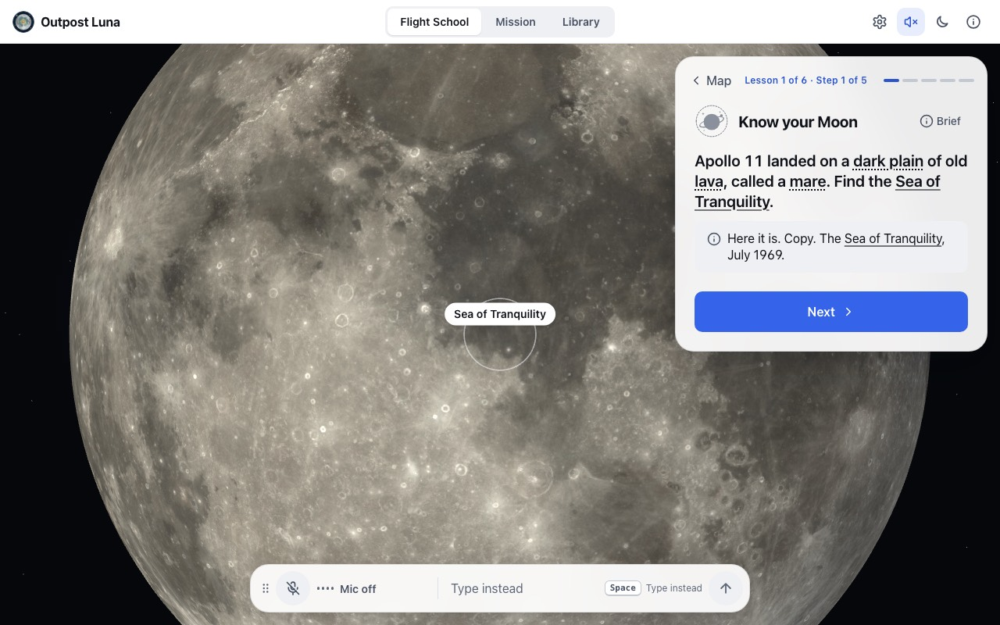 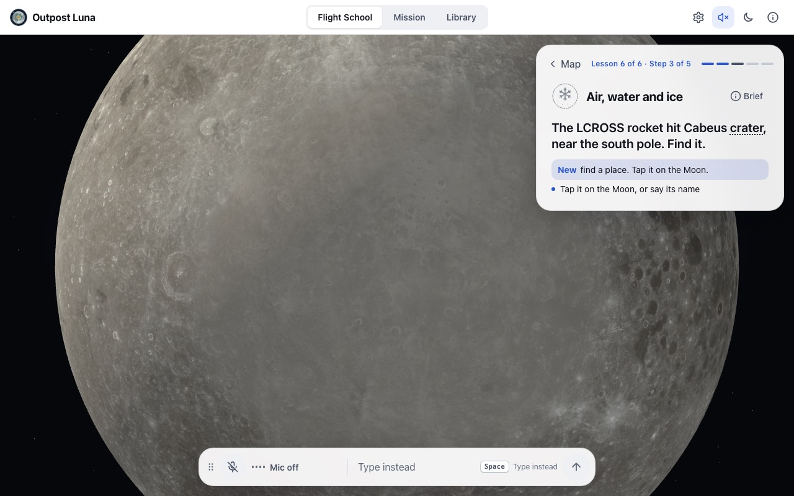

**Fix:** the first time a lesson names a place, show it (ring and label), then ask the kid to tap it. Keep the
unlabelled test for a later revisit, such as the check ride.

### 6. "Find Cabeus crater", but the hint label says "LCROSS Centaur rocket impact site" (FS, confusing)

**Where:** Lesson 6 step 3.

**What the kid sees and thinks:** the question is about **Cabeus**. After two misses CAPCOM says "That's South
Pole–Aitken. Look for the label: LCROSS Centaur rocket impact site." I'm looking for the word "Cabeus" and never see
it. The label is also adult jargon (Centaur is a rocket stage). Before the step the camera parked on that same label
and then hid it.

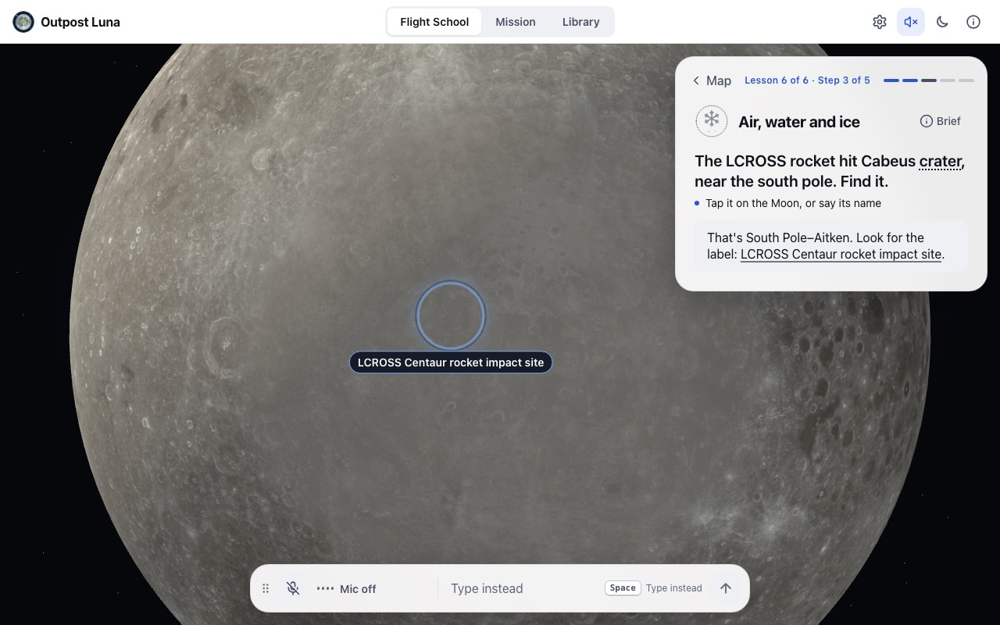

**Fix:** label the target with the word the prompt uses, "Cabeus crater", with "(where LCROSS hit)" as a second line
if it's wanted.

### 7. "Guess first, then watch" steps give the kid no way to guess, and typing a guess is misread (FS, confusing)

**Where:**

- Lesson 1 step 3, far-side sunlight.
- Lesson 2 steps 2 and 5. Step 2 has no question at all: "Watch the bright part grow".
- Lesson 5 step 1, weather.
- Lesson 6 step 1, how cold.

**What the kid sees and thinks:** "Does it ever get sunlight? Guess, then watch. Guess first. Then tap Watch, or
Skip". The only buttons are Watch and Skip.

- I typed "yes" as my guess, and the video opened at once with no "You guessed yes" acknowledgement.
- In Lesson 5 I typed "no", and CAPCOM just said "Let's learn to keep a crew safe."
- In Lesson 2 step 5 I tapped Skip, and the lesson ended without ever answering its question, "In a lunar eclipse,
  what covers the Moon?"

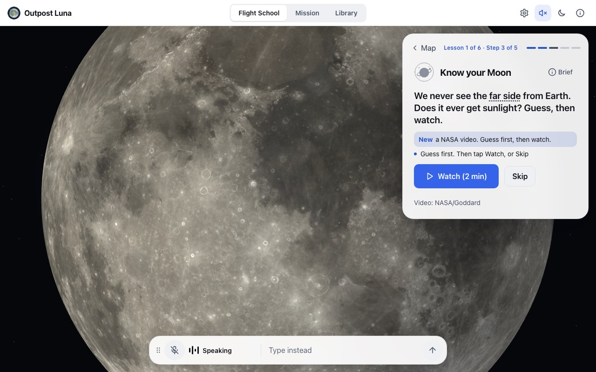 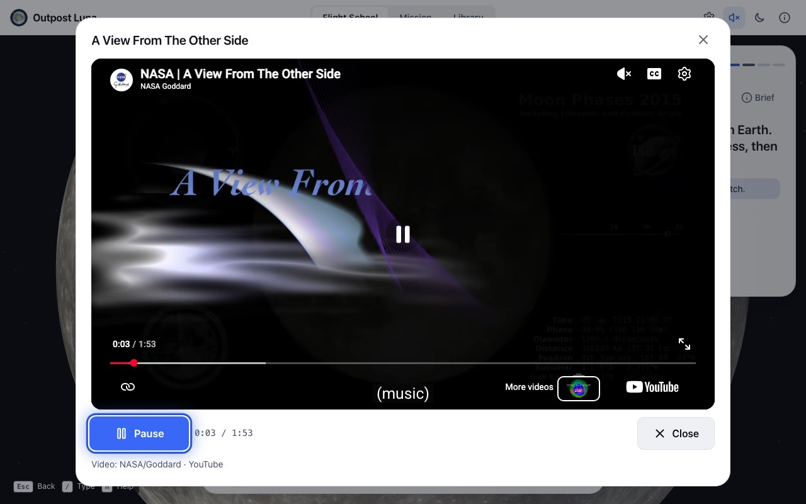

**Fix:**

- Give each video step 2 or 3 guess chips (Yes / No / Not sure) that light up after the video.
- If there's nothing to guess, drop "Guess first".
- On Skip, still show the one-line answer.

### 8. Every lesson opens with a grown-up home activity before any Moon content, and "I don't have a lamp" gets "Put a lamp on the floor" (FS, confusing)

**Where:** Mission prep cards before Lessons 1, 2, 3, 5 and 6:

- Crater drop (flour and cocoa)
- Oreo phases
- Low Sun (lamp)
- Ray shield (flashlight and foil)
- Make regolith (crackers)

**What the kid sees and thinks:** I tapped **Start lesson** and got "Needs a grown-up: Pour flour in a pan…". The
huge blue **Done!** button is right there and **Skip** is small grey text, so most kids will press Done without doing
anything. When I typed "i dont have a lamp", CAPCOM replied "Put a lamp on the floor." The heading also says
"Mission prep" inside Flight School.

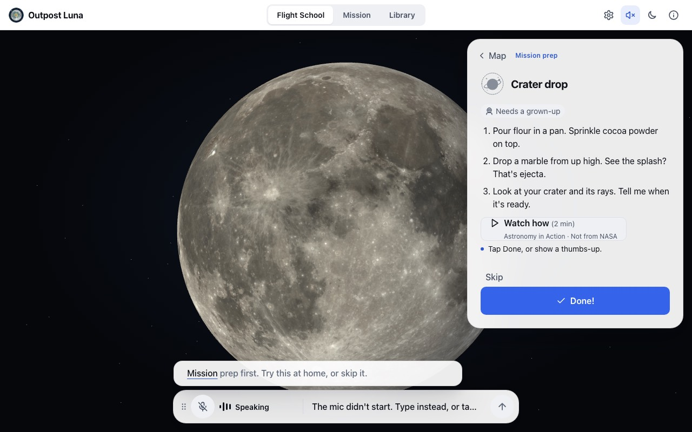 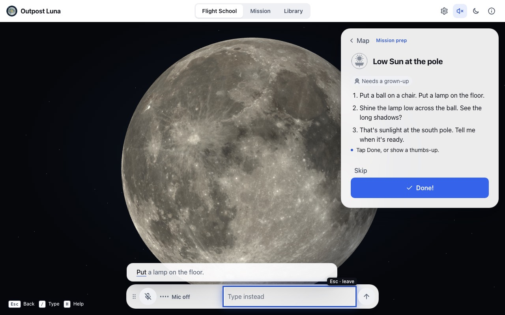

**Fix:**

- Put the activity after the lesson as an optional "Try it at home", or behind a "Grown-up nearby?" choice.
- Make Skip a real button.
- Map "I don't have …" to "That's OK, tap Skip. You can try it later."

### 9. Lesson counts disagree: 6 lessons, 9 patches, and "Step 1 of 4" (FS, confusing)

**Where:** the map header "Flight School 0/9" and "STEP 1 OF 4 · FLIGHT SCHOOL / 3 of 6 lessons done". The lesson
header says "Lesson 1 of 6". The patch card says "1 of 9 patches. 8 lessons to go".

**What the kid sees and thinks:** how many lessons are there? After 6 lessons and the check ride I'm "qualified", but
it still says 3 lessons to go. "Step 1 of 4" means the 4 stages of the whole game (School, check ride, Mission, …),
but nothing says so.

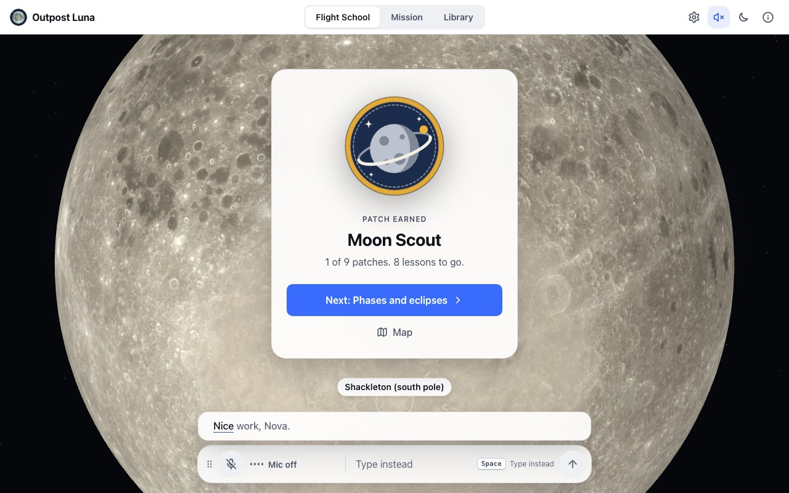 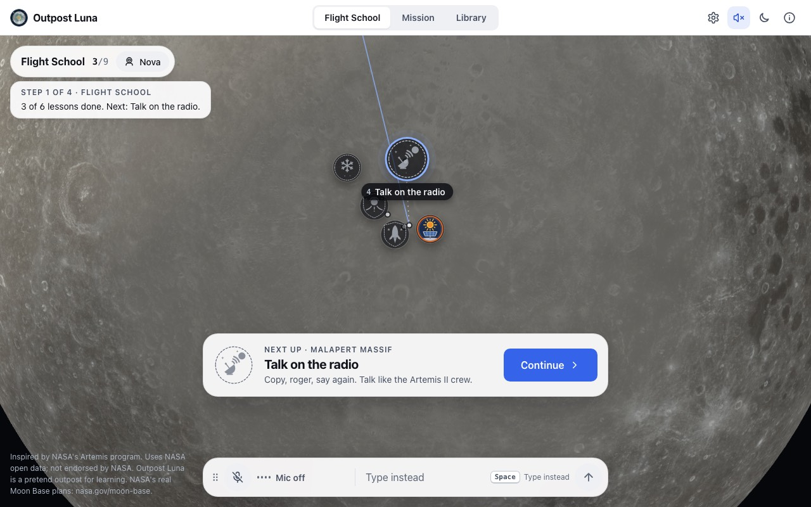

**Fix:** use one number. For example: "Lesson 3 of 6 · then your check ride". Show the 2 bonus lessons as "bonus
patches" that unlock after missions. Drop "Step 1 of 4" or name the steps.

### 10. "Shields up" is wrong three times in Flight School, then it's the first job of the Mission. And "Say again?" means "wrong" (FS + M, confusing)

**Where:**

- Lesson 3 step 3: "Negative. … Tap Heaters up."
- Lesson 5 step 4, the storm: "Say again? Radiation is climbing… Tap Into the shelter."
- Check ride step 3: "Say again? … Hint: Get the whole crew under cover."
- Then the cabin tour step 12: "First job: raise the shields". The storm decision offers "Set shields to 40".

**What the kid sees and thinks:**

- During a radiation storm, "Shields up" sounds right. It even has a sparkle icon next to it, which looks like a
  hint.
- The radio lesson taught that "Say again" means "I didn't hear you", so after tapping a button I think the app
  didn't hear my tap.
- Then the Mission tells me shields are the first thing to do.

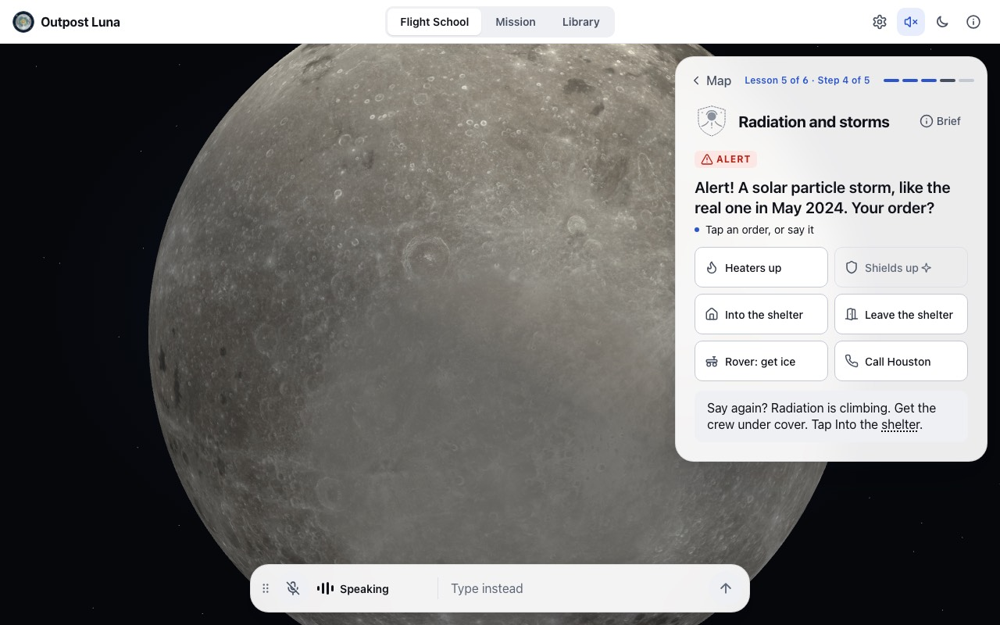 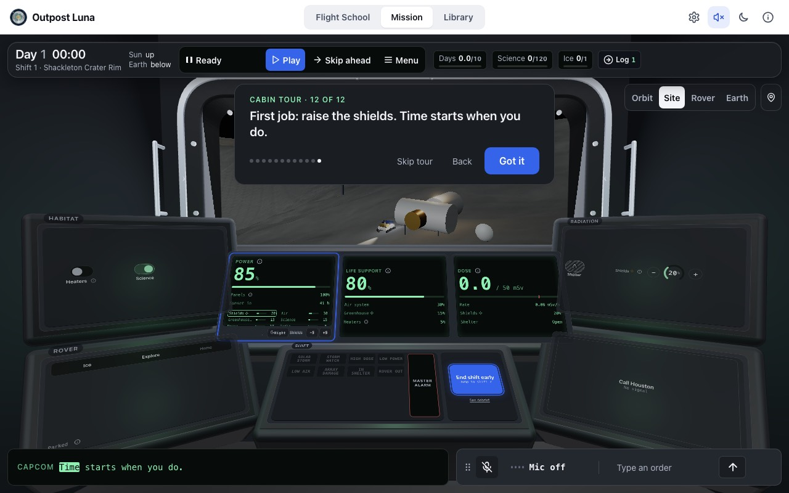

**Fix:**

- Wrong-order feedback should teach: "Shields help a little. In a big storm, the shelter is safer. Tap Into the
  shelter."
- Don't use "Say again?" for a wrong choice.
- Explain or remove the sparkle on Shields.

### 11. Check ride: "Earth is up over the rim", while the screen says "Earth −0.9°" / "Earth below horizon" (FS, confusing)

**Where:** check ride step 1.

**What the kid sees and thinks:** the question says Earth is up. The clock bar right next to it says "Earth −0.9°",
and the screen-reader text says "Earth below horizon". The answer "Yes, Earth is up" is marked right ("the radio
works"). A careful kid who reads the panel and answers "No" is marked wrong. The same card says "Guess first. Any
guess is fine" on a qualifying test, and step 5 says "before day 2 ends" while the clock says Day 7 and Day 8.

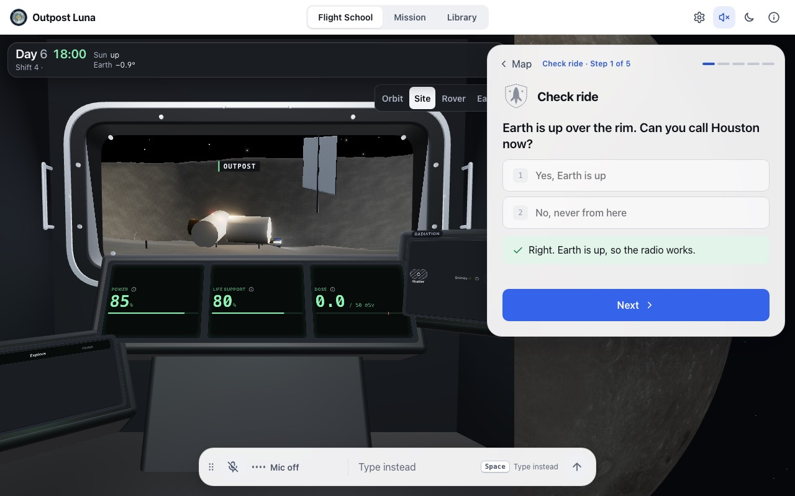

**Fix:** start the check ride's sim at a time when Earth is actually up, or read the question from the live state.
Use "Tap an answer" wording on check-ride steps. Make the day numbers match.

### 12. Check ride storm: pressing Enter for Next leaves focus on "Heaters up" (FS, confusing)

**Where:** check ride step 3 (the storm alert), reached with Enter.

**What the kid sees and thinks:** I've been pressing Enter for Next. The storm alert appears with "Heaters up"
focused and an "Enter" tooltip on it. One more Enter gives the wrong order in a storm.

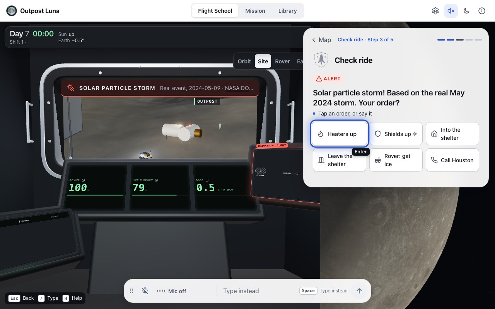

**Fix:** after Next, focus the question or the card, not the first order.

### 13. Natural replies that aren't the button words just get the prompt repeated (FS, confusing)

**Where:**

- Check ride step 4, "Bring the crew out of the shelter": "come out" got CAPCOM repeating "Bring the crew out of
  the shelter."
- Lesson 4 step 5, "Ask CAPCOM to repeat it, radio style": "what?" got no reply at all. "can you repeat that please"
  passed.

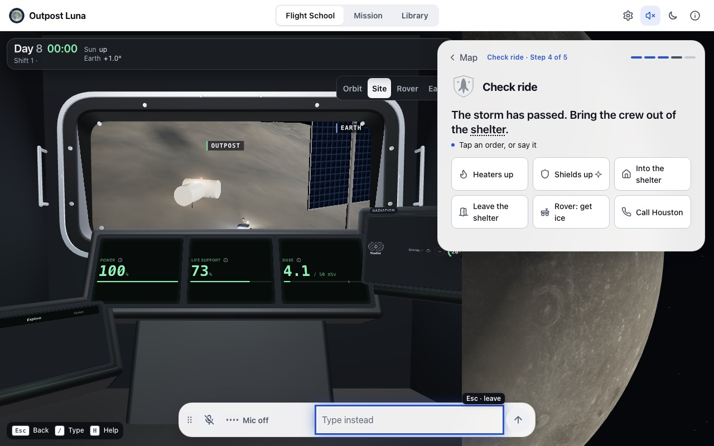 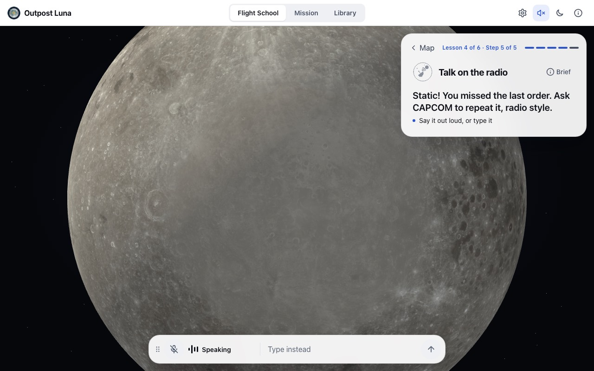

**Fix:** a near miss should get "Did you mean **Leave the shelter**?" with the button glowing (rung 2 of the ladder).
Silence after "what?" should never happen; say the do-line.

### 14. After the first mission, the newly unlocked lesson isn't offered (FS, confusing)

**Where:** Flight School map after the Mission 1 debrief.

**What the kid sees and thinks:** "Welcome home, Commander". The card offers only **Take command**. Lesson 7, "Moon
gravity and dust", has quietly unlocked; its pin glows, but nothing says "New lesson!".

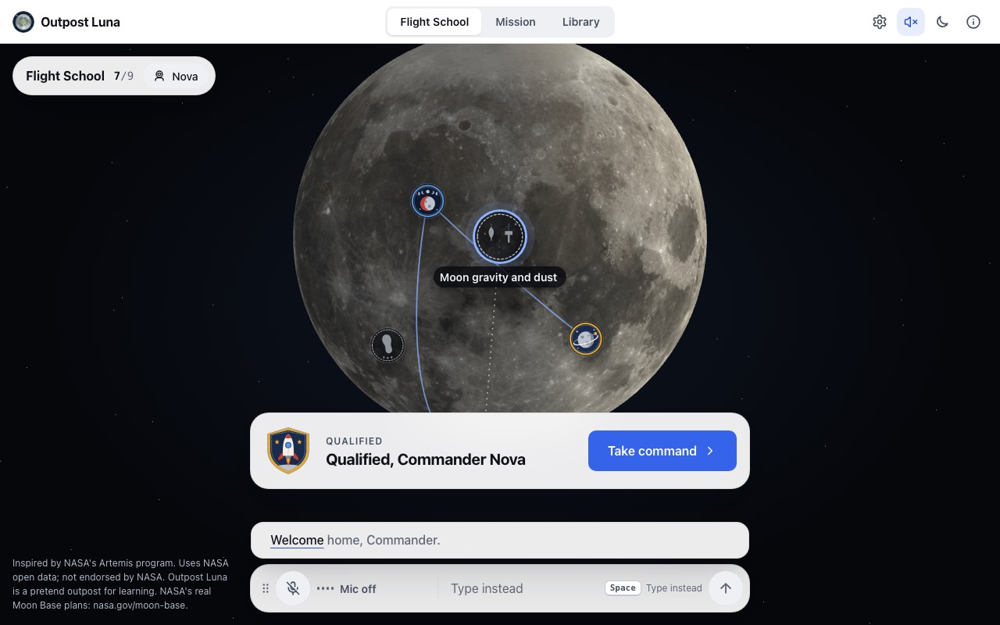

**Fix:** after a mission, if a lesson unlocked, the map card says "New lesson unlocked: Moon gravity and dust" with
its own button, next to Take command.

### 15. The landing-site briefing is adult data (M, confusing)

**Where:** Mission, then "Choose your landing site".

**What the kid sees and thinks:** a score of 64, "Studied, dropped (NASA's 2022 list)", "87% of the year, range
16–87%, LOLA illumination (NASA LRO)", "Diviner temperatures", "Slope at the pad 11°, range 8.1–27.6°". Five tabs:
Balanced, Power first, Ice first, Radio first, Safe landing first, plus "Weigh it yourself". A 7-year-old will just
press the big blue button.

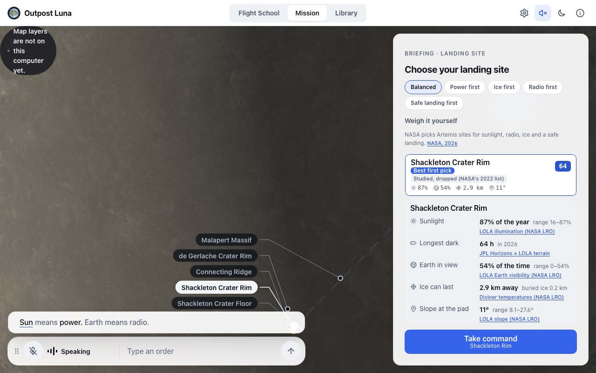

**Fix:** at the Cadet 7–9 level, show 3 icons per site (sun, Earth, ice) as short bars with one-line reasons. Put the
data sources and ranges behind "More".

### 16. During the storm, the Now card keeps asking for things already done, and CAPCOM says "A quiet day" under a red alarm (M, confusing)

**Where:** Mission 1, Day 1 22:00 to Day 2 04:15.

**What the kid sees and thinks:**

- "No storm due. Send the rover for ice." Soon after: STORM WARNING, master alarm red, Now card "Crew into the
  shelter". CAPCOM's caption at the same moment: "Day 1, hour 18. A quiet day."
- I tapped **Crew into the shelter** and got "Crew sheltered. Good." The card then offered "Shields to 40", which I
  tapped.
- The card went back to **Crew into the shelter** while the IN SHELTER light was on. I could tap it again and again.
- When the storm hit, the "On hold: your call" card offered **Go to shelter** and **Set shields to 40**. Both were
  already done.

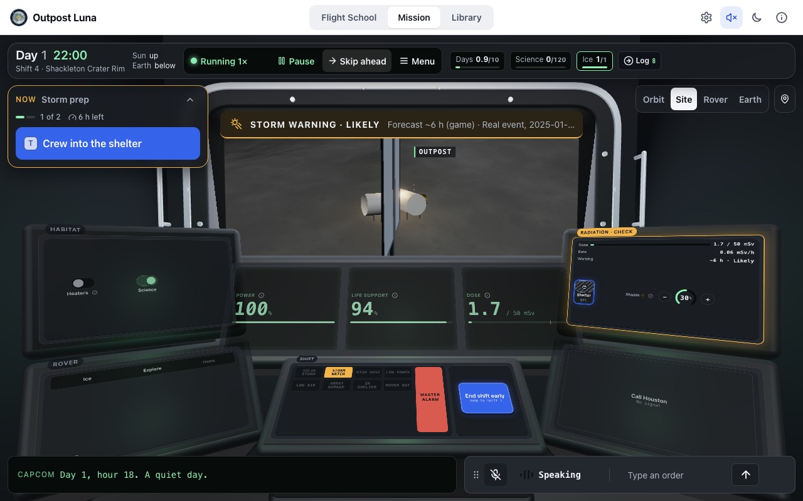 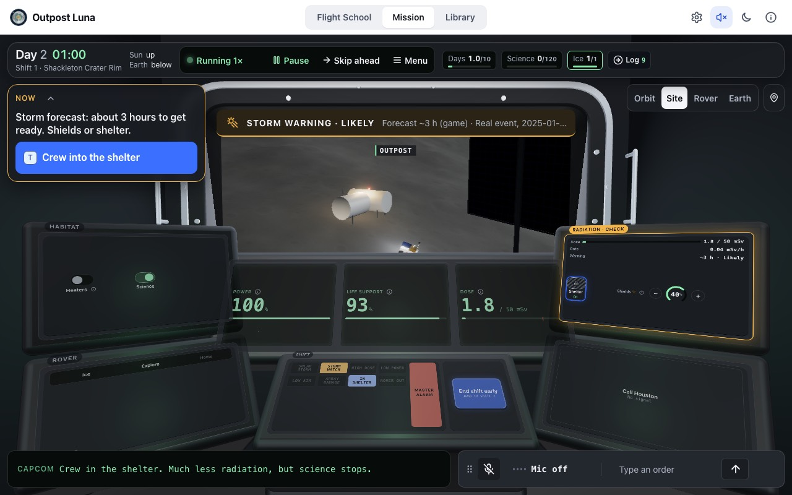 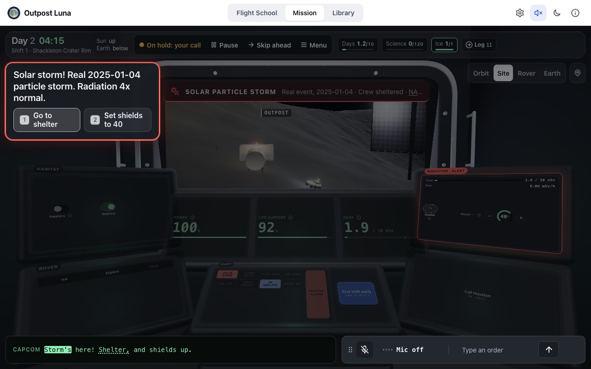

**Fix:**

- When the crew is sheltered, the warning card should say "Crew is safe in the shelter. Wait for the storm."
- The storm decision should be skipped, or show a "You're ready" acknowledgement, when both actions are already done.
- Don't play the routine "quiet day" line while a warning is up.

### 17. The mission clock keeps running behind Settings (M, confusing)

**Where:** opening Settings (gear) during Mission 1.

**What the kid sees and thinks:** I opened Settings to look around. The clock behind it went from Day 6 04:45 to 05:45
in 10 s. A storm or a deadline (the "2 h left" tasks) can pass while I'm in a menu.

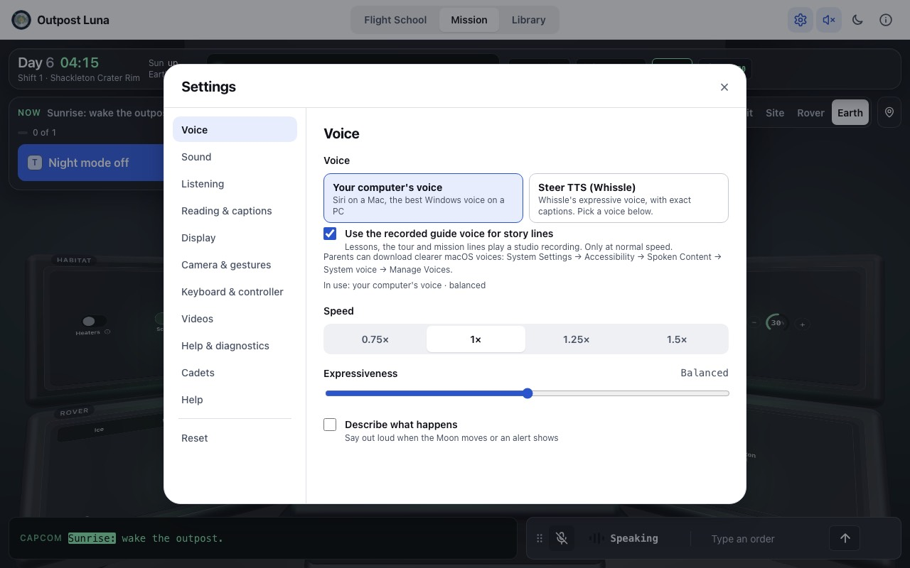

**Fix:** hold the mission clock while Settings, About or a video dialog is open, the same way the "On hold: your
call" state does.

### 18. The cabin panels' text is 4 to 8 px, and the Now card can collapse and hide its button (M, confusing)

**Where:** the Mission cabin (every shift).

**What the kid sees and thinks:**

- The panel labels are unreadable at 1280x800: SOLAR STORM / STORM WATCH annunciators, Heaters, Science, Shields,
  "Next window 134 h", Rover "Ice / Explore / Home".
- The Now card was the only readable guide. When I tapped its chevron by accident it collapsed to just the title,
  "Read the seismometer", with no button, and it **stayed collapsed** for the next tasks. Nothing on the panels says
  "seismometer".

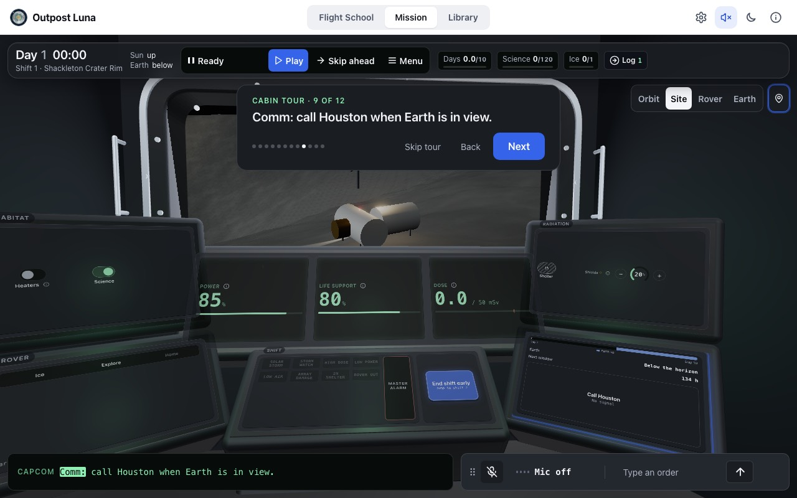 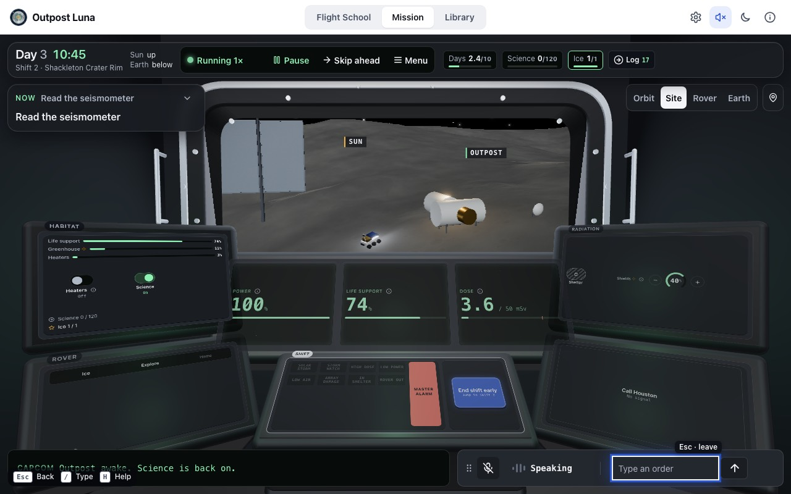

**Fix:**

- Set a minimum of about 14 px for any label a task points to. Zoom the camera to the target panel.
- Re-open the Now card automatically when a new task with a button arrives.

### 19. The debrief is dense and contradicts itself (M, confusing)

**Where:** the Mission 1 debrief.

**What the kid sees and thinks:**

- "sent home 58 of 120 science", then "Science still waiting".
- "Try next: Leave the shelter when the storm ends", but the game itself fast-forwarded the shelter time.
- Five lines of kWh, mSv and journal citations ("Colaprete et al. 2010", "Zhang et al. 2020").
- A chart, with the grade and stars below the fold.

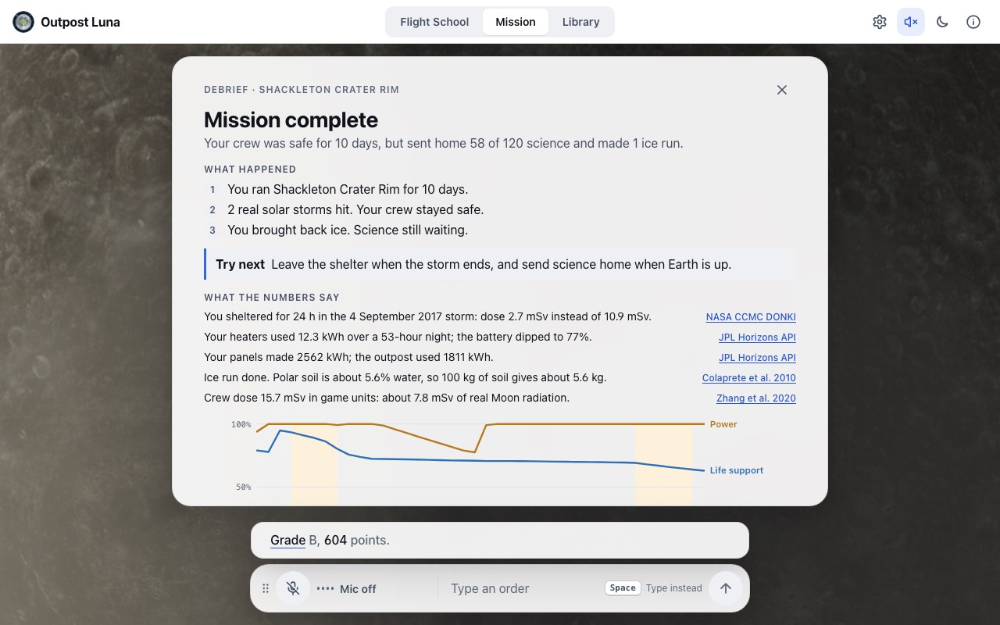

**Fix:** put the grade and stars first, then 3 kid lines ("Crew safe ✓, Ice ✓, Science: half sent home"), then
**Fly again**. Put the numbers and citations behind "For grown-ups / Data".

### 20. The "Earth" window view shows grey ground and black sky with no explanation (M, confusing)

**Where:** Mission, view tabs, then **Earth**, while Earth is below the horizon.

**What the kid sees and thinks:** I picked Earth to see Earth. I got a grey slope and blackness, with no Earth and no
words.

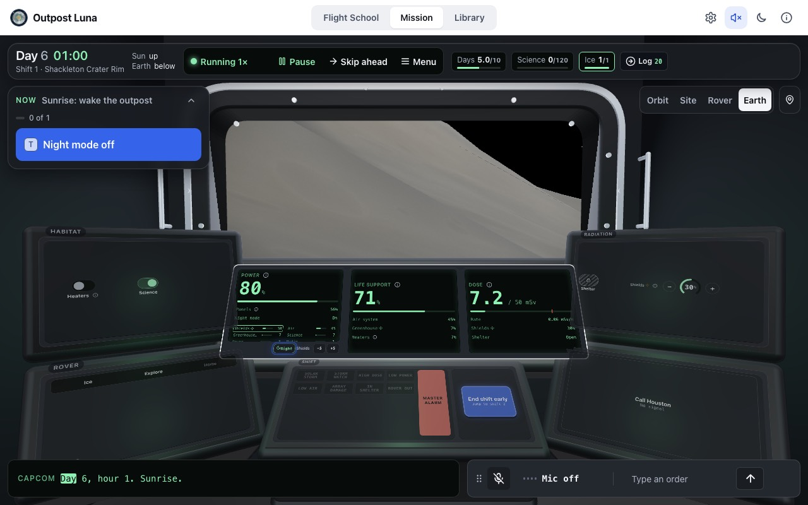

**Fix:** overlay "Earth is below the horizon. It rises on Day 6" with an arrow showing where it will rise.

### 21. A typed rover order works, but the card says "Fast-forwarding…" while the clock runs at 1× (M, confusing)

**Where:** Mission 1, Day 1, after "send the rover for ice".

**What the kid sees and thinks:** "Rover out, back in 15 hours. Fast-forwarding…" while the bar says **Running 1×**.
Later, whole days pass in seconds (Day 6 15:30 to Day 8 00:00 to Day 9) with no beat in between. "Fast-forwarding" is
right sometimes and wrong other times, and when it is right the kid misses days.

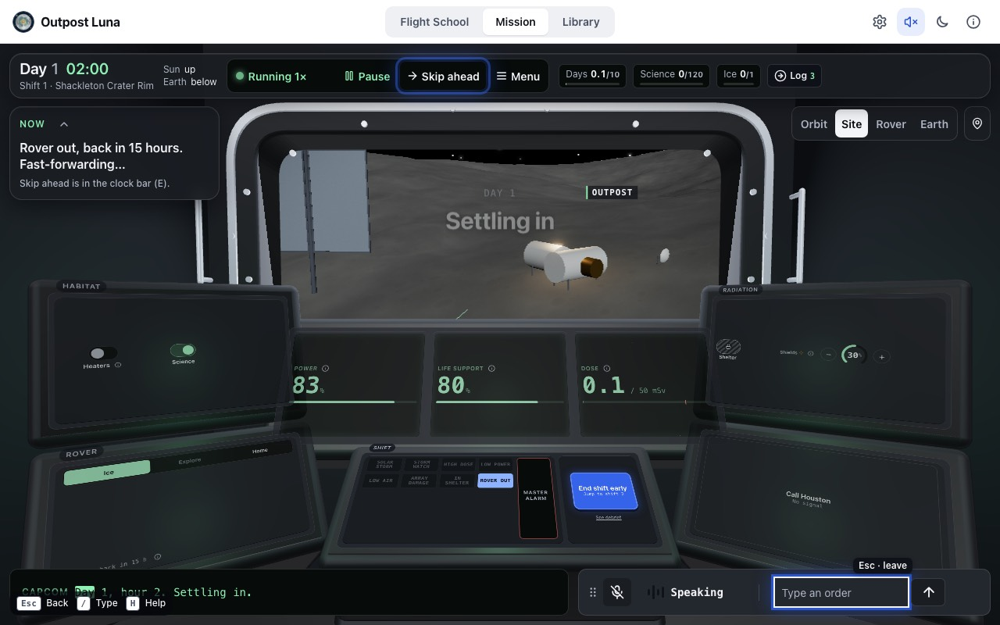

**Fix:** only say "Fast-forwarding" when warp is actually above 1×. When a day is skipped, show a one-line "Day 7: quiet
day, all systems fine" beat.

---

## Polish

### 22. The trace step (the owner's case) can't be reached in the first hour (FS, polish/coverage)

*Lessons from Apollo* holds the only `route` step (Orientale, then Ohm), and it shows "Unlocks after your second
mission". A novice in their first hour never sees it. The owner only did because they had played before.

I unlocked it with a second mission and played it. **The owner's bug is fixed on 0.3.9:**

- The prompt is now "Tap Orientale Basin, then Ohm".
- Both places are on screen, numbered **1** and **2**, ringed and labelled.
- The card tracks progress ("Tap 1: Orientale").
- Tapping Ohm first got "That's Ohm. Orientale Basin is the big bullseye."
- After both taps the path is drawn with Integrity labelled halfway.

Small issues left:

- The wrong-order line could say "Start with 1: Orientale".
- The "Orientale" label sits against the voice bar.
- The prompt mentions "Integrity" before anything shows where it is.
- After the first mission the map card offers only Take command, never this lesson (see 14).

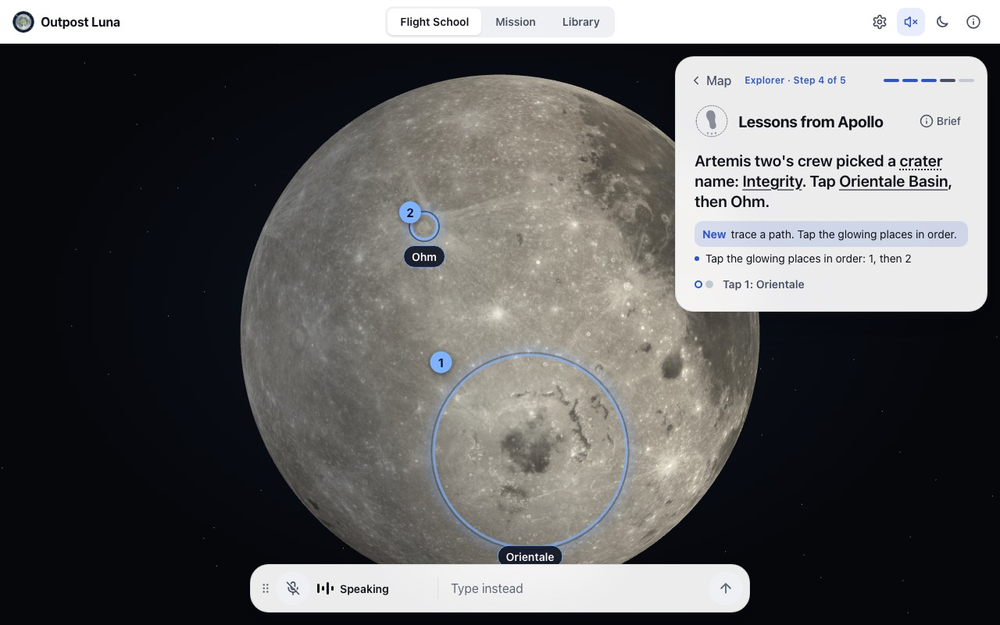 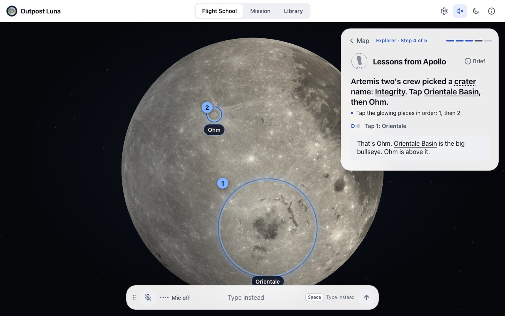 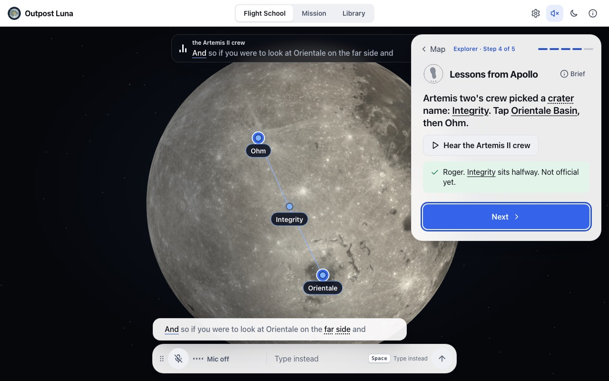

**Fix:** unlock Apollo after Mission 1, and have the map card offer each newly unlocked lesson.

### 23. The mic-failure message is cut off in the input (FS, polish)

"The mic didn't start. Type instead, or ta…" sits in the input box as truncated placeholder text on every screen.

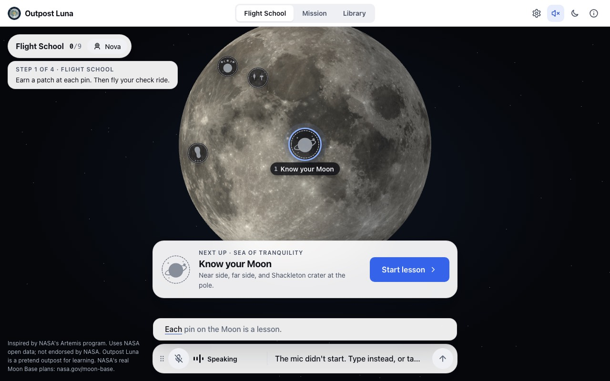

**Fix:** put the message in the caption once, and keep the placeholder to "Type instead".

### 24. Crew clips cut off mid-sentence (FS, polish)

- Lesson 1 step 4: "I do wanna say it's also just very apparent right now that Orientale is".
- Lesson 2 step 4: "But but now there are these very".

These fragments mean nothing to a kid. **Fix:** trim clips to whole sentences, or show a one-line context caption.

### 25. Video issues (FS, polish)

- The YouTube embed (Lesson 1 "A View From The Other Side") shows **More videos**, a way out to YouTube for a
  7-year-old.
- "Watch (1 min)" played a 1:29 video.
- The phases video offered **Watch** and then showed "This video won't play here." with only a Close button. This
  was a dev-cache 502, but the button shouldn't be offered when the file can't load, and the dead end should say
  "Skip it, here's the answer: …".

 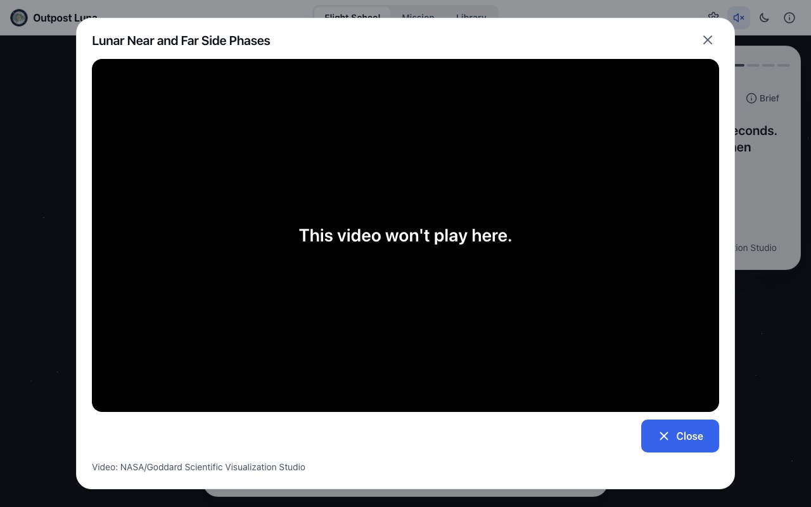

### 26. Jargon and over-precise wording for ages 7 to 9 (FS, polish; a few Mission lines too)

- "LCROSS Centaur rocket impact site"
- "mSv"
- "Earth days" on the compare cards. The kid can't tell this means radio days.
- "Real event, 2025-01-04"
- "Radiation 4x normal"
- "Dose rate 0.06 mSv/h"
- "about 1 hours"
- "Night is coming at Malapert" right after the kid picked Shackleton.

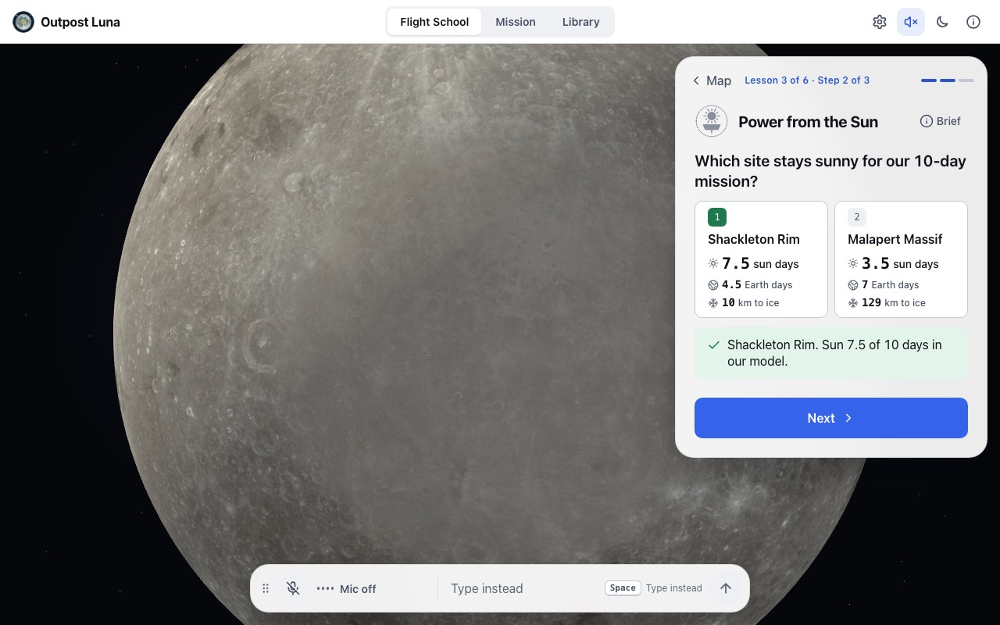

### 27. Duplicated CAPCOM lines (FS + M, polish)

- "Copy. Crew in the shelter. Crew in the shelter. Much less radiation, but science stops."
- "Copy. Crew is out. Back to work. Crew is out. Science can start again."
- Mission: "Copy. Houston sees an active region. Stay sharp. Houston here. Your words took 1.3 seconds…", 33 words
  in a single reply.

### 28. Overlaps (FS + M, polish)

- Check ride: the lesson card covers the right third of the cabin. The view tabs read "Orbit Site Rover Ea", and the
  Radiation panel is hidden.
- Cabin: the keyboard strip (Esc Back / Type / H Help) sits on top of the CAPCOM caption text.
- Map: 4 lesson pins pile up at the pole, and the "Talk on the radio" label covers the pin below it.

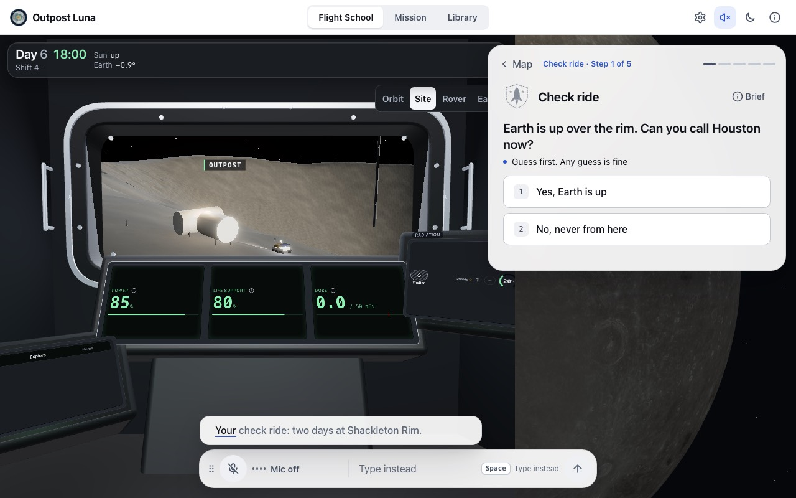  

### 29. No welcome or tour in Flight School (FS, polish)

The first screen after the call sign goes straight to "Start lesson". The 12-step cabin tour exists for the Mission.
Flight School has only the caption "Each pin on the Moon is a lesson." "Show me around" is hidden in Settings, then
Help. The first map was clear enough with one obvious button, so this is polish. A 3-beat intro (the Moon, the
pins, the voice bar with "type instead") would help a kid who doesn't read captions.

### 30. "New:" intro repeated (FS, polish)

"New: find a place. Tap it on the Moon." showed in Lesson 1 and again in Lesson 6. The two steps are the `intent`
and `tap` kinds, with the same intro text.

### 31. Screen-reader live text goes stale (FS + M, polish)

The a11y tree kept "Alert: Alert! A solar particle storm, like the real one in May 2024. Your order?" from Lesson 5
through Lesson 6, the check ride and into the Mission. "Shackleton (south pole)" stayed in the DOM as a label after
Lesson 1 ended. A screen-reader user hears an old storm alert.

### 32. The Mission tour step about the cabin panels is long for a 7-year-old (M, polish)

12 tour beats before the first action, each naming a panel whose own text is unreadable (see 18). The tour does
highlight each panel, and the first job afterwards gets a big button ("Shields up to 30"). **Fix:** cut the tour to
4 beats (window, Now card, clock bar, type/talk). Teach the other panels when their first task arrives.

---

## What worked (keep it)

- **Start:** call sign plus **Start**, one obvious button. On the map, "what do I do?" got "Tap Start lesson to
  begin Know your Moon."
- **Tap ladder on find steps:**
  - miss 1 names what you hit and gives a direction, with a ring;
  - miss 2 adds the label;
  - miss 3 zooms in and shows it.
- **Choice feedback teaches,** for example:
  - "Not quite. This side of the Moon always faces Earth."
  - "We see more or less of its sunny half. It's not Earth's shadow."
  - "Not quite. Particles move fast. An hour is short. Act early."
- **Gold-ring step** ("find the south pole, it's inside the gold ring"): clear and quick.
- **Far side step:** "Not yet. Turn the Moon until the far side faces you. Or press Far side." gives the kid an
  out.
- **Mission start:** the first job had one big button ("Shields up to 30"). Typed "send the rover for ice" worked,
  and Storm prep and Night power-down cards had clear buttons.
- **Saving and resuming:** chapter cards say "Saved. You can quit and pick up here." Quitting and relaunching put me
  exactly back on Day 6, chapter 3, with "Welcome back" (apart from the Play dead end in 3).
- **Captions:** they worked word by word throughout, with the voice silent.

## Suggested order of fixes

**Flight School first:** 1 (help climbs the ladder), 2 (terminator), 5 and 6 (show before asking; matching label), 7
(guess chips), 10 (shields teaching and "Say again"), 8 (prep after the lesson).

**Mission (part 4 stream):** 3 (resume Play), 4 (science star), 16 (storm card loop), 17 (clock behind Settings), 18
(text size and collapsed card), 19 (debrief).
